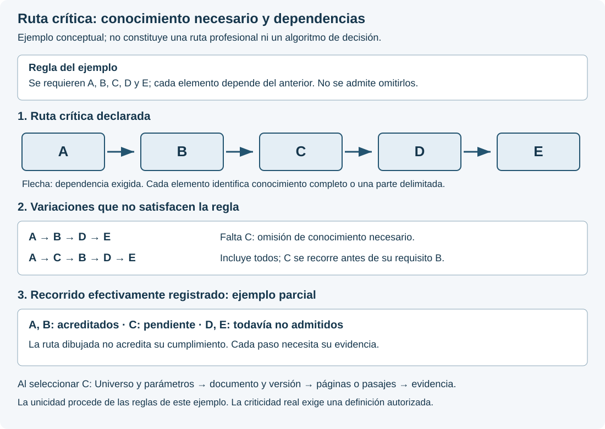

# Parámetros, rutas y evidencia

## Una unidad de significado; funciones diferentes

Un parámetro es una unidad delimitada de significado. La analogía con un átomo ayuda a comprender su separación respecto de otras unidades, pero su atomicidad debe justificarse por definición, función y alcance. Compartir un nombre o una forma de representación no convierte dos objetos en la misma cosa.

El **parámetro de conocimiento** conserva un concepto o una cápsula de información general dentro de un Universo. El **parámetro singular de decisión** formula una cuestión que recibe una valoración concreta, 0, 1 o U, conforme a sus condiciones y evidencia. El conocimiento general no recibe automáticamente el valor de un caso.

Existe además una propuesta distinta: valorar con la terna la **pertenencia de un parámetro de conocimiento a una ruta**. El valor describiría esa relación concreta. No sería una calificación de verdad del conocimiento ni el resultado del consejo profesional. Se trata de un concepto de diseño cuyo contrato de evaluación debe desarrollarse antes de su ejecución.

| Objeto | Pregunta que permite responder | Lo que no debe inferirse |
| --- | --- | --- |
| Unidad de conocimiento | ¿Qué concepto está definido, con qué fuentes y límites? | Que tiene un resultado clínico o técnico propio. |
| Pertenencia a una ruta | ¿Este parámetro pertenece a esta ruta, en estas condiciones? | Que su contenido sea verdadero o que el caso esté resuelto. |
| Cuestión singular de decisión | ¿Qué resultado admite esta cuestión del caso conforme a su contrato? | Que ese resultado sea aplicable a otros casos o rutas. |

Las valoraciones necesitan su pregunta completa, identidad, versión y contexto. Mostrar sólo «0», «1» o «U» impediría saber qué se está afirmando.

## Ejemplo sin contenido clínico ni de ciberseguridad

La unidad K explica cómo interpretar la procedencia de un dato. La ruta R exige comprobar esa procedencia antes de concluir. Se propone evaluar «K pertenece a R bajo las condiciones C» con la siguiente convención ilustrativa: 0, pertenencia conforme; 1, pertenencia no conforme; U, información insuficiente para resolverla. Esa correspondencia necesitaría aprobación en la definición de la ruta; no se convierte aquí en una regla universal del SV.

Supóngase que la pertenencia de K a R está acreditada, pero el dato del caso carece de evidencia suficiente de procedencia. La pertenencia puede recibir 0 y la cuestión singular «¿queda acreditada la procedencia del dato?» permanecer en U. No hay contradicción: son preguntas distintas.

El esquema muestra dependencias conceptuales, no una ruta profesional constituida ni una función ya disponible. Las flechas indican aportación de fundamento; no copian valores.

## Pertenencia no equivale a posibilidad de omisión

Pertenecer a una ruta, estar activado en un contexto y ser obligatorio son propiedades diferentes. La definición competente debe establecer sus relaciones. Un parámetro ajeno a una ruta puede ser necesario en otra que también resulte aplicable.

Si permanece indeterminada una dependencia obligatoria, no se permite omitirla por conveniencia. Se conserva el bloqueo, la abstención o la revisión que prescriba la regla. Tampoco se considera prescindible un elemento cuya criticidad todavía no se haya determinado.

Una ruta en estudio se identifica como **no definida** o **pendiente de constitución**. Ese estado no es el valor U de una evaluación concreta: no debe aparentarse que se ha ejecutado una regla que aún no existe.

### Ejemplo: cinco elementos y una ruta crítica

Sean A, B, C, D y E cinco elementos de conocimiento delimitados. Cada uno puede representar un Universo completo o una parte identificada de éste; la leyenda de la ruta debe declarar el alcance de cada elemento y sus documentos y parámetros asociados.

En este ejemplo se establecen dos reglas: los cinco elementos son obligatorios y cada uno requiere el cumplimiento del anterior. La ruta crítica es **A → B → C → D → E**. Es la única secuencia que satisface ambas reglas; su unicidad procede de estas condiciones expresas, no de una propiedad general de cualquier conjunto de cinco elementos.

| Recorrido propuesto | Comprobación frente a las reglas del ejemplo |
|---|---|
| A → B → C → D → E | Conserva los cinco elementos y respeta todas las dependencias. |
| A → B → D → E | Omite C, que es obligatorio. |
| A → C → B → D → E | Contiene todos los elementos, pero sitúa C antes de su requisito B. |
| A → B → C → E → D | Adelanta E respecto de su requisito D. |

Cinco elementos distintos admiten 5! = 120 permutaciones si no se fija ninguna posición. Si A debe ser el inicio y E el final, quedan 3! = 6 órdenes de los tres elementos intermedios. Esas posibilidades combinatorias no son autorizaciones: las dependencias del ejemplo sólo admiten una. Los recorridos que omiten elementos son variaciones adicionales y también deben confrontarse con las obligaciones declaradas.

**Ruta exigida y recorrido acreditado son objetos distintos.** Si únicamente constan cumplidos A y B, dibujar la ruta completa no permite dar por cumplido C. El acceso al siguiente paso dependiente debe conservar la condición pendiente y su evidencia. Esto tampoco impide consultar otras fuentes ya autorizadas que no dependan de ese paso.

Al seleccionar un elemento, la visualización deberá mostrar su Universo, los parámetros implicados, la edición documental, las páginas o pasajes utilizados, las condiciones de acceso y la evidencia de la actuación. Una figura no sustituye esos registros. Las flechas expresan dependencias de conocimiento; no duraciones ni costes. Los estados de seguimiento de este ejemplo no son valores de la terna decisional.

El diseño no atribuye todavía consecuencias profesionales concretas a una omisión ni establece el algoritmo que constituirá las rutas. Esa definición requiere reglas, fuentes y validación propias del dominio. La representación permite explicar y comprobar una ruta una vez constituida; no la inventa.

### Analogía: la coordinación de una escala aeroportuaria

En la gestión aeroportuaria, la preparación de una salida reúne actividades dependientes, algunas simultáneas. EUROCONTROL describe el seguimiento de la escala y la preparación de la salida mediante hitos que permiten actualizar previsiones y avisos. Esta referencia aporta una analogía de coordinación y seguimiento; no prescribe las rutas del SV. [EUROCONTROL: especificación A-CDM, edición 1.0](https://www.eurocontrol.int/publication/eurocontrol-specification-airport-collaborative-decision-making-cdm).

Supóngase la siguiente planificación simplificada. Las actividades y sus duraciones son **hipotéticas**; agrupan operaciones únicamente para explicar el diagrama y no representan un procedimiento de aeropuerto.

| Elemento | Bloque del ejemplo | Duración supuesta | Requisito previo |
|---|---|---|---|
| A | Coordinación inicial de la escala | 5 minutos | Inicio |
| B | Preparación de cabina | 12 minutos | A terminado |
| C | Preparación de equipaje | 7 minutos | A terminado |
| D | Comprobación conjunta de ambos bloques | 4 minutos | B y C terminados |
| E | Cierre del proceso considerado | 3 minutos | D terminado |

B y C pueden desarrollarse simultáneamente. Bajo estas hipótesis, la duración resulta **5 + máximo(12, 7) + 4 + 3 = 24 minutos**. La ruta A → B → D → E fija la terminación y es la única ruta crítica temporal de este ejemplo. La secuencia A → C → D → E suma 19 minutos: C dispone de cinco minutos de margen, pero **continúa siendo obligatoria**. Elegir la secuencia más corta y prescindir de B incumpliría el requisito de D. Una demora de tres minutos en B llevaría la terminación a 27 minutos; si el coste adicional supuesto fuera de 100 unidades monetarias por minuto de demora final, añadiría 300 unidades. Son cifras didácticas, no estimaciones de un aeropuerto.

Microsoft Project representa este tipo de dependencias y distingue las tareas con margen de las que condicionan la fecha de terminación. Ese significado temporal explica la analogía y debe conservarse al citar la aplicación. [Microsoft: administración de la ruta crítica](https://support.microsoft.com/es-es/project/manage-your-project-s-critical-path).

En el SV se conserva la idea de **dependencias explícitas, condiciones de avance y seguimiento comprobable**, mientras que la criticidad se fundamenta en el conocimiento requerido y las consecuencias de omitirlo. Un parámetro no se vuelve prescindible porque su consulta sea breve ni porque ocupe pocos documentos. Del mismo modo, una dependencia no desaparece por pertenecer a un Universo compartido. El cálculo temporal anterior no es el algoritmo de rutas del SV; permite comprender gráficamente por qué cada obligación debe estar definida y acreditada.

### Analogía: un reparto con nueve destinos

Un repartidor debe atender nueve destinos. Omitir uno incumple el encargo aunque reduzca el tiempo o el combustible. Visitar los nueve, por otra parte, no determina automáticamente el orden: hacen falta distancias, tiempos de viaje, consumo, punto de partida y llegada, y las restricciones que correspondan. Esta clase de problema se estudia en planificación de recorridos; una formulación básica es el problema del viajante, documentado en [Google OR-Tools](https://developers.google.com/optimization/routing/tsp).

La secuencia **1 → 4 → 2 → 8 → 5 → 7 → 3 → 9 → 6** del diagrama sólo ilustra cobertura completa. No se afirma que ahorre más combustible ni tiempo: no se han proporcionado datos que permitan calcularlo. Ambos criterios pueden favorecer recorridos diferentes y necesitan una regla de comparación declarada. Con nueve destinos distintos hay 9! = 362.880 órdenes posibles antes de imponer restricciones o identificar recorridos equivalentes.

El ejemplo explica por qué la planificación no debe confiarse a una secuencia aparentemente razonable. En el SV, una propuesta debe someterse a comprobaciones de cobertura, dependencias, permisos y evidencia. Una respuesta convincente de un LLM no acredita por sí misma que se haya consumido todo el conocimiento exigido. Se conserva exclusivamente la denominación **ruta crítica** para el concepto del SV; las analogías logísticas no fijan su algoritmo ni convierten el número de destinos en una dimensión celular.

### Matrices, restricciones y aceleración

La investigación operativa ofrece antecedentes útiles. Un problema de transporte puede expresar cantidades mediante una matriz X y costes unitarios mediante otra matriz C; el coste total se escribe como la suma de Cᵢⱼ·Xᵢⱼ, sometida a restricciones de oferta, demanda y capacidad. Su formulación lineal admite métodos como el símplex. Ordenar visitas añade restricciones diferentes: una asignación de cantidades no constituye por sí sola un recorrido que visite todos los destinos. Véanse los ejemplos oficiales de [flujo de coste mínimo](https://developers.google.com/optimization/flow/mincostflow) y [programación lineal](https://developers.google.com/optimization/lp/lp_example).

El objetivo de diseño del SV es llevar las operaciones computables a representaciones vectoriales, matriciales y tensoriales que permitan aprovechar la aceleración disponible, bajo control de Rust. Cada matriz debe declarar qué significan sus filas, columnas, valores y operaciones. **La forma numérica conserva el significado; no lo sustituye.** Las restricciones, autorizaciones y evidencias deben acompañar la representación.

Una representación tensorial puede facilitar cálculos en paralelo; no convierte automáticamente la búsqueda de una ruta en una multiplicación de matrices ni elimina su dificultad combinatoria. La elección del algoritmo, su equivalencia con las reglas del SV y su rendimiento completo requieren comprobación. El rendimiento debe medirse para cada realización y carga de trabajo. Emplear Rust, GPU o tensores no demuestra por sí solo una mejora de velocidad.

## Propiedad y composición

Cada parámetro tiene un único Universo propietario y puede relacionarse con otros Universos mediante referencias identificadas. Una transferencia exige designar al nuevo propietario; no puede dejar el parámetro huérfano. Un Universo constituido conserva parámetros asignados. La compartición no transmite valores de un caso, permisos documentales ni conclusiones.

La propiedad de un documento y la de un parámetro se registran separadamente. La conversión de un PDF en Markdown no cambia por sí sola su propiedad, relaciones o prioridades, ni constituye nuevos parámetros. La fuente, su selección y la correspondencia entre representaciones siguen siendo necesarias.

La dimensión de una célula y la posición de cada parámetro obedecen a los pilares del SV y a la versión admitida. El inventario de un Universo no se divide ni se completa automáticamente para obtener una figura. El mapa de relaciones y el polígono decisional representan objetos diferentes.

Una clasificación como CIE-11 puede identificar el problema de referencia. La correspondencia con parámetros y rutas exige constitución propia; el código de una enfermedad no determina por sí solo un diagnóstico ni un consejo.

### Realización celular de un Universo

El Universo constituido debe disponer de una realización computable mediante células SV. La cadena de diseño relaciona **Universo y parámetros → células constituidas → organización matricial → representación tensorial → operaciones autorizadas**. Cada transformación conserva las identidades y el significado; no convierte esos niveles en objetos semánticamente intercambiables.

La correspondencia entre parámetros y posiciones, las dimensiones y las relaciones celulares deben constituirse expresamente. La presencia de un concepto de conocimiento no autoriza a asignarle automáticamente 0, 1 o U para completar un estado. Su estructura y su eventual valoración conservan contratos diferenciados. Las referencias compartidas tampoco duplican por sí mismas un estado.

La organización de cálculo preserva cada célula y su vínculo con el frame. Cambiar la disposición de almacenamiento no permite reordenar posiciones, fusionar instancias ni transformar la prioridad documental en orden celular. Esta es la condición para estudiar la aceleración conservando el objeto del SV.

## Del vector al frame y al cálculo por lotes

La célula SV conserva un vector plano, ordenado y posicional. Su representación visual está vinculada al mismo estado mediante el par conceptual **Frame_C = (frmat, frvis)**: componente matemática y componente visual bajo un contrato común. La correspondencia exige la misma instancia, constitución y versión. Puede producirse la imagen cuando se consulte sin mantener permanentemente todos sus píxeles en memoria.

Los parámetros aportan significado a las posiciones. Atomizar conocimiento no genera por sí solo un vector de valores: hacen falta una constitución y, cuando corresponda, una valoración definida. El vector exacto del SV es un conjunto ordenado de estados ternarios, no un espacio vectorial que admita cualquier operación algebraica.

Como concepto de diseño, una representación tensorial computacional puede organizar varias instancias compatibles para operar sobre ellas conjuntamente. Un eje puede identificar la instancia y otro la posición. Cada instancia conserva su identidad y su frame; reunirlas para calcular no las fusiona en una nueva célula ni cambia el significado de sus valores.

### Ejemplo: los 19.683 estados de SV(9,3)

SV(9,3) admite **3⁹ = 19.683 vectores de estado posibles**, cada uno de nueve posiciones. Una enumeración completa podría ocupar una tabla de 19.683 filas y nueve columnas. La tabla representa el espacio de estados; no convierte la célula en una matriz de 3 × 3 ni cambia su dimensión. Tampoco es necesario materializar todos los estados para evaluar uno. Para dimensiones mayores, el crecimiento de 3ⁿ exige justificar el almacenamiento y los recursos.

Un ejemplo de representación tensorial auxiliar consiste en separar tres indicadores: presencia de 0, presencia de 1 y presencia de U. Para cada instancia y posición, exactamente uno de los tres indicadores vale uno. **Ese uno es una marca de presencia, no el estado semántico 1 del SV.**

En un lote de m células compatibles de n posiciones, esos indicadores pueden organizarse en tres matrices de m × n. Multiplicar cada matriz por una columna de n unos permite contar, por instancia, N₀, N₁ y Nᵤ. Es una operación matricial con significado explícito: cuenta estados; no multiplica decisiones ni promedia U. Debe conservarse el vector original porque los recuentos no preservan el orden de las posiciones.

Por ejemplo, el estado ordenado (0, 0, U, 1, 0, U, 0, 1, 0) produce N₀ = 5, N₁ = 2 y Nᵤ = 2. La suma es nueve. El cálculo conserva U como categoría y no como cero, valor medio o ausencia. Otro orden con esos mismos recuentos seguiría siendo otro vector: por eso deben conservarse las posiciones y su frame.

La terminología general de vectores, matrices, tensores y producto matricial se apoya en Goodfellow, Bengio y Courville, *Deep Learning* (MIT Press, 2016), [capítulo 2, apartados 2.1 y 2.2](https://www.deeplearningbook.org/contents/linear_algebra.html). El ejemplo de indicadores es una aplicación explicativa propia; esa bibliografía no define ni valida la semántica del SV.

La evaluación posterior aplica exclusivamente la regla constituida. Cualquier otra multiplicación, relación entre matrices o composición de células necesita justificar entradas, operación y significado de la salida. Codificar U mediante un número no autoriza a tratarla como una magnitud ordinaria.

La aceleración con GPU, TPU u otros dispositivos necesita una realización específica y comprobaciones de equivalencia y rendimiento. Rust debe preservar los contratos y controlar esa ejecución. El uso de aceleradores por un LLM no demuestra que ejecute directamente las operaciones del SV: debe comprobarse qué recibe, qué realiza y qué devuelve. El [manual](../lenguaje-de-computacion/manual/parametros-rutas.html) precisa esta distinción.

## Qué debe poder consultar el experto

La visualización prevista debe permitir seleccionar un elemento y seguir sus antecedentes y consecuencias, desde una visión general hasta el pasaje documental exacto. Distinguirá:

1. **Composición:** fuentes, partes seleccionadas, Universos, parámetros y relaciones.
2. **Rutas declaradas:** dependencias, condiciones y obligatoriedad; criticidad sólo cuando esté definida.
3. **Actuación registrada:** qué se suministró, qué consultas quedaron registradas, qué referencias utilizó la respuesta y qué se comprobó después.

El recorrido previsto y el registrado deben poder compararse. Las omisiones permanecen visibles con su causa y tratamiento. Las ayudas explicarán el significado y los límites de cada valor, sin depender exclusivamente de colores.

Microsoft Project ofrece una referencia útil de [selección y resaltado de relaciones](https://support.microsoft.com/es-es/project/highlight-how-tasks-link-to-other-tasks). Su [ruta crítica](https://support.microsoft.com/es-es/project/manage-your-project-s-critical-path) responde a la duración del proyecto. En el SV, la obligatoriedad debe justificarse por las consecuencias de omitir conocimiento, no por la longitud visual o temporal de un recorrido.

Las figuras representan las relaciones definidas en este capítulo. Sus rótulos distinguen los objetos, las valoraciones y las transformaciones; los ejemplos no constituyen reglas profesionales de decisión.

## Consecuencias de omitir conocimiento necesario

La criticidad se refiere a las consecuencias de omitir conocimiento necesario para una operación, incluso cuando deba consultarse en otro Universo. La pertenencia, la activación y la obligatoriedad siguen siendo propiedades distintas. Una consecuencia candidata sirve para estudiar y justificar una unidad; sólo su constitución competente puede convertirla en una consecuencia operacional y establecer su tratamiento. Se conserva la [secuencia metodológica](metodologia.html#respetar-la-secuencia-de-constitución).

Se prevén cinco niveles de consecuencias: **bajo, medio, alto, grave y muy grave**. Sus criterios, umbrales, contexto temporal, fundamento y revisión deberán definirse y validarse para el dominio. La clase de actuación omitida no determina por sí sola el nivel. La asignación exige justificar las consecuencias en el contexto aplicable y contar con revisión competente. La falta de información tampoco justifica asignar por defecto el nivel menor.

Estos niveles no amplían la terna, no representan radios del polígono y no modifican la corrección de una prueba ya fijada. Una dependencia obligatoria no se vuelve prescindible por su nivel de consecuencias. Si su evaluación o criticidad está pendiente, se declara esa situación y se mantiene el tratamiento previsto por la regla aplicable, sin inventar una valoración.

## Consulta del conjunto y gestión de rutas críticas

Una evaluación puede comprender una célula, varias de un subdominio o las de un dominio completo. La participación del candidato conserva prueba, edición, intento y alcance; no equivale necesariamente a un polígono. El inventario de Universos candidatos tampoco acredita el número de células constituidas ni sus contactos.

La consulta prevista distinguirá el conjunto, las rutas críticas y el detalle de cada célula. Permitirá abrir los polígonos necesarios sin representarlos todos simultáneamente. La selección y los filtros no alterarán la cobertura exigida y deberán indicar qué se muestra. Ruta prescrita, recorrido observado y declaración del modelo seguirán separados y vinculados a sus evidencias.

En EET-IA, **Rutas críticas** identifica el panel descriptivo del Evaluador y del Administrador, con acceso desde Inicio. Su estado es **En preparación**: no permite todavía definir, autorizar ni ejecutar rutas. El uso experto en producción conserva su espacio y permisos propios. Las rutas concretas, los contactos y sus evidencias requerirán sesión y permisos sobre su alcance; esta explicación pública no publica esos recorridos.

La definición de los métodos y su comparación requerirán una fase específica de análisis formal, documental, experimental y adversarial. Se comprobarán cobertura, dependencias, omisiones, condiciones de avance y terminación, incertidumbre y trazabilidad antes de valorar eficiencia. Las analogías anteriores y una conclusión aparentemente correcta no sustituyen esa validación. La [organización de la presentación de evaluaciones](https://github.com/juantoniolloretegea/SV-motor/blob/main/laboratorio/ensayo-ia-y-observabilidad/modelos-de-ia/estandar-comparativo-o-benchmark/PRESENTACION-CELULAS-Y-RUTAS.md) desarrolla sus criterios de consulta sin constituir un algoritmo de rutas.

## Invariantes y admisibilidad de la ampliación

La ampliación de células y rutas queda subordinada a los pilares y a las [invariantes constitutivas del SV, §§11–13](https://www.itvia.online/pub/presuncion-estructural-protopersonalidad-e-invariantes-constitutivos-en-el-sistema-vectorial-sv/release/3). Son condiciones de conformidad: una implementación incompatible no pertenece al SV. La revisión debe cubrir las seis invariantes, incluida la primacía humana y el Acta a la que remiten; no basta comprobar el dibujo ni una respuesta coincidente.

La probabilidad, la estadística fundante, la minería de datos y la inferencia sin fundamento explícito no constituyen el método de decisión del SV. Los datos probabilísticos procedentes de fuentes externas conservan su condición externa y requieren admisibilidad, procedencia, método y alcance declarados; recibirlos no los convierte en certeza, regla de cierre o autoridad del sistema. El [régimen de la U, §§11–15](https://www.itvia.online/pub/origen-doctrinal-definicion-y-alcance-de-la-u-en-el-sistema-vectorial-sv/release/1) impide sustituir la no determinación por una probabilidad o una conclusión sin soporte suficiente.

El [tiempo como medida y metadato, §1.4](https://www.itvia.online/pub/algebra-de-composicion-intercelular-del-marco-sv--iii-horizonte-de-sucesos-y-reevaluacion-discreta/release/2) permite registrar duraciones y referencias externas; el tiempo no es primitiva ontológica ni causa autónoma del cambio. Los sucesos y sus dependencias gobiernan la trayectoria. Medir un examen no modifica esta distinción.

Toda regla futura de rutas deberá declarar sus argumentos, condiciones, derivación, autoridad y evidencias antes de ejecutarse. Las escalas externas de consecuencias pueden estudiarse como fuentes de dominio, sin importar automáticamente sus modelos probabilísticos, equiparar sus categorías ni alterar las invariantes. Su correspondencia y aplicabilidad necesitan justificación competente.

El [contraste de fuentes de consecuencias](https://github.com/juantoniolloretegea/SV-motor/blob/main/laboratorio/ensayo-ia-y-observabilidad/modelos-de-ia/estandar-comparativo-o-benchmark/CONSECUENCIAS-Y-FUENTES.md) documenta el alcance de las referencias sanitarias, de ciberseguridad y jurídicas consultadas. Las cinco categorías previstas no equivalen al regulador de incorporación extrínseca del SV ni constituyen aún una escala operacional validada.

## Constitución celular de las rutas y polígono decisional

El Agente Especializado recibe su ámbito mediante Universos y células constituidos, con la biblioteca que fundamenta sus parámetros. La biblioteca anclada es el conjunto de fuentes, ediciones y selecciones identificadas que sostienen ese conocimiento; su vinculación no concede por sí sola permisos de entrega. El alcance puede comprender parte de un dominio o varios dominios autorizados. La ruta crítica delimita el conocimiento necesario para una consulta sin exigir la lectura indiscriminada de todos los libros y sin omitir dependencias obligatorias.

Los puntos de relación entre rutas deben identificar los parámetros conceptuales que intervienen y su función. Su evaluación requiere una constitución celular admitida por el SV: dimensión, identidad y orden de posiciones, cuestiones evaluadas, fuentes, regla y condiciones de criticidad. El polígono representa esa célula; no se obtiene convirtiendo el mapa de rutas en una figura por semejanza geométrica. Un parámetro compartido conserva su identidad, mientras que las valoraciones correspondientes a preguntas, rutas o casos distintos permanecen diferenciadas.

La clasificación de una célula aplica el umbral canónico **T(n) = ⌊7n/9⌋**, donde n es su número de posiciones y los signos ⌊ ⌋ indican la parte entera inferior. Se conservan por separado los recuentos N₀, N₁ y Nᵤ, cuya suma es n. Alcanzar el umbral de 0 permite la clasificación Apta; alcanzar el de 1, No apta; en los demás casos, Indeterminada, conforme a los [Fundamentos algebraico-semánticos, apartado 5](https://github.com/juantoniolloretegea/SV-matematica-semantica/blob/606c040afec77d4f2aeb62134b58d7d2b6bf48d1/documentos/fundamentos/README.md).

**La clasificación celular no sustituye las condiciones de admisión de la ruta.** El contrato identifica previamente qué parámetros o dependencias son críticos y qué efecto tiene su incumplimiento o indeterminación. Un resultado global favorable no autoriza a omitir una obligación ni a compensar una prohibición crítica. La criticidad, la pertenencia a una ruta y la prioridad bibliográfica son propiedades distintas. Tampoco se traslada a una consulta profesional el contrato particular de un examen de modelos.

Se denomina **Polígono SV Decisional** a la representación del resultado celular constituido para la cuestión singular del experto, vinculada al recorrido acreditado y a su fundamento documental. Puede requerirse más de un polígono; su composición debe conservar las reglas y las identidades de las células. La figura decisional se distingue de los polígonos intermedios de comprobación, de un mapa de relaciones y de la representación de un examen.

| Momento de la consulta gobernada | Correspondencia que debe conservarse |
| --- | --- |
| Pregunta del experto | Identidad de consulta, finalidad, dominio y alcance autorizado. |
| Selección del conocimiento | Universos, parámetros y fuentes pertinentes, con todas las dependencias obligatorias. |
| Evaluación del recorrido | Ruta constituida, condiciones de admisión, células admitidas y actuaciones comprobadas. |
| Valoración singular | Cuestiones del caso, valores 0, 1 o U y fundamentos propios de cada posición. |
| Presentación del resultado | Polígono o polígonos decisionales, consejo asociado y acceso a sus antecedentes. |
| Decisión profesional | Juicio de la persona experta, distinto del consejo recibido y registrado según el procedimiento aplicable. |

La denominación «decisional» identifica la función de apoyo a la decisión; no confiere autoridad a la IA. El modelo puede formular el consejo y su explicación dentro de las condiciones autorizadas. La decisión profesional corresponde exclusivamente a la persona experta. El SV determina la representación conforme al estado comprobado; el modelo no inventa la figura, no modifica la célula y no obtiene acceso al núcleo mediante su respuesta.

Al seleccionar una posición del polígono, el experto deberá poder consultar la cuestión evaluada, su valor, las condiciones críticas, la fuente y el pasaje que lo fundamentan, así como el recorrido registrado. La explicación de la IA se conserva diferenciada de esas comprobaciones. No se atribuye a la trazabilidad observable acceso al razonamiento interno del modelo.

## Potencial matemático aplicado al conocimiento y a las rutas

La ampliación incorpora como requisito de estudio la aplicación de las **Matemáticas del Potencial SV** a los parámetros y recorridos de cada dominio. Su antecedente es [Orientación universal y geográfica, potencial del suceso e interfaz de dominio, apartados 3–4 y 8.9](https://www.itvia.online/pub/orientacion-universal-y-geografica-potencial-del-suceso-e-interfaz-de-dominio-desde-el-universo-y-los-seres-biologicos-humanoide-sv/release/1), DOI [10.21428/39829d0b.5e15cabb](https://doi.org/10.21428/39829d0b.5e15cabb). Las [Reglas y condiciones de las Matemáticas del Potencial SV](https://www.itvia.online/pub/reglas-y-condiciones-de-las-matematicas-del-potencial-sv), especialmente sus apartados 1, 4 y 10–19, precisan las condiciones matemáticas de esa aplicación.

Para un dominio D y un suceso admisible e, la lectura polar constituida define **P_D(e) = μ_D(e) − λ_D(e)** e **I_D(e) = μ_D(e) + λ_D(e)**. P_D es el potencial e I_D, la intensidad. Las componentes polares deben ser no negativas, tener orientación y escala comunes y proceder de una regla explícita. U no es una magnitud numérica y no interviene en esa resta.

Aplicar esta lectura a una unidad de conocimiento exige definir qué objeto o suceso asociado al parámetro se evalúa, cómo se obtienen sus componentes, qué comparación entre rutas se admite y cómo se interpreta el resultado en el dominio. Se declararán entradas, unidades o escala, operación, condiciones de admisión, residual, retorno, versión y autoridad revisora. El **residual** expresa aquí el resultado de comprobar una condición exigida; el **retorno** explica qué significa el resultado para el objeto y el problema de origen. Una fórmula disponible no determina por sí sola los valores de un parámetro de Inmunología o Ciberseguridad.

El potencial permite comparar diferencias bajo esas condiciones, pero **no identifica por sí solo cada parámetro**. Por ejemplo, los pares polares (7,2) y (9,4) tienen potencial 5 e intensidades 9 y 13. Incluso la igualdad de potencial e intensidad no demuestra que dos objetos sean idénticos. Se conservan el identificador del parámetro, su Universo, su definición, sus fuentes y el contexto de la valoración. No se añaden diferencias artificiales para forzar valores numéricos únicos.

Como propósito de investigación, **se estudiará si el potencial permite comparar rutas que satisfagan las condiciones de cobertura y dependencia del dominio, y con qué límites**. Esta utilidad no se considera demostrada por disponer de una fórmula de potencial. Deben definirse la magnitud que se evalúa, el cálculo correspondiente al recorrido completo y su relación con el criterio de elección. El potencial de los parámetros individuales no determina automáticamente el de una ruta.

La cobertura y las dependencias exigidas se comprueban antes de comparar las rutas. Una alternativa que incumpla esas condiciones no puede considerarse mejor por su potencial. Los criterios deben precisar qué significa «más adecuada» y cómo se resuelven los casos de igualdad; no se presupone que exista una única ruta preferible. La comprobación de que no se omite conocimiento obligatorio es una exigencia propia y no se deduce del valor del potencial.

El potencial no sustituye el umbral celular, la terna, la criticidad ni la obligatoriedad de una dependencia. Su uso para seleccionar o comparar recorridos exige una regla expresa y comprobada; no autoriza a elegir automáticamente el mayor potencial ni a omitir conocimiento de menor valor calculado. Si falta la definición de una componente o su fundamento, se declara el cálculo pendiente. No se reemplaza lo desconocido por cero ni se presenta la falta de ejecución como una U ya evaluada.

Esta aplicación se mantiene en el plano matemático y documental. No atribuye a un parámetro clínico energía física, edad cosmológica ni propiedades biológicas por analogía con el antecedente. El traslado entre dominios requiere una correspondencia justificada, denominada transducción en las fuentes, y pruebas de lo que conserva. La interpretación física de esas publicaciones conserva su ámbito propio y no constituye evidencia clínica ni de ciberseguridad para esta aplicación.

## Preparación e incorporación progresiva

Las definiciones anteriores son requisitos de constitución e integración. La disponibilidad operativa de las rutas y sus polígonos decisionales requiere completar y revisar el dominio correspondiente, al menos uno de los dominios considerados, constituir sus células y contratos y comprobar su realización en Rust bajo la DSL y la semántica regidas por el núcleo. El otro dominio conserva sus propias condiciones: la recepción de Inmunología no habilita automáticamente Ciberseguridad, ni a la inversa.

Durante la seudo-producción, estos requisitos se declaran sin atribuirles una ejecución inexistente. Las respuestas externas permitidas por el protocolo conservan su carácter consultivo y no se presentan como Polígonos SV Decisionales acreditados. El aislamiento de la IA y la protección del núcleo permanecen obligatorios. Incorporar documentos a la biblioteca permite preparar conocimiento y, cuando exista autorización de entrega, fundamentar consultas; no activa por sí solo células, rutas o cálculos de potencial. Cada capacidad se habilita tras su constitución, comprobación y autorización específicas. Véanse las [condiciones de seudo-producción](../../evaluacion/validacion-autorizacion-modelos/autoridad.html#estado-de-seudo-producción).

## Trazabilidad y límites de la explicación

Cada actuación necesita conservar documentos, versiones, huellas, fragmentos, autorizaciones, reglas, entradas, salidas y decisiones de revisión. Un documento puede haberse preparado sin haberse enviado; una cita del modelo puede existir sin haberse contrastado. Estas situaciones deben identificarse por separado.

La explicación de una IA no prueba por sí sola qué proceso interno siguió. El sistema debe ofrecer evidencia observable y permitir comprobar el soporte documental de sus afirmaciones. Una modificación o revocación posterior impide los usos nuevos afectados y conserva la posibilidad de reconstruir los anteriores.

Esta trazabilidad permite examinar actuaciones y responsabilidades. No equivale por sí sola a corrección científica, certificación ni exoneración jurídica. El experto debe poder distinguir la insuficiencia documental, la incertidumbre de una cuestión y un fallo técnico.

El encaje de estas necesidades en la ejecución se desarrolla en el [Lenguaje de Computación SV: fundamentos, arquitectura y referencia](../lenguaje-de-computacion/manual/parametros-rutas.html). La definición de rutas y su comprobación siguen siendo requisitos previos a su uso.

---

© 2026 Juan Antonio Lloret Egea. Algunos derechos reservados. | ORCID: 0000-0002-6634-3351 | Instituto Tecnológico Virtual de la Inteligencia Artificial para el Español™ (ITVIA) | IA eñ™ – La Biblia de la IA™ | ISSN 2695-6411 | Licencia Creative Commons Atribución-NoComercial-SinDerivadas 4.0 Internacional (CC BY-NC-ND 4.0).
