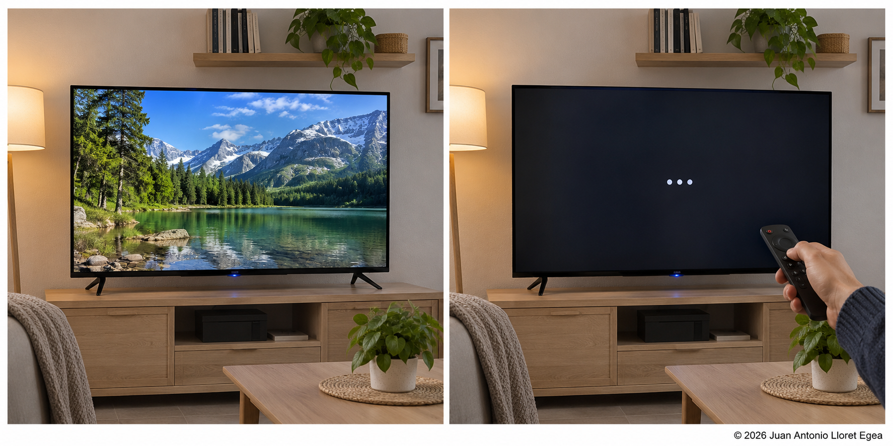
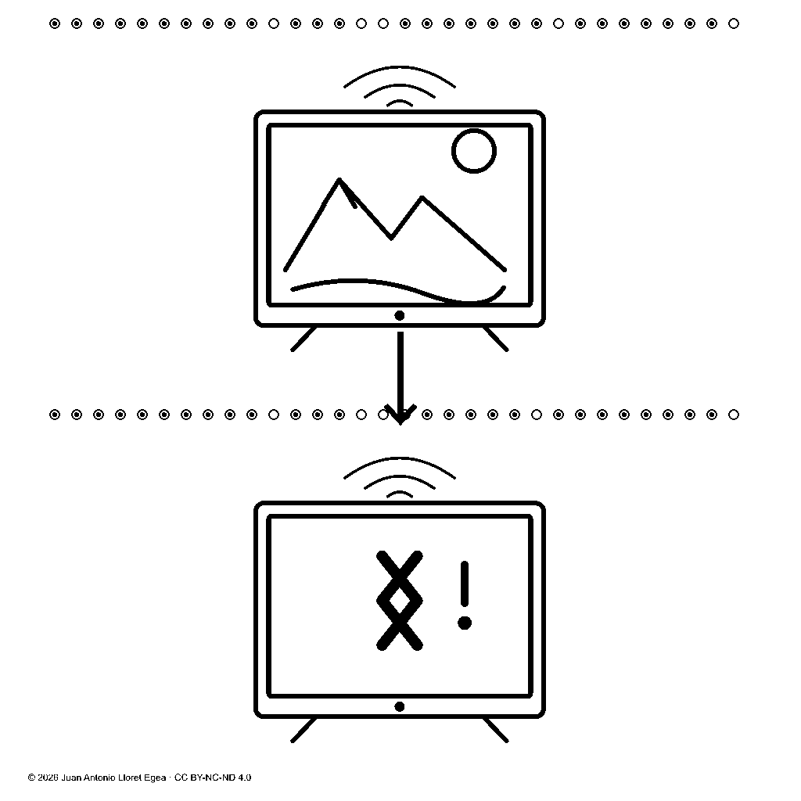
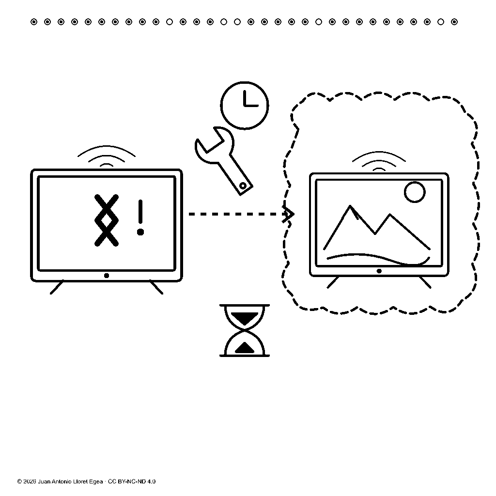

# Ingeniería y arquitectura de la Inteligencia Artificial del Sistema Vectorial mediante el Lenguaje Basado en Imágenes

Publicación académica: [identificador de objeto digital (DOI) 10.21428/39829d0b.0481eae3](https://doi.org/10.21428/39829d0b.0481eae3).

**Juan Antonio Lloret Egea**  
Instituto Tecnológico Virtual de la Inteligencia Artificial para el Español (ITVIA). Identificador de autor: [ORCID 0000-0002-6634-3351](https://orcid.org/0000-0002-6634-3351).

Obras relacionadas: [*Inteligencia Artificial del Sistema Vectorial*, edición V.04](https://documentos-sv.itvia.online/investigacion/inteligencia-artificial-sv/), y [*Tratado Lenguaje Basado en Imágenes (LBI) — Imagen real ↔ (glifo, texto) ↔ Célula SV*, edición V.13](https://documentos-sv.itvia.online/investigacion/lenguaje-basado-en-imagenes/). Artículo fundacional del tratado: [identificador de objeto digital (DOI): 10.21428/39829d0b.8b9c0155](https://doi.org/10.21428/39829d0b.8b9c0155).

© 2026 Juan Antonio Lloret Egea. Licencia [Creative Commons Atribución-NoComercial-SinDerivadas 4.0 Internacional (CC BY-NC-ND 4.0)](https://creativecommons.org/licenses/by-nc-nd/4.0/deed.es) para los contenidos propios. Las fuentes e instrumentos citados conservan sus condiciones de uso.

## Resumen

Se propone una arquitectura de Inteligencia Artificial del Sistema Vectorial (SV) cuyo razonamiento se constituye mediante representaciones visuales, relaciones explícitas y operaciones reproducibles. Su fundamento inmediato es el Lenguaje Basado en Imágenes (LBI), integrado con la terna, las células, la dinámica del suceso, la transducción entre dominios, el aprendizaje trazable y las matemáticas del potencial del Sistema Vectorial. La arquitectura exige vincular cada estado visual con su composición de glifos, su expresión verbal cuando exista, su representación celular y su potencial calculado. El lenguaje natural actúa como interfaz de entrada y salida; no establece la lógica interna del razonamiento. Se examinan los modelos lingüísticos contemporáneos, sus avances y sus límites de fundamentación, interpretabilidad y coste, sin equiparar entrenamiento a gran escala con toda ejecución local. Un caso sintético de televisión inteligente permite desarrollar la cadena documental, las relaciones de precedencia, hipótesis y finalidad, la contabilización ternaria y el cálculo reversible del potencial digital. Se incorporan también consultas reproducibles sobre una manzana y ensayos delimitados del modelo Génesis, con conservación de resultados adversos y errores críticos de percepción. Se distinguen los resultados reproducibles de representación de las capacidades todavía pendientes de reconocimiento y transducción semántica. La contribución es una especificación de arquitectura y de sus condiciones de demostración; no constituye la acreditación de una inteligencia artificial general ni de una superioridad empírica sobre sistemas existentes.

**Palabras clave:** razonamiento visual; representación ternaria; trazabilidad; transducción semántica; potencial digital; abstención; inteligencia artificial determinista.

## 1. Problema de investigación y alcance

Una respuesta verbal convincente no permite, por sí sola, reconstruir las operaciones que la produjeron ni comprobar que sus afirmaciones procedan de evidencia suficiente. El problema abordado consiste en diseñar un sistema donde la observación, la representación, la operación de razonamiento y la expresión del resultado permanezcan relacionadas de manera verificable. La pregunta central es si puede realizarse una inteligencia artificial que opere internamente sobre estados visuales constituidos y conserve, para cada conclusión, sus premisas, reglas, transformaciones y límites de validez.

La propuesta adopta la cadena:

> **Imagen real ↔ (glifo, texto) ↔ Célula del Sistema Vectorial (SV) ↔ Potencial de un *frame* del Sistema Vectorial (SV).**

Un *frame* es aquí una representación constituida de un suceso o de un estado de información acerca de él. «Constituida» significa que se han fijado las posiciones, sus funciones, los participantes, las relaciones y las condiciones de interpretación. Un glifo es una composición visual que representa esas relaciones. El potencial es el resultado de una regla matemática declarada sobre una representación y un dominio determinados. La cadena no identifica sin condiciones una fotografía, una frase libre y un escalar: exige correspondencias explícitas y la conservación de la información necesaria para recorrerla.

El alcance inicial comprende sistemas artificiales y dominios delimitados. La expresión «razonamiento visual» designa operaciones sobre representaciones visuales efectivamente utilizadas para producir una conclusión; no implica conciencia ni una reproducción del funcionamiento biológico humano. La revisión bibliográfica es selectiva, con fuentes primarias consultadas hasta el 7 de noviembre de 2026. Se combina con una exposición formal y un ejemplo documental reproducible, no con una comparación experimental general entre modelos.

## 2. Estado del arte: capacidades, incentivos y condiciones de ejecución

### 2.1. Predicción lingüística y ajuste mediante recompensas

Una familia central de los asistentes generativos contemporáneos utiliza modelos de lenguaje de gran tamaño, denominados *large language models* (LLM). La arquitectura *transformer* introdujo mecanismos de atención paralelizables; numerosos modelos posteriores generan secuencias mediante distribuciones condicionadas sobre unidades de texto, o *tokens*. En una formulación autorregresiva, la probabilidad de una secuencia se factoriza como producto de las probabilidades de cada unidad condicionada por las anteriores. La factorización describe un mecanismo de generación; no demuestra la verdad de lo generado. [[1]](https://doi.org/10.48550/arXiv.1706.03762)

El entrenamiento para seguir instrucciones puede combinar demostraciones humanas con preferencias sobre respuestas y aprendizaje por refuerzo. InstructGPT documentó mejoras de adecuación y veracidad respecto de sus referencias, conservando errores. DeepSeek-R1 mostró que recompensas sobre tareas verificables pueden mejorar capacidades de resolución. Por tanto, la recompensa no es intrínsecamente contraria al razonamiento correcto; sus efectos dependen de qué conducta se evalúa y cómo se puntúa. [[2]](https://doi.org/10.48550/arXiv.2203.02155)[[3]](https://doi.org/10.1038/s41586-025-09422-z)

Existe, sin embargo, un conflicto cuando formular una respuesta conjetural recibe más puntuación que reconocer insuficiencia de información. Kalai y colaboradores analizan cómo determinadas prácticas de entrenamiento y evaluación favorecen respuestas plausibles pero falsas, habitualmente denominadas alucinaciones. El riesgo es que la respuesta se optimice para ser aceptada sin que exista una obligación equivalente de demostrar su fundamento. Esto constituye una presión del objetivo de optimización, no una necesidad matemática de que todo modelo responda siempre: pueden establecerse abstenciones, consultas documentales y verificaciones externas. [[4]](https://doi.org/10.48550/arXiv.2509.04664)

La generación aumentada mediante recuperación documental vincula la producción de texto con pasajes recuperados y ha mostrado mejoras de factualidad. La disponibilidad de documentos amplía la evidencia accesible, aunque no prueba por sí sola que cada afirmación generada se corresponda correctamente con ellos. Una arquitectura auditable debe distinguir disponibilidad de la fuente, interpretación de su contenido y validez de la conclusión. [[5]](https://doi.org/10.48550/arXiv.2005.11401)

### 2.2. Explicación verbal y trazabilidad causal

La producción de una explicación paso a paso no garantiza que esa explicación refleje el mecanismo que causó la respuesta. Turpin y colaboradores mostraron casos en los que factores introducidos en la entrada alteraban las respuestas sin aparecer fielmente reconocidos en sus explicaciones. El resultado se refiere a modelos y tareas concretos; no autoriza a declarar falsa toda explicación de cualquier modelo. Sí exige separar una narración justificativa de una traza de ejecución comprobable. [[6]](https://doi.org/10.48550/arXiv.2305.04388)

La interpretabilidad mecanicista aporta análisis parciales de circuitos internos. Lindsey y colaboradores identificaron mecanismos concretos de Claude 3.5 Haiku mediante grafos de atribución, señalando límites de cobertura y aproximación. La auditabilidad no es absolutamente imposible; resulta incompleta y dependiente de métodos especializados. Además, disponer de los pesos no equivale a disponer de una explicación causal íntegra, mientras que una interfaz de servicio cerrada restringe todavía más el acceso al modelo y a su proceso de entrenamiento. [[7]](https://transformer-circuits.pub/2025/attribution-graphs/biology.html)

### 2.3. Recursos, acceso y coste ambiental

El entrenamiento de modelos de gran escala puede requerir infraestructuras ajenas al alcance de un usuario individual. El informe de DeepSeek-V3 declara 2,788 millones de horas de unidades de procesamiento gráfico (GPU) H800 y una valoración de 5,576 millones de dólares, calculada a dos dólares por hora de unidad. El importe corresponde al entrenamiento descrito y excluye la investigación previa y los experimentos de ablación; no representa el coste íntegro del proyecto ni una tarifa universal. El propio informe reconoce exigencias de despliegue relevantes para equipos pequeños. [[8]](https://doi.org/10.48550/arXiv.2412.19437)

La Agencia Internacional de la Energía estima en su informe de 2026 que el consumo eléctrico mundial de los centros de datos pasaría de 485 teravatios hora en 2025 a aproximadamente 950 en 2030, según su proyección central. Son magnitudes de todos los centros de datos, no exclusivamente de los modelos lingüísticos, y el segundo valor es una proyección. El informe documenta simultáneamente mejoras de eficiencia por tarea y expansión de usos más intensivos. Por ello, el impacto ambiental no puede inferirse del número de parámetros ni de una consulta aislada: requiere declarar cargas de trabajo, infraestructura y suministro energético. [[9]](https://www.iea.org/reports/key-questions-on-energy-and-ai/executive-summary)

Entrenar un modelo de gran escala y ejecutar uno ya entrenado son problemas distintos. Phi-3 documenta modelos suficientemente pequeños para ejecución en un teléfono, y existen sistemas de ejecución local con cuantización y aprovechamiento de procesadores generales. Estos resultados impiden afirmar que los modelos lingüísticos excluyan necesariamente el ordenador personal. Las restricciones reales dependen del modelo, memoria, precisión, contexto y rendimiento requerido. La dependencia de proveedores cerrados es una condición de determinadas ofertas y arquitecturas de servicio, no de toda inteligencia artificial contemporánea. [[10]](https://doi.org/10.48550/arXiv.2404.14219)[[11]](https://github.com/ggml-org/llama.cpp)

### 2.4. Antecedentes del razonamiento visual estructurado

La combinación de percepción y representación simbólica tiene antecedentes relevantes. El aprendizaje *neurosimbólico* de Mao y colaboradores construye representaciones de escenas y convierte frases en programas ejecutables sobre ellas. Este precedente impide presentar la mera asociación de imagen, símbolo y lenguaje como una novedad exclusiva. La investigación aquí propuesta se delimita por obligaciones conjuntas: constitución ternaria, correspondencia celular, potencial calculado, conservación por adición, operaciones explícitas y abstención ante fundamento insuficiente. La diferencia arquitectónica deberá contrastarse mediante realizaciones y tareas comparables. [[12]](https://doi.org/10.48550/arXiv.1904.12584)

## 3. Fundamentos del Sistema Vectorial y dependencia entre las dos obras

El Sistema Vectorial establece el marco formal; el Lenguaje Basado en Imágenes constituye las representaciones visuales y sus correspondencias; la Inteligencia Artificial del Sistema Vectorial estudia cómo operar sobre esas representaciones para razonar, conservar conocimiento y dialogar. La dependencia es **Sistema Vectorial → Lenguaje Basado en Imágenes → Inteligencia Artificial del Sistema Vectorial**. La autonomía de la última obra se refiere a su objeto de desarrollo, no a una desvinculación de sus fundamentos. [[13]](https://doi.org/10.21428/39829d0b.b0cf9a13)[[14]](https://doi.org/10.21428/39829d0b.8b9c0155)

La terna (0,1,U) y la célula son obligatorias. Una célula de morfología (n,b) tiene n=b² posiciones, con b entero y b≥3. En el alfabeto ternario, las asignaciones posibles son 3ⁿ. Cada parámetro P1…Pn tiene una función constituida y un solo valor; no contiene una frase. En una evaluación de fidelidad, 0 expresa conservación comprobada, 1 alteración comprobada y U indeterminación competente. En una codificación descriptiva, la interpretación se fija por su constitución: no se traslada automáticamente el significado evaluativo a todos los datos.

La economía celular exige la menor representación adecuada que conserve las relaciones críticas. No permite eliminar una finalidad relevante, rellenar posiciones sin función ni utilizar U para encubrir un procedimiento ausente. Tener una matriz ternaria no acredita, por sí solo, un cuerpo, un anillo o un espacio vectorial: las operaciones y sus propiedades requieren definición y demostración dentro del marco aplicable.

La transducción entre dominios aporta las obligaciones de conservación de las correspondencias. La dinámica del suceso y el estudio de ciclos distinguen la configuración representada de su aparición concreta; la conservación por adición mantiene los antecedentes y sus rectificaciones. El orden de dependencia o precedencia no requiere adoptar el tiempo como primitiva, aunque puedan registrarse fechas como instrumentos de observación. [[15]](https://doi.org/10.21428/39829d0b.5c31d534)[[16]](https://doi.org/10.21428/39829d0b.8ea18396)[[17]](https://doi.org/10.21428/39829d0b.2b3c9808)

El aprendizaje trazable fundamenta la incorporación de conocimiento con sus condiciones y procedencia. Una instancia observada no demuestra una ley universal; una regla nueva conserva su alcance y evidencia. Las matemáticas del potencial exigen declarar dominio, magnitudes, regla y calibración, antes de comparar resultados. Estos fundamentos se incorporan conjuntamente; la imagen no sustituye ninguno de ellos. [[18]](https://doi.org/10.21428/39829d0b.bebc607c)[[19]](https://doi.org/10.21428/39829d0b.dcb48723)

### 3.1. Par biyectivo, composición y activación

La analogía funcional con la percepción humana orienta la relación entre representación accesible y procesos subyacentes. La persona puede interpretar una forma visual sin rehacer los cálculos que la producen; la arquitectura conserva la posibilidad de recorrer esos cálculos y su evidencia cuando se necesita fundamentar la conclusión. La analogía no establece equivalencia biológica ni sustituye la demostración de las correspondencias.

El polígono es la expresión visual constitutiva del estado matemático. Su interacción permite relacionar cada parámetro con la cuestión y la evidencia correspondientes, así como localizar una U y examinar su fundamento. La persona experta en el dominio y el agente artificial especializado son participantes distintos; este último puede operar con las representaciones matemática y visual sin asumir la identidad profesional de la primera. La convención cromática vigente representa 0 en rojo, 1 en verde y U en azul, acompañados de radios y rótulos. El color codifica el símbolo y no sustituye su interpretación constituida. Esta función se mantiene en cada célula de una composición, con independencia de la morfología utilizada [21].

Una célula constituida y su polígono canónico forman siempre un par biyectivo, **Frame_C=(frmat,frvis)**. El contrato preserva instancia, constitución, revisión y posiciones ordenadas; los radios ρ(0)=1, ρ(1)=2 y ρ(U)=3 codifican los tres estados. La [correspondencia visual de la biblioteca](https://documentos-sv.itvia.online/dominios/lenguaje-de-computacion/manual/parametros-rutas#correspondencia-visual) desarrolla esa obligación. Un glifo semántico o una captura de pantalla no sustituyen por sí solos el polígono canónico.

El tratado denomina *frame* local al par celular y *frame* global a la composición identificada de uno o varios pares y sus relaciones [21]. La representación global conserva cada biyección local junto con agrupación, funciones, dependencias y contexto. No crea una célula por suma de longitudes: dos células de nueve posiciones siguen siendo dos células. Local tampoco exige recortar una imagen.

Pertenencia y activación se registran separadamente. Las relaciones simultáneas de color, contención y apoyo no imponen una sucesión. La Trayectoria Poligonal de Activación, definida sobre observables y activaciones [17, parte IV], no es el polígono celular. Dos vectores distintos pueden tener el mismo número de U; una curva de ese recuento no conserva todo el estado. Reconstruir una sucesión global exige las agrupaciones y correspondencias de activación. Una nueva consulta computacional conserva identidad propia sin convertirse en una nueva captura física.

La repetición factual de un estado bajo constituciones compatibles no elimina la nueva activación [17, parte II]. La identidad del suceso y el contenido recuperable permanecen vinculados, sin fabricar diferencias numéricas mediante cifras que no procedan de la regla de potencial.

## 4. Arquitectura de razonamiento visual y diálogo

### 4.1. Dos entradas, una representación interna

La entrada visual admite una imagen cargada o adquirida mediante un dispositivo. Primero conserva la fuente y las condiciones conocidas de adquisición; después constituye participantes y relaciones mediante procedimientos explícitos del dominio admitido. Cuando el procedimiento no puede identificar una relación crítica, no la completa por semejanza ni la presenta como observada. El reconocimiento de escenas arbitrarias continúa siendo una capacidad que debe investigarse.

La entrada verbal requiere un transductor lingüístico que determine las relaciones expresadas y sus ámbitos. A partir de ellas se constituye una representación visual sintética de la consulta. Esta imagen interviene en las operaciones posteriores; no se añade retrospectivamente como explicación de una conclusión obtenida por otro procedimiento. Una pregunta sobre un hecho no se convierte por ese procedimiento en evidencia de que el hecho ocurrió.

La frontera lingüística no puede eliminarse: comprender una consulta textual requiere establecer una correspondencia semántica. La propuesta sitúa esa operación en interfaces verificables y mantiene la lógica interna desligada de la formulación verbal concreta. La publicación del transductor lingüístico del Sistema Vectorial parte de una representación observacional finita y difiere su obtención desde texto libre. Por tanto, no acredita por sí sola un intérprete automático de cualquier idioma. [[20]](https://doi.org/10.21428/39829d0b.6c9cbb28)

### 4.2. Estado, operación y conclusión

Un estado admitido conserva imagen, glifos, células, potencial, procedencia e identidad. Una operación recibe estados y una regla identificada, comprueba sus premisas y produce otro estado con la relación de dependencia correspondiente. La conclusión debe poder reconstruirse repitiendo la operación sobre las mismas entradas y la misma versión de la regla. El grafo de razonamiento enlaza los estados con las operaciones que efectivamente los produjeron.

> Observación constituida → relaciones visuales → comprobación de premisas → operación explícita → nuevo estado visual → expresión verbal cotejada.

La arquitectura propia excluye selección probabilística de conclusiones, inferencia opaca y respuesta por predicción verbal. El determinismo significa que entradas y reglas iguales producen el mismo resultado; no garantiza que una premisa sea verdadera ni que una regla modele adecuadamente el mundo. De ahí la necesidad de verificar por separado fuente, interpretación, operación y expresión.

Si falta evidencia para una afirmación, el resultado admisible es una abstención delimitada: se declara qué no puede concluirse y qué observación permitiría continuar. U se reserva a una cuestión correctamente constituida cuya evaluación sea indeterminada. La falta de un intérprete, una imagen ilegible o una regla no implementada son incidencias de cobertura o recepción, no resultados ternarios que deban fabricarse.

La transparencia exige conservar la secuencia efectiva de entradas, versiones, reglas, operandos, estados celulares intermedios y polígonos asociados, cálculos y resultado. Cada aproximación de presentación mantiene acceso a su valor exacto o expresión recuperable. Una explicación verbal no sustituye este registro. La auditabilidad de extremo a extremo requiere que puedan examinarse las dependencias y reproducirse las operaciones bajo las condiciones declaradas; no se acredita cuando falta un tramo del recorrido.

### 4.3. Expresión verbal sin dependencia lógica del idioma

La salida verbal puede variar de lengua y de prosa, siempre que conserve participantes, negación, modalidad, precedencia, causalidad y finalidad. No se exige coincidencia literal con una frase de referencia. Sí se exige que la correspondencia entre texto y relaciones sea verificable en cada idioma admitido. La independencia del idioma es una obligación de arquitectura y de validación, no una comprensión universal ya demostrada.

El repertorio visual debe poder contrastarse sin glosas resolutivas. Una explicación académica del funcionamiento del repertorio tiene una finalidad distinta de la lámina presentada para evaluar comprensión. La imagen y sus glifos han de aportar la información visual examinada; una definición verbal adjunta no puede emplearse como prueba de reconocimiento visual.

## 5. Correspondencia, identidad y pérdida admisible

La biyección exacta se establece entre representaciones canónicas y sus codificaciones bajo una constitución conocida. La relación con una imagen fuente incluye su identificación y la información que permite recuperarla. Una frase breve puede conservar el significado y omitir millones de detalles visuales: sin la referencia al registro o esos datos, no determina una única fotografía. La cadena completa requiere conservar dicha referencia, también cuando se accede a ella desde texto.

Cada aparición recibe una identidad propia dentro de una colección, por ejemplo S40. El potencial digital distingue representaciones normalizadas diferentes; la identidad del suceso distingue apariciones. Dos archivos pueden contener exactamente las mismas muestras y producir el mismo potencial digital, aunque pertenezcan a registros diferentes. La captura finita no demuestra igualdad física absoluta; tampoco permite calcular diferencias que el instrumento no registró. La resolución, calibración y contexto se conservan como información documentada, sin introducir diferencias numéricas ficticias.

La fidelidad de una reconstrucción con pérdida se evalúa separadamente. Para una célula de n parámetros, el criterio documentado utiliza T(n)=⌊7n/9⌋. Se comprueban primero los errores: la clasificación es No apto si N₁≥T(n); en otro caso, Apto si N₀≥T(n); e Indeterminado en los restantes. El dictamen añade las criticidades: un error crítico determina No apto y una U crítica impide Apto. Así, en (9,3), T(9)=7, pero siete aciertos no compensan la alteración de una causalidad crítica. [[13]](https://doi.org/10.21428/39829d0b.b0cf9a13)

Para preservar un contenido nuclear, una relación hipotética correctamente conservada puede recibir 0 en la evaluación de fidelidad. La incertidumbre del hecho representado y la incertidumbre sobre si el texto lo expresa bien son cuestiones diferentes. Esta separación evita confundir una hipótesis válida como representación con una afirmación factual confirmada.

## 6. Ejemplo desarrollado: estados de un televisor y reparación requerida

### 6.1. Imagen, glifos y relaciones

**Figura 1.** Imagen fuente sintética del caso de televisión del tratado, identificada como Imagen4. La apariencia fotográfica no la convierte en captura de un aparato real. Se conserva íntegramente la representación utilizada para calcular el potencial. © 2026 Juan Antonio Lloret Egea · ITVIA · CC BY-NC-ND 4.0.

El caso constituido establece que el mismo televisor funcionaba, deja de funcionar, presenta una posible corrupción de Android y requiere reparación para recuperar su funcionamiento. La figura 1 muestra apariencias distintas de una pantalla; la precedencia, el fallo, la identificación del sistema y la hipótesis causal proceden de la constitución del caso. Una imagen estática de arranque no diagnostica corrupción. El aparato genérico representado tampoco se identifica con una unidad del modelo comercial TCL 43T69C.

**Figura 2.** Composición visual del funcionamiento anterior y del fallo presente. Corresponde a las relaciones de S40 y S41. El orden representado no demuestra una duración física. [Geometría vectorial de origen](https://documentos-sv.itvia.online/investigacion/lenguaje-basado-en-imagenes/formatos/22-02-funcionamiento-y-fallo.svg). © 2026 Juan Antonio Lloret Egea · ITVIA · CC BY-NC-ND 4.0.

| Estado | Relación constituida | Alcance lógico |
| --- | --- | --- |
| S40 | Funcionamiento anterior del televisor. | Estado afirmado en el caso. |
| S41 | Fallo presente del mismo televisor. | S40 precede a S41. |
| S42 | Corrupción de Android → fallo. | Relación causal hipotética. |
| S43 | Reparación pendiente → recuperación del funcionamiento. | Relación de finalidad; no de resultado conseguido. |

Estas relaciones definen un grafo tipado: S40 y S41 se enlazan por precedencia; S42 se refiere al fallo mediante una relación causal hipotética; S43 vincula una intervención requerida con un estado pretendido. No se interpretan las cuatro referencias como cuatro hechos sucesivos ya realizados. Los tipos de las relaciones determinan qué operaciones están permitidas.

**Figura 3.** Glifo conservado del suceso S43: reparación requerida y recuperación pretendida. Se reproduce como objeto de contraste, sin atribuir comprensión universal a sus signos. [Correspondencia documental completa](https://documentos-sv.itvia.online/investigacion/lenguaje-basado-en-imagenes/23-correspondencias.html#suceso-S43). © 2026 Juan Antonio Lloret Egea · ITVIA · CC BY-NC-ND 4.0.

### 6.2. Composición celular y cadena de texto

Para S40, la expresión de referencia es «La televisión inteligente funcionaba en el estado anterior»; para S41, «La misma televisión inteligente no funciona en el estado presente». Cada representación conserva cinco células (9,3), cuyas posiciones se leen en el orden P1–P9:

| Célula | S40 | S41 |
| --- | --- | --- |
| 1 | 000000000 | 000000000 |
| 2 | 010001100 | 010001100 |
| 3 | 000001000 | 000010000 |
| 4 | 000011010 | 000011010 |
| 5 | 011010001 | 011010011 |

S40 contabiliza 34 valores 0 y 11 valores 1; S41, 33 valores 0 y 12 valores 1. No contienen U. Los cambios se interpretan mediante la constitución del repertorio, no atribuyendo significado a una posición aislada sin su definición. Las reservas históricas que se señalan a continuación deben distinguirse de parámetros plenamente constituidos.

La cadena verbal de referencia de S43 es: «Es necesario reparar la televisión, con el propósito de recuperar el funcionamiento. La reparación está pendiente y el resultado no se afirma realizado». Su idioma es el español. Es una expresión de referencia constituida, no una respuesta atribuida a un participante artificial. El registro conserva las siguientes cuatro células de contenido:

| Célula | Morfología | Valores ordenados de P1 a Pn | Valores 0 / 1 / U |
| --- | --- | --- | --- |
| 1 | (9,3) | 000000000 | 9 / 0 / 0 |
| 2 | (16,4) | 0100011000001000 | 12 / 4 / 0 |
| 3 | (16,4) | 0000010110001101 | 10 / 6 / 0 |
| 4 | (16,4) | 0001100111010001 | 9 / 7 / 0 |

El total es 9+16+16+16=57 posiciones: 40 valores 0, 17 valores 1 y ninguna U. Los valores codifican el contenido conforme a su constitución; los 17 valores 1 no son 17 errores de una respuesta. Las cuatro células tampoco se identifican con una célula de evaluación. La composición completa S40–S43 contiene 23 células históricas; sus reservas declaradas impiden presentarla como una entrada íntegramente admitida en la nueva arquitectura sin completar las condiciones de constitución.

La relación con la figura 1 es contextual. S40 y S41 están vinculados a sus dos mitades; S42 y S43 proceden de relaciones narrativas y no de una captura que pruebe la corrupción o la reparación. Por ello, el ejemplo expone todos los componentes documentados de la cadena y sus cálculos, pero no acredita una conversión autónoma completa desde una fotografía real. Esta limitación es comprobable en el [registro público de correspondencias](https://documentos-sv.itvia.online/investigacion/lenguaje-basado-en-imagenes/23-correspondencias.html).

### 6.3. Potencial de la imagen: cálculo y retorno

El **convenio de representación posicional de imágenes del Sistema Vectorial, versión 02 (SVIMG02)** fija el orden de las muestras, sus dimensiones y una terminación de identificación. SV designa Sistema Vectorial; IMG abrevia imagen; 02 indica la versión. Se leen por filas las componentes roja, verde, azul y alfa, con ocho bits por componente, y se añaden dieciséis octetos que conservan perfil, anchura y altura. El resultado tiene m bits y representa un entero C, con 0≤C<2ᵐ. La definición no depende de reconocer un televisor. [[21]](https://documentos-sv.itvia.online/investigacion/lenguaje-basado-en-imagenes/17-potencial.html)

μ=3·2ᵐ+C; λ=2ᵐ−1−C; P=μ−λ=2ᵐ⁺¹+2C+1; I=μ+λ=2ᵐ⁺²−1.

Para comprobar la aritmética sin escribir millones de cifras, tómese el control reducido m=3 y C=5: μ=24+5=29; λ=8−1−5=2; P=29−2=27; I=29+2=31. El retorno C=(27−16−1)/2=5 recupera la entrada. Es un control de la fórmula, no una imagen válida del convenio completo.

En la figura 1, 1774×887=1.573.538 píxeles producen 6.294.152 componentes. Añadiendo los dieciséis octetos, m=8×6.294.168=50.353.344 bits. Si xⱼ es el octeto situado en la posición j, C₀=0 y Cⱼ=256Cⱼ₋₁+xⱼ. Los primeros valores son 253, 253, 253 y 255; por ello C₁=253, C₂=65.021, C₃=16.645.629 y C₄=4.261.281.279. La misma regla continúa hasta el último octeto, sin resumir ni reordenar las muestras.

P=250353345+2C+1; N=m+2=50.353.346; q=P/2ᴺ.

El entero P exacto ocupa N bits. Su longitud permite recuperar m=N−2, y C=(P−2ᵐ⁺¹−1)/2 recupera los octetos. Para cada m, la función es estrictamente creciente en C; para m distintos, los potenciales tienen longitudes binarias distintas. La inyectividad se refiere a representaciones digitales admitidas por este convenio, no a una medición exhaustiva del mundo físico.

La recta Atlas aporta una transformación logarítmica acotada. En esta aplicación, la entrada es el racional digital q y el régimen común es s=64. Con escala 64 y parámetro η=1/10:

δ=64·ln(1+10q)/ln(11); μAtlas=64+δ/2; λAtlas=64−δ/2.

La transformación es estrictamente creciente y su inversa exacta es q=(11δ/64−1)/10. Como P es impar, q=P/2ᴺ está reducido y conserva el numerador y la longitud. La expresión exacta permite el retorno; la aproximación decimal que facilita la lectura no ofrece esa garantía.

| Operación para Imagen4 | Resultado aproximado |
| --- | --- |
| q | 0,99607843160583620 |
| 1+10q | 10,96078431605836201 |
| ln(1+10q) | 2,39432384064361159 |
| ln(11) | 2,39789527279837067 |
| δ=PAtlas | 63,904678214892 |
| μAtlas; λAtlas | 95,952339107446; 32,047660892554 |
| IAtlas=μAtlas+λAtlas | 128 |

El [desarrollo completo de Imagen4](https://documentos-sv.itvia.online/investigacion/lenguaje-basado-en-imagenes/calculos/Imagen4.html) proporciona muestras iniciales, terminación, expresión exacta y retorno. La proyección utiliza la función de [Orientación, apartado 6.4](https://www.itvia.online/pub/orientacion-universal-y-geografica-potencial-del-suceso-e-interfaz-de-dominio-desde-el-universo-y-los-seres-biologicos-humanoide-sv/release/1#proyeccin-sobre-escala-acotada), con la entrada digital declarada por el convenio. No convierte colores en edades ni asigna al aparato el potencial de sus píxeles. [[22]](https://doi.org/10.21428/39829d0b.5e15cabb)

Para el glifo S43, 1024×1024×4+16=4.194.320 octetos y m=33.554.560. Se aplica la misma regla: P=2ᵐ⁺¹+2C+1. Su proyección se muestra como 64,000000000000 al redondear a doce decimales, aunque el valor exacto es inferior a 64. No se identifica con el potencial de Imagen4 ni con otro glifo que comparta ese redondeo. El [cálculo de S43](https://documentos-sv.itvia.online/investigacion/lenguaje-basado-en-imagenes/calculos/Recurso131.html) conserva la expresión exacta y su recuperación.

El potencial digital no constituye un método de compresión ni una distancia de significado. El entero exacto conserva una cantidad de información proporcional al tamaño de las muestras. Una pequeña diferencia en su cifra de consulta no demuestra semejanza conceptual, y una coincidencia decimal no demuestra identidad. Las relaciones de significado se comparan mediante glifos, constituciones y operaciones, no mediante proximidad escalar sin fundamento.

### 6.4. Deducción admisible y validación de la expresión

Ante «¿qué se pretende con la reparación?», la finalidad de S43 permite expresar «recuperar el funcionamiento del televisor». Ante «¿ya está reparado?», S43 no permite afirmar la ejecución. El sistema debe conservar que la reparación figura pendiente y que no consta una observación posterior que la acredite. Una imagen sintética de un televisor reparado, producida a partir de la pregunta, tampoco sería esa observación.

La evaluación de la expresión libre requiere dos operaciones separadas: obtener sus relaciones con evidencia sobre el texto y cotejarlas con la referencia. El cotejo estructurado disponible para este dominio constituye P1–P9: identidad del aparato; funcionamiento anterior; fallo presente; precedencia; pertenencia de Android; carácter hipotético de la corrupción; dirección y modalidad causal; reparación requerida y pendiente; finalidad sin resultado afirmado. Todas son críticas. Confirmar la corrupción sin evidencia altera P6; afirmar además su causalidad como comprobada altera P7. Dar por realizada la reparación altera P8; presentar la recuperación pretendida como un resultado alcanzado altera P9. Cada condición se contrasta por separado con las relaciones efectivamente expresadas. Ninguna semejanza de vocabulario compensa esas diferencias.

La realización inicial comprueba relaciones previamente estructuradas; no extrae todavía con garantía esas relaciones de texto libre. El contraste visual tampoco ha acreditado comprensión integral y generalizable del repertorio. Los [resultados delimitados del tratado](https://documentos-sv.itvia.online/investigacion/lenguaje-basado-en-imagenes/19-verificacion.html) permiten examinar las ambigüedades existentes. La validación automática de la cadena completa debe demostrar ambas operaciones y su composición antes de emitir un dictamen sobre respuestas libres.

### 6.5. Consulta de una manzana y alcance del modelo Génesis

Génesis es el modelo experimental inicial; la revisión técnica 1.0.0-experimental.72 conserva procedimientos delimitados de consulta y percepción. El caso de una manzana sintética constituye nueve proposiciones y una célula de escena **000000001**: manzana, recipiente y superficie visibles; predominio verde; apariencia transparente; contención; apoyo; cantidad unitaria y presencia de corte visible. El perfil fija 0 como afirmación, 1 como negación y U como indeterminación de la proposición. P9 enuncia «La manzana presenta un corte visible» y recibe 1; por tanto, el vector conserva que no se observa un corte. El [tratado, capítulo 21](https://documentos-sv.itvia.online/investigacion/lenguaje-basado-en-imagenes/25-desarrollo), muestra imagen, glifo, texto, posiciones y cálculo [21].

La imagen de 1254×1254 píxeles y cuatro componentes de ocho bits produce **m=50 320 640 bits** tras incorporar la terminación de dieciséis octetos. Aplicando las fórmulas del apartado 6.3, q≈0,9056285917557406 y **δ≈61,60597065872314**. El retorno conserva el entero exacto; no se realiza con esta aproximación. El potencial pertenece al dominio de la imagen, no al dominio biológico de la fruta.

Nueve preguntas sobre la evidencia originan respuestas acerca de fruta, color, cantidad, contención, apoyo, transparencia y corte; las consultas sobre quién la colocó y su sabor reciben abstención por falta de documentación. La primera constitución fue asistida. Una escena aislada y nueve consultas de dos células reúnen **19 instancias**, 171 posiciones: 89 valores 0 y 82 valores 1; el control se conserva aparte. La repetición triple produce veintisiete respuestas estables por grupos.

El procedimiento posterior recupera las muestras desde el potencial exacto antes de la percepción automática. Interviene, por tanto, en el acceso efectivo a la evidencia. No se ha demostrado que las diferencias de potencial midan semejanza semántica o mejoren la deducción. El ensayo de quince imágenes sintéticas reúne 405 ejecuciones: los 135 grupos de tres se mantienen estables, pero once de quince referencias se satisfacen, incluidas dos abstenciones exigidas. Sólo una de tres imágenes nuevas satisface su referencia. El control 000110000 incumple dos criticidades y conserva **No apto** [21].

El conjunto perceptivo contabiliza 180 células (9,3), 1620 posiciones —346 valores 0, 1236 valores 1 y 38 valores U— y un control aparte. Los dieciocho retornos nuevos de potencial son exactos; el registro acumulativo alcanza 347 potenciales. Estas magnitudes no demuestran que las realizaciones instrumentales ya incorporen el polígono canónico interactivo ni que generalicen a fotografías arbitrarias.

Las composiciones posteriores emplean símbolos oficiales Bliss con relaciones experimentales [23]. Las 39 estructuras y 936 combinaciones controladas examinadas no autorizan sustituir todas las representaciones previas por una gramática Bliss supuestamente validada. Una capa verbal o simbólica correcta no compensa un inventario perceptivo erróneo.

## 7. Memoria, aprendizaje y ejecución en arquitecturas disponibles

La memoria se organiza como registros de estados y relaciones, con referencias inequívocas a imagen, glifos, texto, células, potencial y antecedentes. Las rectificaciones añaden registros y conservan su relación con los anteriores. El aprendizaje se investiga como ampliación explícita de representaciones, reglas y casos documentados; cada incorporación tiene alcance y condiciones de admisión. La trazabilidad no acredita por sí sola que una generalización sea válida.

Las células pueden disponerse en tablas, matrices y tensores, siempre que se conserve qué dimensión identifica suceso, célula y parámetro. Las posiciones auxiliares de procesamiento no pasan a ser parámetros del Sistema Vectorial ni se rellenan con U. Las operaciones compatibles pueden ejecutarse en unidades de procesamiento gráfico o en unidades de procesamiento tensorial (TPU), después de comprobar su equivalencia con el cálculo de referencia. La aceleración no aporta automáticamente una semántica correcta.

La propuesta no exige conceptualmente un centro de datos para sus operaciones finitas y delimitadas. El cálculo posicional y el cotejo de relaciones pueden desarrollarse en ordenadores personales; el volumen de imágenes, la longitud de los enteros exactos y la conservación acumulativa determinan sus exigencias. No se dispone todavía de una medición integral de latencia, memoria, consumo eléctrico y cobertura que permita afirmar una superioridad económica o ambiental de la arquitectura completa. Esa comparación deberá realizarse con tareas, calidad exigida y límites de evidencia equivalentes.

La eventual programación mediante el Lenguaje de Computación del Sistema Vectorial exige traducir relaciones visuales constituidas a operaciones formales conservando su significado. Describir una reparación no autoriza a ejecutarla; producir un programa que compile tampoco demuestra que sus premisas sean verdaderas. El [desarrollo de programación visual del tratado](https://documentos-sv.itvia.online/investigacion/lenguaje-basado-en-imagenes/20-programacion.html) y el [entorno público de experimentación del lenguaje](https://lenguaje-sv.itvia.online/) delimitan esta relación. La generación autónoma de programas desde cualquier imagen permanece como objetivo de investigación.

## 8. Condiciones de demostración y límites actuales

La comparación pertinente debe contrastar resultados demostrados con resultados demostrados, y requisitos propuestos con requisitos propuestos. Los modelos lingüísticos poseen capacidades empíricas amplias que esta arquitectura no ha reproducido todavía. A su vez, la existencia de tales capacidades no convierte cada respuesta en una deducción documentada. La contribución del Sistema Vectorial es fijar un contrato de representación y operación cuyo cumplimiento pueda examinarse.

| Dimensión | Modelos lingüísticos examinados | Arquitectura propuesta |
| --- | --- | --- |
| Producción de respuestas | Generación condicionada, con ajustes y verificaciones variables. | Operaciones sobre estados visuales y expresión cotejada. |
| Evidencia insuficiente | La abstención depende del diseño y la evaluación. | La abstención delimitada es obligatoria. |
| Trazabilidad | Explicaciones verbales e interpretabilidad parcial. | Conservación exigida de entradas, regla, operación y resultado. |
| Lenguas | Cobertura aprendida y calidad variable. | Correspondencia lingüística que debe validarse por lengua. |
| Ejecución local | Posible según tamaño y recursos; no universal. | Objetivo de realización delimitada; rendimiento integral pendiente. |
| Alcance demostrado | Resultados publicados para numerosas tareas. | Representaciones, cálculos reversibles y cotejo estructurado delimitado. |

La validación debe incluir dominios no utilizados en la constitución inicial, alteraciones de una única relación crítica, pérdidas de información, consultas sin respuesta sustentada y paráfrasis en las lenguas admitidas. Repetir idénticas entradas comprueba determinismo; recuperar muestras comprueba reversibilidad; conservar relaciones comprueba fidelidad semántica. Ninguna de estas comprobaciones sustituye a las demás.

Persisten problemas abiertos: reconocimiento visual fuera del repertorio, interpretación de texto libre, ambigüedad de determinados glifos, composición de operaciones, crecimiento de memoria y medición integral de recursos. Resolverlos exige avanzar de manera coordinada: primero constituir y contrastar el fundamento en el Lenguaje Basado en Imágenes; después incorporarlo a la arquitectura de inteligencia artificial con una realización verificable. Una capacidad no demostrada no se convierte en disponible por figurar en un diagrama.

La estabilidad y la corrección se miden separadamente. Una respuesta errónea repetida conserva el error; un número finito de repeticiones no demuestra invariancia universal. La ampliación de cadenas debe medir operaciones encadenadas, parámetros críticos conservados, abstenciones justificadas y errores acumulados. Los resultados del apartado 6.5 documentan avances delimitados y fallos perceptivos abiertos, no una promoción del modelo como solución general.

El tratado conserva las bases de representación y su desarrollo; el libro de inteligencia artificial conserva arquitectura, versiones del modelo y ensayos. Los artículos académicos vinculados exponen los fundamentos y resultados delimitados de sus respectivas ediciones. Una modificación de reglas requiere identificar su fundamento y volver a contrastar las capacidades afectadas.

## 9. Conclusiones

La arquitectura propuesta sitúa el razonamiento en representaciones visuales constituidas e impone su vinculación con glifos, células ternarias, potenciales y evidencia. El lenguaje natural conserva su utilidad como interfaz flexible, mientras que las operaciones internas deben poder reconstruirse sin depender de una formulación verbal particular. La insuficiencia documental es una condición explícita de abstención.

El ejemplo de televisión desarrolla cálculos y correspondencias existentes, identifica el carácter hipotético de la causa y distingue finalidad de resultado. La codificación reversible del potencial digital está delimitada matemáticamente; la comprensión visual y la transducción semántica completa requieren demostraciones adicionales. Esta separación permite formular una investigación contrastable, compatible con ejecución local y aceleración disponible, sin anticipar capacidades generales, infalibilidad ni ventajas de recursos todavía no medidas.

## Bibliografía

[1] Vaswani, A., y colaboradores (2017). *Attention Is All You Need*. [DOI: 10.48550/arXiv.1706.03762](https://doi.org/10.48550/arXiv.1706.03762).

[2] Ouyang, L., y colaboradores (2022). *Training language models to follow instructions with human feedback*. [DOI: 10.48550/arXiv.2203.02155](https://doi.org/10.48550/arXiv.2203.02155).

[3] Guo, D., y colaboradores (2025). *DeepSeek-R1 incentivizes reasoning in LLMs through reinforcement learning*. Nature, 645, 633–638. [DOI: 10.1038/s41586-025-09422-z](https://doi.org/10.1038/s41586-025-09422-z). [Informe accesible y versiones](https://arxiv.org/abs/2501.12948).

[4] Kalai, A. T.; Nachum, O.; Vempala, S. S.; Zhang, E. (2025). *Why Language Models Hallucinate*. [DOI: 10.48550/arXiv.2509.04664](https://doi.org/10.48550/arXiv.2509.04664).

[5] Lewis, P., y colaboradores (2020). *Retrieval-Augmented Generation for Knowledge-Intensive NLP Tasks*. [DOI: 10.48550/arXiv.2005.11401](https://doi.org/10.48550/arXiv.2005.11401).

[6] Turpin, M.; Michael, J.; Perez, E.; Bowman, S. R. (2023). *Language Models Don't Always Say What They Think: Unfaithful Explanations in Chain-of-Thought Prompting*. [DOI: 10.48550/arXiv.2305.04388](https://doi.org/10.48550/arXiv.2305.04388).

[7] Lindsey, J., y colaboradores (2025). *On the Biology of a Large Language Model*. [Transformer Circuits, 27 de marzo](https://transformer-circuits.pub/2025/attribution-graphs/biology.html).

[8] DeepSeek-AI y colaboradores (2024; revisión de 2025). *DeepSeek-V3 Technical Report*. [DOI: 10.48550/arXiv.2412.19437](https://doi.org/10.48550/arXiv.2412.19437).

[9] Agencia Internacional de la Energía (2026). *Key Questions on Energy and AI*. [Informe y resumen ejecutivo](https://www.iea.org/reports/key-questions-on-energy-and-ai).

[10] Abdin, M., y colaboradores (2024). *Phi-3 Technical Report: A Highly Capable Language Model Locally on Your Phone*. [DOI: 10.48550/arXiv.2404.14219](https://doi.org/10.48550/arXiv.2404.14219).

[11] Comunidad ggml-org. *llama.cpp*. Documentación de ejecución y cuantización. [Repositorio oficial](https://github.com/ggml-org/llama.cpp); consulta de 7 de noviembre de 2026.

[12] Mao, J.; Gan, C.; Kohli, P.; Tenenbaum, J. B.; Wu, J. (2019). *The Neuro-Symbolic Concept Learner: Interpreting Scenes, Words, and Sentences From Natural Supervision*. [DOI: 10.48550/arXiv.1904.12584](https://doi.org/10.48550/arXiv.1904.12584).

[13] Lloret Egea, J. A. (2026). *Fundamentos algebraico-semánticos del Sistema Vectorial SV*, edición 3. [DOI: 10.21428/39829d0b.b0cf9a13](https://doi.org/10.21428/39829d0b.b0cf9a13).

[14] Lloret Egea, J. A. (2026). *Lenguaje Basado en Imágenes (LBI): representación trazable y conservación semántica en el Sistema Vectorial (SV)*. [DOI: 10.21428/39829d0b.8b9c0155](https://doi.org/10.21428/39829d0b.8b9c0155).

[15] Lloret Egea, J. A. (2026). *Álgebra de composición intercelular del marco SV — IV. Transducción al alfabeto ternario e interfaz paramétrica del sistema*. [DOI: 10.21428/39829d0b.5c31d534](https://doi.org/10.21428/39829d0b.5c31d534).

[16] Lloret Egea, J. A. (2026). *Dinámica del Suceso - Sistema Vectorial SV*, edición 3. [DOI: 10.21428/39829d0b.8ea18396](https://doi.org/10.21428/39829d0b.8ea18396).

[17] Lloret Egea, J. A. (2026). *Conjunto matemático unificado del cambio factual, ciclos, medición factual y trayectorias poligonales de activación en el Sistema Vectorial SV*. [DOI: 10.21428/39829d0b.2b3c9808](https://doi.org/10.21428/39829d0b.2b3c9808).

[18] Lloret Egea, J. A. (2026). *Aprendizaje trazable en inteligencia artificial: evolución estructural del conocimiento con frames ternarios y trazas acumulativas*. [DOI: 10.21428/39829d0b.bebc607c](https://doi.org/10.21428/39829d0b.bebc607c).

[19] Lloret Egea, J. A. (2026). *Reglas y condiciones de las Matemáticas del Potencial SV*. [DOI: 10.21428/39829d0b.dcb48723](https://doi.org/10.21428/39829d0b.dcb48723). [Colección y directrices de aplicación](https://www.itvia.online/matematicas-del-potencial).

[20] Lloret Egea, J. A. (2026). *El transductor lingüístico — morfismo de dominio — y el horizonte H_NLP del Sistema Vectorial SV: construcción formal del mapeo entre actos comunicativos, textura de indeterminación y evaluación ternaria*, apartado 3.1. [DOI: 10.21428/39829d0b.6c9cbb28](https://doi.org/10.21428/39829d0b.6c9cbb28).

[21] Lloret Egea, J. A. (2026). *Tratado Lenguaje Basado en Imágenes*, edición V.13, capítulos 3, 12, 15–18 y 21–22; e *Inteligencia Artificial del Sistema Vectorial*, edición V.04. [Tratado](https://documentos-sv.itvia.online/investigacion/lenguaje-basado-en-imagenes/) · [Arquitectura](https://documentos-sv.itvia.online/investigacion/inteligencia-artificial-sv/).

[22] Lloret Egea, J. A. (2026). *Orientación universal y geográfica, potencial del suceso e interfaz de dominio desde el Universo y los seres biológicos: humanoide*, apartados 6.4–6.8. [DOI: 10.21428/39829d0b.5e15cabb](https://doi.org/10.21428/39829d0b.5e15cabb).

[23] Blissymbolics Communication International (2026). *BCI Authorized Vocabulary of Blissymbolics*, edición con notas de 12 de septiembre de 2026. [Vocabulario oficial](https://www.blissymbolics.org/index.php/bci-av-2026) · [Licencia y atribución CC BY 4.0](https://www.blissymbolics.org/index.php/licensing). La referencia fundamenta el repertorio, no certifica las composiciones experimentales.

## Instrumentos y comunidades

La realización propia del Sistema Vectorial utiliza exclusivamente [Rust](https://github.com/rust-lang/rust), con análisis mediante [Clippy](https://github.com/rust-lang/rust-clippy). La presentación geométrica interactiva corresponde a [egui](https://github.com/emilk/egui); la persistencia puede apoyarse en [redb](https://github.com/cberner/redb). [Candle](https://github.com/huggingface/candle) es un instrumento de cálculo disponible, cuya presencia no acredita ni autoriza introducir procedimientos probabilísticos en esta arquitectura. La edición de las obras emplea [mdBook](https://github.com/rust-lang/mdBook). Estos instrumentos no sustituyen los fundamentos ni los resultados de validación.

El entorno examinado utiliza Rust 1.98.1, Cargo 1.98.1, Clippy 0.1.98 y mdBook 0.5.4. La realización posterior fija [resvg 0.49.0](https://github.com/linebender/resvg), [Serde 1.0.229](https://github.com/serde-rs/serde) y [serde_json 1.0.154](https://github.com/serde-rs/json). La persistencia histórica redb 4.4.0 se distingue de los registros posteriores. El visor egui conserva su condición de integración pendiente en los experimentos descritos; Candle no interviene en el procedimiento perceptivo de contornos. Las versiones identifican lo utilizado, sin afirmar que sean las distribuciones más recientes.

## Disponibilidad documental

El [manuscrito canónico de este artículo](https://github.com/IA-en/biblioteca-documental/blob/main/libros/investigacion/inteligencia-artificial-sv/articulo/manuscrito.md) se conserva junto con sus figuras y desarrollos numéricos en la [carpeta documental de la investigación](https://github.com/IA-en/biblioteca-documental/tree/main/libros/investigacion/inteligencia-artificial-sv/articulo). La edición de lectura del tratado permite consultar los registros y cálculos sin instalar programas adicionales. Las referencias distinguen los valores exactos de sus aproximaciones y la evidencia disponible de los objetivos todavía pendientes.

