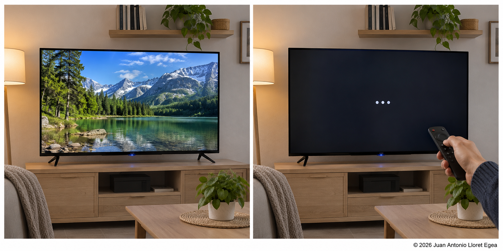
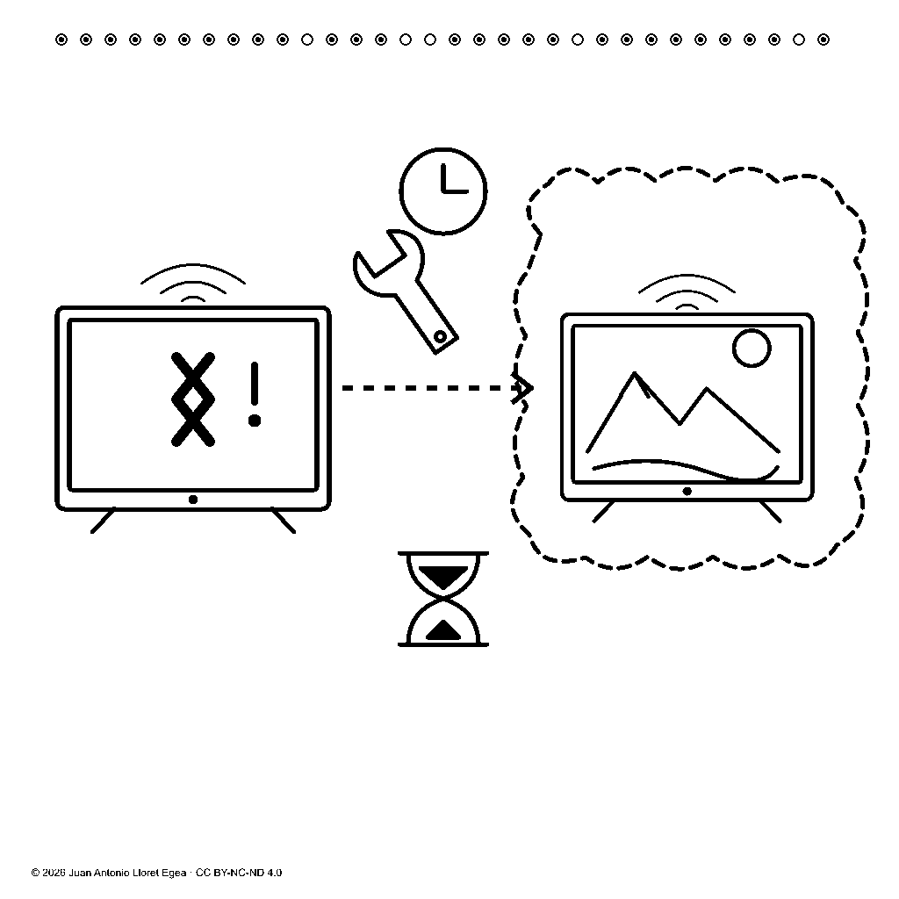

# 7. Ejemplo: funcionamiento y reparación de un televisor

El tratado estudia una televisión inteligente que funcionaba, deja de funcionar y requiere una reparación. La corrupción de su sistema se plantea como hipótesis causal. El caso sirve para examinar cuatro distinciones: estado anterior y presente, observación e hipótesis, intervención pendiente y ejecutada, finalidad y resultado.

<figure id="figura-7-1" class="figura-tratado">

<figcaption class="pie-figura"><strong>Figura 7.1.</strong> Imagen sintética del caso, conservada sin modificar sus muestras. No documenta una avería de un aparato real ni acredita su causa.<small class="autoria-figura">© 2026 Juan Antonio Lloret Egea · Instituto Tecnológico Virtual de la Inteligencia Artificial para el Español (ITVIA) · Creative Commons Atribución-NoComercial-SinDerivadas 4.0 Internacional (CC BY-NC-ND 4.0).</small></figcaption>
</figure>

La imagen completa conserva el potencial de Imagen4 del tratado. Su proyección Atlas, redondeada a doce decimales, es **63,904678214892**. El [desarrollo numérico de Imagen4](https://documentos-sv.itvia.online/investigacion/lenguaje-basado-en-imagenes/calculos/Imagen4.html) permite comprobar las entradas y recuperar el valor exacto. El redondeo sirve para consulta, no para identificación única.

## Lo visible y lo constituido

Los dos paneles muestran apariencias diferentes de una pantalla. El relato constituido añade que se trata del mismo aparato en dos estados relacionados por precedencia. La identificación de Android y la hipótesis de corrupción pertenecen al contenido de referencia; no se deducen de la mera presencia de una pantalla oscura. Esta diferencia evita convertir una ilustración en evidencia de diagnóstico.

El modelo comercial TCL 43T69C se utiliza en la colección de potencial como ejemplo de documentación de un objeto. La figura 7.1 es una escena genérica; no se presenta como fotografía de ese modelo ni como medición de una unidad física. Sus especificaciones comerciales no determinan el estado de un aparato concreto.

## Secuencia de relaciones

| Referencia del tratado | Contenido constituido | Conclusión que no autoriza por sí solo |
|---|---|---|
| S40 | El televisor funcionaba en el estado anterior. | Que seguirá funcionando indefinidamente. |
| S41 | El mismo televisor no funciona en el estado presente. | Una causa técnica determinada. |
| S42 | La corrupción del sistema se propone como hipótesis causal. | Que la corrupción haya sido comprobada. |
| S43 | La reparación es necesaria para recuperar el funcionamiento. | Que la reparación haya ocurrido o haya tenido éxito. |

El [registro del tratado](https://documentos-sv.itvia.online/investigacion/lenguaje-basado-en-imagenes/23-correspondencias.html#suceso-S40) reúne las frases, glifos, células y potenciales del caso. Sus composiciones históricas contienen las limitaciones de reserva allí declaradas. La exposición del ejemplo no las convierte en entradas plenamente conformes de una inteligencia artificial ya realizada.

<figure id="figura-7-2" class="figura-tratado">

<figcaption class="pie-figura"><strong>Figura 7.2.</strong> Glifo de referencia S43. Su propuesta visual distingue intervención pendiente y recuperación pretendida. La interpretación requiere contraste; el glifo no acredita una reparación real.<small class="autoria-figura">© 2026 Juan Antonio Lloret Egea · Instituto Tecnológico Virtual de la Inteligencia Artificial para el Español (ITVIA) · Creative Commons Atribución-NoComercial-SinDerivadas 4.0 Internacional (CC BY-NC-ND 4.0).</small></figcaption>
</figure>

La figura 7.2 conserva su [célula y potencial exacto de referencia](https://documentos-sv.itvia.online/investigacion/lenguaje-basado-en-imagenes/23-correspondencias.html#suceso-S43). Es otra representación digital y no recibe el potencial de la imagen completa. Las figuras son las mismas muestras utilizadas en el tratado; sus pies pertenecen a la presentación editorial.

## Pregunta, operación y respuesta

Ante «¿ya está reparado?», el procedimiento debe identificar que la pregunta se refiere a la ejecución de la intervención sobre ese televisor. El estado S43 sólo aporta necesidad y finalidad. No permite responder afirmativamente ni negar que la reparación haya podido realizarse fuera de lo documentado. Una expresión fiel sería: «La reparación figura como pendiente en el caso; no hay una observación posterior que acredite su ejecución».

Ante «¿qué se pretende con la reparación?», la finalidad constituida permite responder: «Recuperar el funcionamiento del televisor». Las palabras pueden variar, pero no debe transformarse la finalidad en un resultado alcanzado.

Para responder que el aparato vuelve a funcionar sería necesaria otra observación constituida con sus propias correspondencias. Su incorporación añadiría un suceso y conservaría los anteriores. Este es el tipo de transición que el sistema debe poder justificar visual y matemáticamente.

<!-- © 2026 Juan Antonio Lloret Egea. CC BY-NC-ND 4.0. Publicación de arquitectura: https://doi.org/10.21428/39829d0b.0481eae3. Artículo fundacional del LBI: https://doi.org/10.21428/39829d0b.8b9c0155. -->
