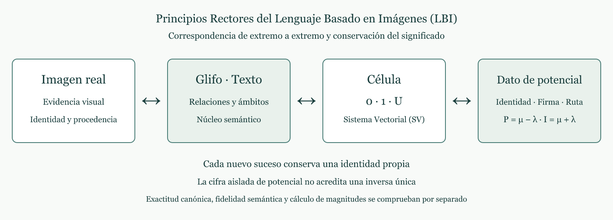
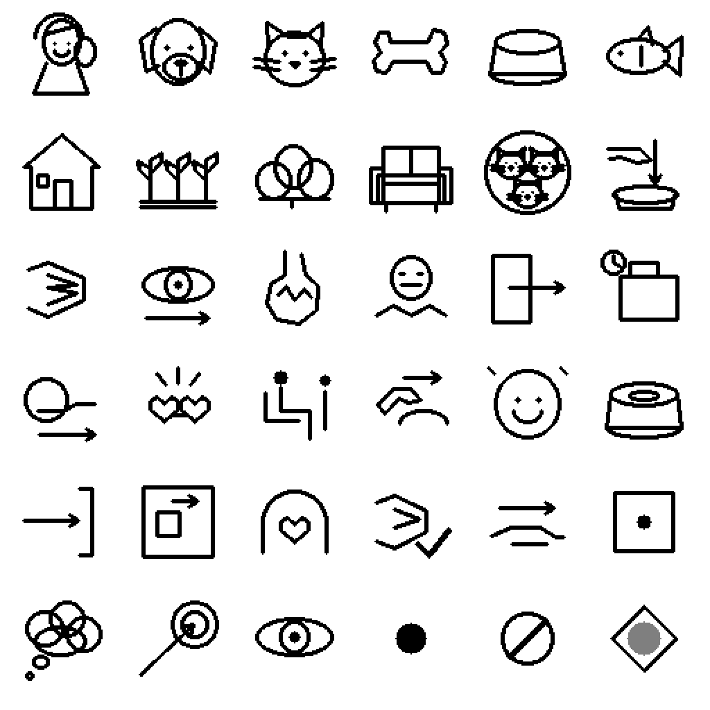
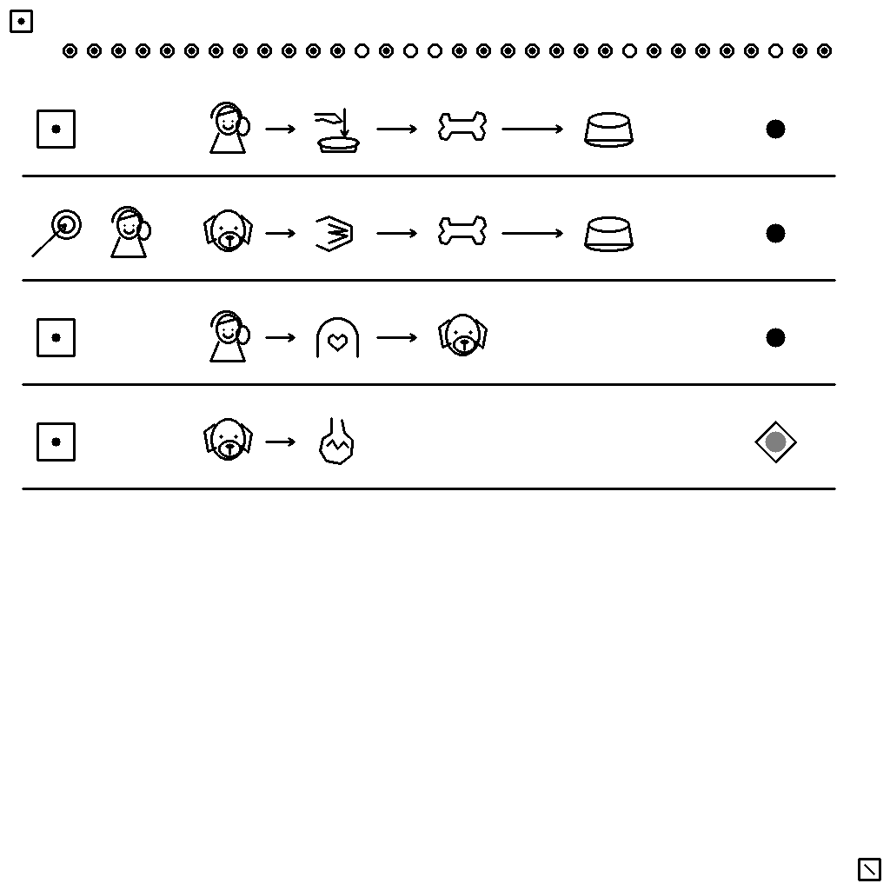
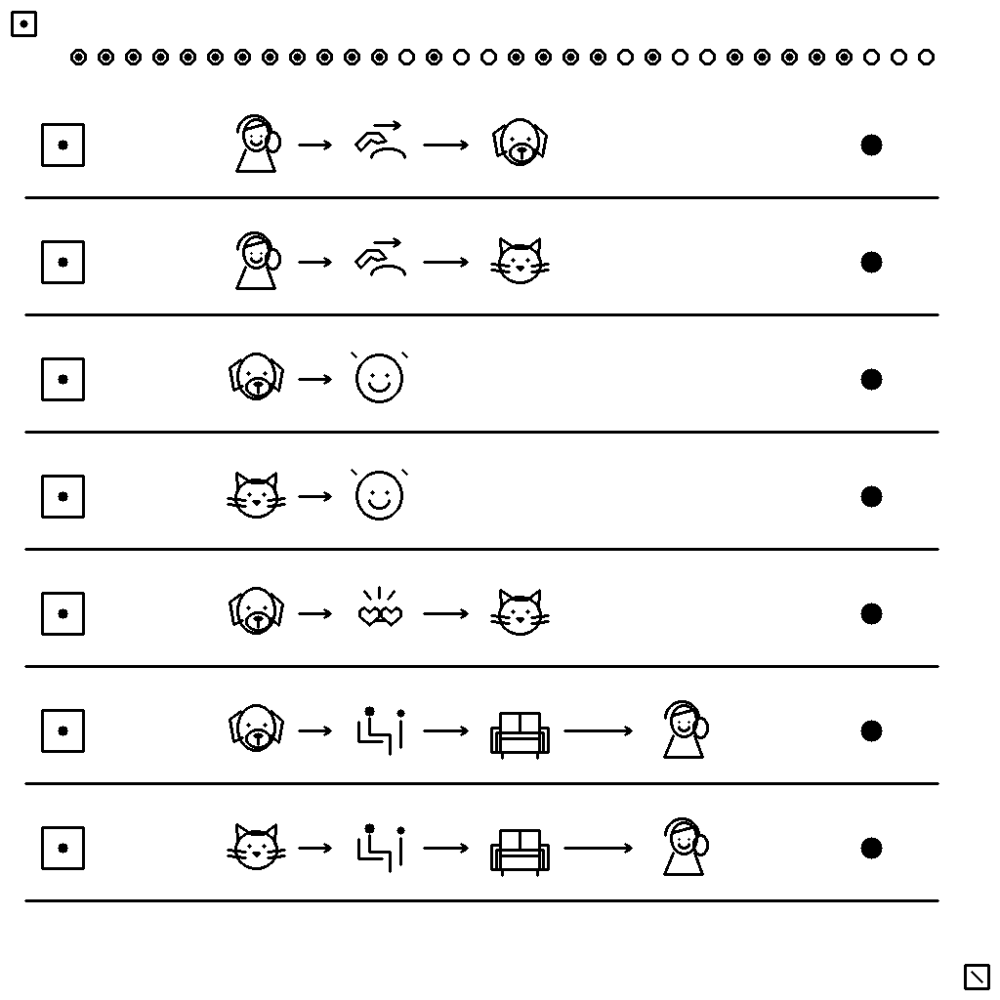
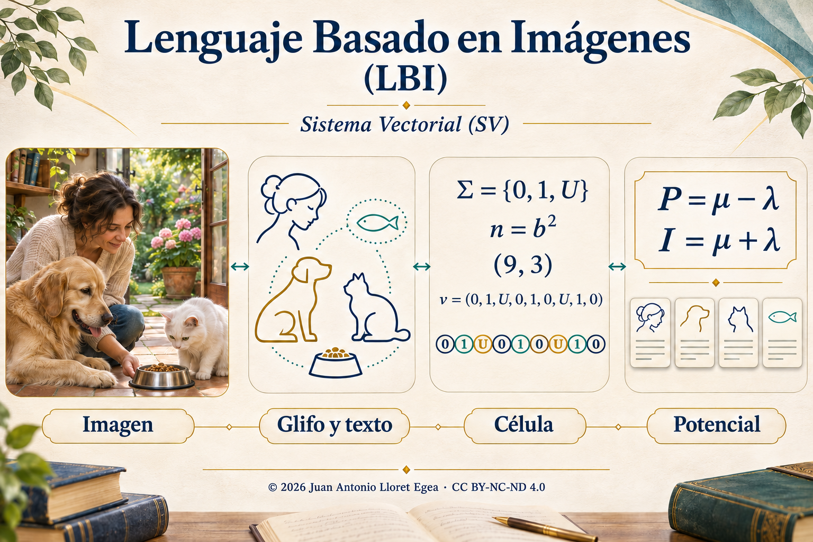

# Lenguaje Basado en Imágenes (LBI): representación trazable y conservación semántica en el Sistema Vectorial (SV)

**Juan Antonio Lloret Egea**

Publicación académica · Edición 1 · 5 de noviembre de 2026. Identificador de objeto digital (DOI): <a href="https://doi.org/10.21428/39829d0b.8b9c0155" target="_blank" rel="noopener noreferrer">10.21428/39829d0b.8b9c0155</a>.

© 2026 Juan Antonio Lloret Egea. Algunos derechos reservados. Open Researcher and Contributor ID (ORCID): [0000-0002-6634-3351](https://orcid.org/0000-0002-6634-3351). Instituto Tecnológico Virtual de la Inteligencia Artificial para el Español™ (ITVIA). IA eñ™ – La Biblia de la IA™. Número Internacional Normalizado de Publicaciones Seriadas (ISSN): 2695-6411.

Licencia [Creative Commons Atribución-NoComercial-SinDerivadas 4.0 Internacional (CC BY-NC-ND 4.0)](https://creativecommons.org/licenses/by-nc-nd/4.0/deed.es) para los contenidos propios de esta versión. Los materiales de terceros conservan sus derechos y condiciones.

**Versión - V · 5 de noviembre de 2026.**

Tratado de referencia: <a href="https://documentos-sv.itvia.online/investigacion/lenguaje-basado-en-imagenes/" target="_blank" rel="noopener noreferrer"><em>Tratado Lenguaje Basado en Imágenes (LBI) - Imagen real ↔ (glifo, texto) ↔ Célula del Sistema Vectorial (SV) ↔ Potencial de un frame del Sistema Vectorial (SV)</em></a>.

## Resumen

Se presenta una propuesta de Lenguaje Basado en Imágenes (LBI) que investiga la conservación del contenido nuclear de una escena a través de cuatro componentes vinculados: imagen real, representación mediante glifo y texto, célula del Sistema Vectorial (SV) y dato de potencial del suceso. La propuesta distingue identidad del acontecimiento, contenido semántico y representación material. Se estudia un repertorio de treinta y seis signos y un caso narrativo de once *frames* con veintiocho relaciones. El conjunto experimental conserva setenta y cuatro vectores, con 834 posiciones de las cuales 832 son informativas. La recuperación comprobada se limita a las representaciones canónicas y al conjunto examinado; no demuestra una biyección general sobre fotografías. Una exploración de comprensión muestra ambigüedades en finalidad, temporalidad, negación, consumo y atribución del pensamiento. Se identifican además dos posiciones reservadas cuya conformidad requiere resolución. Se establecen las condiciones que deberá satisfacer el retorno exacto o con pérdida, y se precisa por qué el potencial numérico aislado no constituye un identificador universal. Se describe la organización matricial y tensorial del conjunto, su tratamiento local y una vía de traducción visual hacia el Lenguaje de Computación del Sistema Vectorial. El trabajo delimita una metodología verificable; la comprensión independiente del idioma, la conversión fotográfica general y la programación visual completa permanecen como objetivos de investigación.

**Palabras clave:** representación visual; fidelidad semántica; transducción ternaria; identidad de sucesos; parámetros críticos; reconstrucción; potencial matemático.

## 1. Problema y alcance

En este artículo, el Sistema Vectorial (SV) designa un marco de representación mediante parámetros ordenados con tres estados posibles, una definición explícita de su significado y un registro de sucesos que incorpora nuevas inscripciones sin sustituir las anteriores. Esta última propiedad se denomina conservación por adición. El nombre del marco identifica la procedencia de las reglas; su validez en el presente estudio depende de las definiciones y de los contrastes que se exponen a continuación.

Se llama imagen real a una captura de una escena del mundo con procedencia documentada; imagen sintética, a una escena generada; glifo, a una representación gráfica cuyo significado se fija mediante una convención; y contenido nuclear, al conjunto de participantes, relaciones, estados y distinciones cuya conservación se exige para una tarea. Por ejemplo, cambiar la textura del plato puede ser admisible; convertir al receptor del alimento en quien lo entrega cambia la relación. La capa textual expresa ese mismo contenido en lenguaje natural. Ninguna de estas definiciones supone que el lenguaje interior del observador pueda conocerse a partir de su respuesta.

Reconocer un perro en una imagen no exige leer su denominación en un idioma particular. Sin embargo, reconocer referentes no equivale a comprender quién realiza una acción, quién recibe sus efectos, qué ocurrió antes o qué resultado se pretendía. Una misma imagen puede sustentar interpretaciones distintas. La investigación debe determinar qué distinciones visuales permiten conservar esas relaciones y cuáles necesitan una convención explícita.

El objetivo es que una expresión visual permita recuperar un contenido nuclear comparable al que expresaría una frase o un párrafo, aunque cambien el idioma, la sintaxis o los detalles no esenciales de la prosa. Este objetivo no se considera demostrado por la mera presencia de figuras reconocibles. Tampoco se presupone que una imagen contenga de forma inequívoca estados internos, intenciones o relaciones temporales.

La directriz de la propuesta es:

**Imagen real ↔ (glifo, texto) ↔ Célula del Sistema Vectorial (SV) ↔ Potencial de un *frame* del Sistema Vectorial (SV).**

Las flechas indican obligaciones de correspondencia y retorno. No afirman que todas esas transformaciones estén ya realizadas. La Figura 1 representa el recorrido; las secciones siguientes distinguen la especificación, las comprobaciones disponibles y las condiciones aún pendientes.

<figure>

<figcaption><strong>Figura 1.</strong> Recorrido rector de la investigación. El cuarto componente comprende el dato completo de potencial, con identidad, contexto y condiciones de interpretación; una cifra separada de ese registro no garantiza el retorno. Fuente: tratado, figura 3.1. © 2026 Juan Antonio Lloret Egea. Licencia Creative Commons Atribución-NoComercial-SinDerivadas 4.0 Internacional. Versión en formato vectorial: <a href="../src/imagenes/03-01-recorrido.svg" target="_blank" rel="noopener noreferrer">figura 1</a>.</figcaption>
</figure>

## 2. Fundamento formal y distinciones necesarias

| Símbolo | Definición en este artículo |
| --- | --- |
| Σ={0,1,U} | Alfabeto de estados; U designa indeterminación bajo una cuestión definida. |
| b, n=b² | b es un entero mayor o igual que tres; n es el número de parámetros de una célula. |
| v=(v₁,…,vₙ) | Secuencia ordenada de estados, con vᵢ∈Σ. |
| Γ | Constitución: preguntas, orden, dominio, evidencias admisibles, interpretación y reglas. |
| C, Ican | Composiciones admitidas e imágenes canónicas bajo una misma constitución. |
| R, D | Representación de una composición y recuperación desde su imagen canónica. |
| K, N₀, N₁ | Conjunto de posiciones críticas y cantidades de calificaciones 0 y 1. |
| μ, λ, P, Ipol | Polos, potencial como diferencia e intensidad como suma. |

### 2.1. Célula, constitución y significado

Una célula de la familia considerada tiene n=b² posiciones ordenadas, con b entero y b≥3. Cada posición toma un valor del alfabeto Σ={0,1,U}. La notación (n,b), por ejemplo (9,3), expresa esta dimensión; no obliga a disponer los parámetros en una cuadrícula. El conjunto Σⁿ contiene 3ⁿ configuraciones. Esta descripción no convierte automáticamente Σⁿ en un espacio vectorial sobre un cuerpo: cualquier estructura adicional requiere operaciones definidas y comprobación de sus axiomas.

La constitución fija la identidad, el orden y la cuestión asociada a cada parámetro, así como el dominio, la interpretación de sus valores y las reglas aplicables. Una palabra o una explicación no ocupa una posición ternaria. El significado procede de la constitución y de las relaciones declaradas. La especificación de paridad entre célula e imagen exige conservar conjuntamente instancia, estado, contrato y representación [1]. Una célula se interpreta, por tanto, como el par (Γ,v), no mediante v aislado. En una evaluación, 0 significa que se satisface la condición, 1 que se incumple y U que no queda determinada. En una representación narrativa puede constituirse otra cuestión: 0 afirma una relación, 1 la niega y U deja su estado sin determinar. Una negación correctamente representada puede recibir calificación 0 en la evaluación. Son cuestiones diferentes y no deben compartir una interpretación implícita.

En el repertorio experimental, un campo expresa si una relación se afirma, se niega o queda indeterminada; otros campos seleccionan referentes y relaciones. La recuperación de esta codificación no acredita por sí sola que todos sus campos satisfagan el contrato semántico de una célula. Esa correspondencia debe establecerse posición por posición, sin trasladar silenciosamente una convención informática a una regla del Sistema Vectorial (SV).

### 2.2. Suceso, contenido e identidad

Se denomina *frame* a una unidad que vincula un estado matemático con su representación visual conforme a una misma constitución e identidad de suceso. Para describir el caso, su contenido se organiza en relaciones con participantes ordenados, ámbito, perspectiva y estado. El ámbito distingue un hecho físico de un pensamiento, una percepción o una finalidad; la perspectiva identifica a quién se atribuye el contenido cuando es necesario. Esta organización es una descripción semántica, no una definición algebraica adicional de la célula.

Así, «la dueña deposita el hueso en el plato» asigna los papeles agente, objeto y recipiente. «Para que el perro lo consuma» añade una relación en el ámbito de finalidad. La segunda relación no prueba que el consumo haya ocurrido: ese hecho exige una aparición posterior constituida. Del mismo modo, representar que el gato piensa en pescado no introduce un pescado físico en el lugar.

Dos acontecimientos pueden presentar el mismo contenido visual y seguir siendo sucesos distintos. Por ello, la conservación se realiza mediante nuevas inscripciones con identidad propia. La repetición de una escena no autoriza a sustituir la inscripción anterior. También deben distinguirse el individuo persistente y cada estado de su trayectoria: el perro que recoge el pescado y el perro que lo deposita mantienen su referente, pero participan en acontecimientos diferentes.

### 2.3. Biyección, equivalencia y recuperación documental

Sean C las composiciones admitidas bajo una constitución fija, Ican las imágenes canónicas, R:C→Ican la representación y D:Ican→C su recuperación. Una biyección exige demostrar D(R(c))=c para todo c∈C y R(D(i))=i para todo i∈Ican. Comprobar esas igualdades en un conjunto finito aporta evidencia de ese conjunto; no sustituye una demostración sobre todo el dominio.

La primera identidad implica que R es inyectiva: si R(c₁)=R(c₂), aplicar D a ambos miembros da c₁=c₂. La segunda garantiza que ninguna imagen admitida queda fuera de la representación. Es una consecuencia elemental de las definiciones, no una demostración de que el procedimiento experimental satisfaga ambas identidades en todos los casos.

Una célula finita tampoco puede distinguir por sí sola más de 3ⁿ entradas. Si la cantidad de imágenes originales admisibles supera esa cifra, su codificación inyectiva en una única célula de dimensión n es imposible. Se necesitan composiciones de células, una restricción explícita del dominio o información adicional. El repertorio común cuenta como información disponible para la reconstrucción.

La reducción semántica de una fotografía suele omitir información. Si dos fotografías diferentes se asignan a una misma descripción nuclear, esa asignación no es inyectiva sobre los originales. Cabe definir una equivalencia semántica o conservar datos adicionales suficientes para el retorno exacto. Formalmente, si SΓ(x) extrae las distinciones exigidas de una imagen x, puede definirse x∼Γy cuando SΓ(x)=SΓ(y). Un retorno que conserva esa equivalencia recupera una clase semántica, no necesariamente el archivo original. Debe declararse cuál de esas obligaciones se adopta.

Localizar una imagen conservada mediante su identificador es recuperación documental. Reconstruir sus muestras a partir de una representación es una operación diferente. Una huella permite contrastar un archivo disponible, pero no contiene por sí sola la información necesaria para reconstruirlo. La misma distinción se aplica al dato de potencial.

### 2.4. Expresión verbal, idioma y reconstrucción

Una expresión verbal puede variar sin modificar su contenido nuclear. Para formalizar esta libertad, sean L una lengua y sΓ,L(t) la interpretación admitida de un texto t bajo la constitución Γ. Dos textos, incluso en lenguas diferentes, son equivalentes para la tarea cuando recuperan los mismos referentes, relaciones, estados y distinciones críticas. No se exige igualdad de palabras, longitud o estilo. Se exige que una afirmación no se convierta en negación, una finalidad en hecho consumado o un receptor en agente. Si el texto admite varias interpretaciones nucleares incompatibles, su retorno no queda determinado.

La unicidad concierne al contenido constituido y a la identidad del suceso. «El perro come» puede describir innumerables acontecimientos: por sí sola, esa frase no identifica uno de ellos. La reconstrucción desde la cadena textual requiere una identificación unívoca del suceso y acceso a su constitución, además del contenido suficiente para el grado de fidelidad exigido. Cuando esa información se aporta mediante referencias, forma parte de la representación completa. Si se exige recuperar el archivo original, también debe conservarse la información necesaria para esa recuperación. La libertad de la prosa se modela así mediante clases de expresiones equivalentes, sin confundirlas con una biyección entre todas las cadenas de caracteres y todas las imágenes.

Estas condiciones permiten formular una obligación común para las cuatro entradas de la cadena: cada representación admitida debe resolver un mismo registro completo y hacer explícito qué puede reconstruir. Una traducción, un cambio de glifo o una captura degradada se aceptan después de comprobar esa correspondencia. La conservación del significado es una propiedad que debe contrastarse, no una consecuencia automática de producir un texto fluido.

## 3. Entrada desde una imagen y pérdida admisible

### 3.1. Captura y transducción

La especificación de transducción al alfabeto ternario distingue el procedimiento de captura, el objeto observado, su admisibilidad y el transductor [2]. Para el dominio visual, ello exige documentar la imagen obtenida, las condiciones que permiten utilizarla, la observación pertinente para cada parámetro y el criterio que determina su valor ternario. Una captura y su interpretación no son la misma operación. Para un parámetro j, sea Oⱼ el conjunto de observaciones admisibles. La regla τⱼ:Oⱼ→Σ debe asignar exactamente un estado a cada observación admitida mediante criterios que no se solapen. Por ejemplo, una observación suficiente de un recipiente puede apoyar la afirmación o la negación de «contiene alimento»; una oclusión puede impedir decidirlo si así lo contempla la constitución. El ejemplo ilustra la estructura de la regla y no aporta por sí mismo un detector de objetos.

Los fallos del instrumento deben conservar su diagnóstico. Su eventual proyección a U necesita una política previa y explícita del dominio; no puede utilizarse U para ocultar un archivo ausente, un dato inválido o una conversión no realizada. La información no cubierta por la interfaz tampoco puede declararse conocida por conveniencia.

### 3.2. Parámetros críticos

La criticidad depende del contenido que debe conservarse. Si la cuestión es reconocer una escena volcánica, determinados cambios de vegetación o iluminación pueden resultar secundarios, mientras que eliminar la estructura relevante del volcán puede impedir la interpretación requerida. Si la cuestión cambia, también puede cambiar qué información es crítica. El antecedente documental del volcán desarrolla esta dependencia del significado [3].

<figure>

<figcaption><strong>Figura 2.</strong> Escena volcánica generada para explicar la selección de información pertinente. Es una ilustración sintética, no una fotografía ni un resultado experimental de reconocimiento. Fuente: tratado, figura 6.1. © 2026 Juan Antonio Lloret Egea. Licencia Creative Commons Atribución-NoComercial-SinDerivadas 4.0 Internacional. Versión en formato vectorial: <a href="../src/formatos/06-nueva-01-escena-completa.svg" target="_blank" rel="noopener noreferrer">figura 2</a>.</figcaption>
</figure>

<figure>

<figcaption><strong>Figura 3.</strong> Variante de relieve cerrado utilizada para discutir la pérdida de información nuclear. Las figuras 2 y 3 no constituyen una intervención controlada sobre un único atributo; sus diferencias tienen función explicativa. Fuente: tratado, figura 6.6. © 2026 Juan Antonio Lloret Egea. Licencia Creative Commons Atribución-NoComercial-SinDerivadas 4.0 Internacional. Versión en formato vectorial: <a href="../src/formatos/06-nueva-06-relieve-cerrado.svg" target="_blank" rel="noopener noreferrer">figura 3</a>.</figcaption>
</figure>

Una reconstrucción con pérdida exige una edición previa de la evaluación: preguntas P1–Pn, n=b², significado de cada posición, clave, criticidades y regla aplicable. La regla documentada utiliza T(n)=⌊7n/9⌋ [8, §5.2]. Para un vector completo de calificaciones, la clasificación es No apto si N₁≥T(n), Apto si N₀≥T(n), e Indeterminado en los demás casos. Aquí N₀ y N₁ cuentan las posiciones calificadas 0 y 1; ⌊·⌋ indica la parte entera inferior. Por ejemplo, T(9)=7 y T(16)=12. Sea K⊆{1,…,n} el conjunto de parámetros críticos, fijado antes del contraste. La admisión de una reconstrucción requiere tanto N₀≥T(n) como vⱼ=0 para todo j∈K. La criticidad contractual se conserva separada: un error crítico impide la aptitud, y una indeterminación crítica no permite declararla [4]. Esta regla es el criterio adoptado del marco documental; no es una estimación estadística de probabilidad de comprensión.

En una evaluación de dieciséis parámetros, doce satisfacciones pueden alcanzar el umbral; si una de las cuatro posiciones restantes altera un parámetro crítico, la reconstrucción no es admisible. Una indeterminación crítica exige resolver la información insuficiente antes de declarar la aptitud. No se interpreta el umbral como permiso para perder una fracción fija de píxeles.

La fidelidad semántica no se sustituye por una medida global de parecido visual. Una alteración pequeña en el conjunto de píxeles podría cambiar un participante, una negación o el destinatario de una acción. Del mismo modo, añadir detalles estéticos no compensa la pérdida de una relación crítica.

## 4. Material y método del caso exploratorio

### 4.1. Material y constitución del caso

El caso describe una secuencia con una dueña, un perro, un gato blanco, un hueso, un pescado y varios lugares. La dueña deposita el hueso con una finalidad; el perro lo consume; el gato encuentra el plato vacío; después el perro recupera un pescado y lo entrega al gato. El desenlace expresa amistad, compañía, alegría y caricias. Los contenidos atribuidos al pensamiento del gato se mantienen como pensamiento del personaje, sin elevarlos a afirmaciones zoológicas universales.

El repertorio comprende once figuras referenciales, dieciocho relaciones, cuatro ámbitos y tres estados: treinta y seis signos. Se conserva además una plantilla blanca para emplazamientos sin argumento aplicable. La gramática ordena ámbito, perspectiva cuando corresponda, participantes, relación y estado. Los papeles se interpretan conforme a la relación: agente, alimento y recipiente no son intercambiables.

<figure>

<figcaption><strong>Figura 4.</strong> Repertorio experimental de treinta y seis signos. La existencia de una leyenda permite interpretar el contrato, pero no demuestra comprensión espontánea del repertorio. Fuente: tratado, figura 8.1. © 2026 Juan Antonio Lloret Egea. Licencia Creative Commons Atribución-NoComercial-SinDerivadas 4.0 Internacional. Versión en formato vectorial: <a href="../src/formatos/08-01-repertorio.svg" target="_blank" rel="noopener noreferrer">figura 4</a>.</figcaption>
</figure>

El lienzo lógico contiene 1024×1024 muestras. La cabecera visual registra serie, ordinal y número de relaciones. La recuperación canónica utiliza las plantillas y su disposición en la imagen; el contrato incluye el repertorio compartido. La afirmación de que no se consulta un vector oculto en los metadatos no significa ausencia de una gramática o de una base de plantillas.

| *Frame* | Contenido nuclear constituido |
| --- | --- |
| 1 | Depósito del hueso por la dueña y finalidad de consumo. |
| 2 | Consumo concluido del hueso por el perro. |
| 3 | Llegada y hambre del gato. |
| 4 | Mirada del gato hacia el plato. |
| 5 | Vacío del plato y percepción atribuida al gato. |
| 6 | Pensamiento del gato sobre huesos y pescado. |
| 7 | Salida del perro al jardín y almacenamiento previo del pescado. |
| 8 | Recogida del pescado con la boca. |
| 9 | Depósito del pescado en el plato y destinatario. |
| 10 | Consumo concluido del pescado por el gato. |
| 11 | Amistad, compañía, alegría y caricias. |

La tabla resume el caso para su discusión. No sustituye las relaciones, los ámbitos ni los vectores publicados en el tratado. El último *frame* reúne relaciones concurrentes y no impone por sí solo una sucesión interna entre postura, caricias y alegría.

<figure>

<figcaption><strong>Figura 5.</strong> Primera aparición canónica: depósito y finalidad. Los signos y sus emplazamientos deben interpretarse conforme a la constitución, no como una fotografía de la escena. Fuente: tratado, figura 9.1. © 2026 Juan Antonio Lloret Egea. Licencia Creative Commons Atribución-NoComercial-SinDerivadas 4.0 Internacional. Versión en formato vectorial: <a href="../src/formatos/09-01-frame.svg" target="_blank" rel="noopener noreferrer">figura 5</a>.</figcaption>
</figure>

<figure>

<figcaption><strong>Figura 6.</strong> Aparición final: amistad, compañía, alegría y caricias. La expresión de varios predicados permite distinguir sus participantes y estados, aunque no garantiza que un observador sin clave los reconozca correctamente. Fuente: tratado, figura 9.11. © 2026 Juan Antonio Lloret Egea. Licencia Creative Commons Atribución-NoComercial-SinDerivadas 4.0 Internacional. Versión en formato vectorial: <a href="../src/formatos/09-11-frame.svg" target="_blank" rel="noopener noreferrer">figura 6</a>.</figcaption>
</figure>

### 4.2. Procedimiento de contraste

La comprobación distingue dos objetos: conservación de la representación y comprensión de las relaciones. Para el primero se cotejan las identidades, la longitud y el orden de los vectores, su representación canónica y su recuperación. La igualdad se exige componente a componente; la mera coincidencia del número total de estados no basta. La correspondencia de un mismo contenido con dos identidades distintas se comprueba por separado.

Para el segundo se realizó una exploración con un único candidato, un sistema conversacional en línea. Se presentaron las once láminas sin la frase de origen ni la clave; se solicitó interpretación libre y propuesta de orden, después preguntas dirigidas y finalmente una valoración del repertorio. El orden de las etapas se conservó para distinguir la lectura inicial de la interpretación tras exposición adicional. No se efectuó una comparación controlada entre modelos, personas o idiomas.

La unidad de contraste semántico fue cada una de las veintiocho relaciones constituidas. La evaluación distinguió recuperación completa, parcial, incompatible y ausencia de recuperación. En términos operativos, la recuperación completa conserva la relación y sus argumentos pertinentes; la parcial identifica algún elemento sin reconstruir el conjunto; la incompatibilidad altera una distinción requerida; y la ausencia no proporciona una lectura atribuible a la relación. La cautela modal se conserva: una propuesta expresada como posibilidad no se transforma en una afirmación firme del candidato. No se calculó concordancia entre evaluadores independientes ni un dictamen global de aptitud.

La precedencia se examinó sobre los 55 pares posibles de once apariciones, distinguiendo decisiones confirmadas e hipótesis. La valoración posterior de los signos midió claridad declarada, no exactitud independiente. Las respuestas se produjeron en español; la independencia respecto del idioma es una hipótesis que este diseño no permite contrastar.

## 5. Resultados del caso exploratorio

### 5.1. Conservación y economía

Las once apariciones comprenden veintiocho relaciones y setenta y cuatro vectores: cincuenta de nueve posiciones y veinticuatro de dieciséis. Su capacidad total es 834, frente a 832 posiciones informativas. Las dos reservas se encuentran en los *frames* 3 y 5. Se conservan como evidencia del prototipo, pero requieren resolución antes de afirmar conformidad celular integral. El criterio de economía utilizado no autoriza a introducir posiciones de conveniencia.

La base gráfica compartida representa 59 521 posiciones en la codificación conservada; junto con la historia suma 60 355. Esta cifra no incluye todo el coste de la gramática ni de su documentación. La comparación de economías deberá declarar siempre qué información se conserva en la célula, en un repertorio común o en datos auxiliares.

La revisión recuperó exactamente los 74 vectores desde una disposición multidimensional indexada por *frame*, célula y posición. Esta organización distingue las posiciones celulares existentes de los emplazamientos auxiliares utilizados para ordenar los datos; estos últimos no son parámetros ni valores U. Se comprobó asimismo que dos identidades distintas pueden conservar el mismo contenido y que un conflicto de identidad impide incorporar el conjunto de inscripciones examinado. Esas comprobaciones no acreditan inmutabilidad física de cualquier archivo ni equivalencia semántica universal.

### 5.2. Comprensión del repertorio

La exploración conservó cuatro etapas: lectura libre, propuesta de orden, preguntas dirigidas y revisión del atlas. El candidato recibió inicialmente las láminas sin el relato ni la clave. La comparación de las dos primeras etapas con las veintiocho relaciones obtuvo una lectura completa expresada como posibilidad, quince recuperaciones parciales, dos propuestas incompatibles y diez relaciones no recuperadas. Estas categorías no son valores de la terna ni una clasificación agregada de aptitud.

La ordenación no produjo una secuencia firme. Los cincuenta y cinco pares de precedencia quedaron sin decisión confirmada. De cinco hipótesis de baja confianza, dos coincidían con la clave y tres invertían relaciones. La ausencia de decisión no debe presentarse como una tasa del cien por cien de error.

En la revisión posterior del atlas se declararon doce signos claros, veintidós ambiguos y dos no interpretables. Estas declaraciones describen la claridad percibida por un candidato con exposición previa; no son treinta y seis observaciones independientes ni una estimación de comprensión poblacional. La comparación completa de las dos últimas etapas con la clave continúa pendiente.

Las confusiones prioritarias afectan al vacío del plato, el consumo concluido, la finalidad, la atribución del pensamiento, los papeles de las flechas, la representación de una clase y la anterioridad. La siguiente revisión debe contrastar variantes discriminantes y conservar cada versión, evitando cambiar simultáneamente todos los signos.

## 6. Potencial e individuación

### 6.1. Magnitud, identidad y dato completo

Las formulaciones básicas son P=μ−λ e Ipol=μ+λ. Se escribe Ipol para distinguir la intensidad polar del conjunto de imágenes canónicas; la fuente utiliza I para esa intensidad. μ y λ son las magnitudes de los dos polos de la representación; P expresa su diferencia orientada e Ipol su suma. No representan directamente categorías como perro, gato o alimento. Su aplicación exige definir qué observación visual mide cada polo y con qué escala y orientación. La norma de individuación distingue base común, firma singular, diferencial, proyección de ruta, residual y dictamen; precisa que el potencial individual no sustituye al identificador [5].

Sobre una base polar igualada, la fuente utiliza μⱼ=μᴱ⁰+δⱼ/2 y λⱼ=λᴱ⁰−δⱼ/2. En esta expresión, μᴱ⁰ y λᴱ⁰ son los polos de la base, y δⱼ es el diferencial del individuo j obtenido mediante una proyección declarada de sus características. Con base μᴱ⁰=λᴱ⁰=47, el diferencial +1,20 produce (μⱼ,λⱼ)=(47,60;46,40), P=1,20 e Ipol=94; el diferencial −0,60 produce (46,70;47,30), P=−0,60 e Ipol=94. Son ejemplos sintéticos de la fuente que permiten comprobar las operaciones. No son mediciones del perro, del gato o de las imágenes del estudio.

La formulación del potencial del suceso establece expresamente que sucesos diferentes pueden compartir potencial sin confundirse como acontecimientos [9, §§III.8 y IV.1]. Los pares polares (7,2) y (9,4) producen exactamente P=5. Aumentar el número de decimales no elimina esa igualdad. Incluso una pareja de potencial e intensidad puede repetirse en dos sucesos distintos. Por ello, el retorno debe apoyarse en el dato completo de potencial y en las correspondencias constituidas, no en una supuesta unicidad espontánea del escalar.

Los once *frames* tienen registros de potencial vinculados, pero no magnitudes visuales calculadas: falta constituir la proyección que obtiene los polos o el diferencial desde observaciones del dominio. Un cálculo pendiente no se sustituye por cero ni por U. Si se exige una proyección escalar inyectiva, deberán definirse su dominio y su regla, y demostrarse esa propiedad.

### 6.2. Conjuntos equipotenciales y recorridos

Una vez constituido un dominio D y una función de potencial PD:D→ℝ, puede definirse el conjunto de nivel Ep={x∈D:PD(x)=p}. Si contiene varios elementos, la cifra p no identifica por sí sola uno de ellos. Si PD es inyectiva, cada conjunto de nivel contiene como máximo un elemento. Estas consecuencias de la definición explican por qué la unicidad escalar absoluta y las superficies equipotenciales no triviales no pueden exigirse simultáneamente al mismo dominio y a la misma función. La identidad de los sucesos se conserva separadamente.

Hablar de superficie exige, además, dotar al dominio de estructura geométrica suficiente. En un dominio abierto de ℝ³, una función continuamente diferenciable con gradiente no nulo sobre un nivel permite describirlo localmente como una superficie, por el teorema de la función implícita [16]. Un conjunto finito de imágenes con etiquetas numéricas no constituye por ese solo hecho una superficie. Tampoco el uso de la palabra potencial atribuye unidades, leyes físicas o fuerzas a la representación.

Un recorrido de sucesos (e₀,…,eₘ) puede asociarse a la secuencia de potenciales (P₀,…,Pₘ), siempre que la escala, la orientación y el dominio permitan compararlos. Las diferencias ΔPᵢ=Pᵢ₊₁−Pᵢ describen cambios entre pasos; su suma es Pₘ−P₀ y no identifica el recorrido intermedio. La investigación podrá estudiar restricciones de paso, regiones de igual valor y búsqueda de recorridos definidos. Para que una máquina interprete ese recorrido deberá disponer también de la constitución y de las correspondencias con imágenes, glifos, textos y células. Esta posibilidad no sustituye la definición pendiente de la proyección visual del potencial.

## 7. Discusión y condiciones de ampliación

### 7.1. Comprensión y alcance multidisciplinar

La propuesta reúne problemas de percepción visual, semiótica, representación del conocimiento, lingüística, lógica, matemáticas y computación. La imagen aporta evidencia perceptible; el glifo hace explícitas las relaciones constituidas; el texto permite expresarlas en una lengua; la célula conserva estados ordenados, y el dato de potencial incorpora una magnitud interpretada dentro de su dominio. El vínculo entre estas funciones permite estudiar un mismo contenido desde disciplinas distintas sin presuponer que reconocer figuras equivalga a comprender toda una escena.

El estudio permite distinguir conservación de información y comprensión. Un programa puede recuperar exactamente un código que un observador no interpreta correctamente; a la inversa, una descripción verbal puede conservar el núcleo de una escena sin permitir reconstruir todos sus píxeles. Una investigación rigurosa debe evaluar ambas propiedades por separado.

Los trabajos de diagnóstico visual aportan antecedentes útiles. *CLEVR: A Diagnostic Dataset for Compositional Language and Elementary Visual Reasoning* estudia capacidades composicionales y sesgos que pueden permitir aciertos sin resolver la relación visual [6]. *GQA: A New Dataset for Real-World Visual Reasoning and Compositional Question Answering* utiliza estructuras de escena y programas de preguntas, y examina consistencia y vinculación con la imagen [7]. Se citan como antecedentes de control experimental, no como demostraciones del Lenguaje Basado en Imágenes (LBI).

La ampliación deberá incorporar fotografías capturadas del mundo, observaciones con procedencia, constituciones sin reservas y pruebas previamente definidas. Los contrastes prioritarios son intercambio de agente y receptor, inversión temporal, finalidad incumplida, negación y diferenciación entre pensamiento y hecho. Para estudiar la independencia del idioma deberán mantenerse constantes las relaciones nucleares y comparar condiciones de comprensión en varias lenguas.

La instrucción de no consultar fuentes externas delimita el procedimiento de la prueba; no acredita por sí sola ausencia de conocimiento previo o de exposición anterior a materiales relacionados. La publicación del caso completo permite inspeccionar sus materiales, pero exige seleccionar posteriormente casos nuevos o controlar la exposición si se pretende evaluar lectura sin clave.

### 7.2. Organización matricial y tensorial

Los mismos datos pueden organizarse como registros de sucesos, tablas, matrices o arreglos multidimensionales sin cambiar las células que representan. En este caso, cincuenta células de nueve posiciones forman una matriz de 50×9, y veinticuatro de dieciséis posiciones forman otra de 24×16. En conjunto conservan 834 posiciones. Una vista tensorial de procesamiento de 11×16×16 dispone de 2816 emplazamientos: 834 corresponden a posiciones celulares y 1982 sirven exclusivamente para igualar las dimensiones de procesamiento. Las identidades del suceso, las células y sus posiciones se conservan mediante correspondencias explícitas.

En este uso computacional, tensor designa un arreglo multidimensional; no se afirma que esos datos satisfagan una ley geométrica de transformación tensorial. Las máscaras de posición distinguen los emplazamientos utilizados de los auxiliares. Otras máscaras identifican las dos reservas entre las 834 posiciones del caso. El relleno auxiliar no es un nuevo parámetro ni un estado U. La representación numérica que almacena U mediante la etiqueta 2 tampoco autoriza a sumar o multiplicar U como si fuese un número. Las operaciones deben definirse sobre la codificación y justificar su correspondencia con la terna.

### 7.3. Computación local y arquitecturas de aceleración

La organización anterior abre la posibilidad de utilizar unidades de procesamiento gráfico (GPU) y unidades de procesamiento tensorial (TPU). Las primeras admiten ejecución paralela de operaciones compatibles; las segundas están orientadas especialmente a operaciones matriciales [10, 11]. Para aprovecharlas se requiere definir operaciones compatibles con sus tipos numéricos, transportar las máscaras y comprobar que sus resultados conservan la semántica. La mera existencia de un tensor no proporciona una ejecución acelerada ni demuestra que resulte ventajosa.

La clasificación discreta, la comprobación de referencias, la conservación de registros y la representación del caso pueden realizarse localmente en un ordenador personal convencional. Las comprobaciones del conjunto aquí descrito se realizaron en un equipo local; sus 834 estados ocupan 834 octetos en la codificación compacta, sin contar imágenes, constituciones y datos auxiliares. El procedimiento explícito no exige entrenar un modelo neuronal ni disponer de un centro de datos como requisito conceptual. La propia formulación algebraica distingue la clasificación por conteos de la elección e interpretación de los parámetros [8, §8.1].

Esta viabilidad local concierne al repertorio finito y a las operaciones examinadas. No establece requisitos mínimos de memoria o tiempo para cualquier dominio ni acredita conversión automática de fotografías arbitrarias. La percepción general, el crecimiento del repertorio o una búsqueda extensa pueden aumentar los recursos necesarios. No se ha medido una ejecución del conversor en aceleradores ni una ventaja de rendimiento frente a otros sistemas.

### 7.4. Programación visual y Lenguaje de Computación del Sistema Vectorial

El Lenguaje Basado en Imágenes puede investigarse también como forma de autoría de programas para el Lenguaje de Computación del Sistema Vectorial. La relación tiene un fundamento concreto: ambos describen células, estados, referencias y relaciones cuya interpretación debe permanecer explícita. Programar visualmente exigiría componer glifos admitidos que determinasen declaraciones y operaciones del lenguaje; el texto explicativo podría variar mientras permaneciese estable esa representación formal. Una escena descriptiva no se convierte automáticamente en una orden de actuación.

El [entorno interactivo del Lenguaje de Computación del Sistema Vectorial](https://lenguaje-sv.itvia.online/) permite examinar esa base [15]. Ofrece perfiles fuente en español e inglés para Sistema Vectorial Poligonal (SVP), denominados SVP-ES y SVP-EN. Ambos se resuelven hacia una gramática común y una representación intermedia (IR, por su denominación inglesa) común. El idioma de la interfaz se gestiona separadamente del perfil del programa; las cadenas, los identificadores y los comentarios del usuario no se traducen automáticamente [13, §12]. Esta equivalencia de perfiles formales no implica admitir cualquier frase en cualquier idioma.

En el contraste realizado el 5 de noviembre de 2026, el ejemplo oficial de célula simple fue admitido en los dos perfiles. Las representaciones obtenidas conservaron los mismos objetos, estados y declaraciones de operación; sólo difirió la huella de la fuente. El resultado acredita esa compilación y su correspondencia en el ejemplo. No acredita que se haya ejecutado la operación declarada, ni que se haya convertido una imagen en un programa.

Para realizar la ampliación visual, sea GΓ el conjunto de composiciones de glifos admitidas y sea A el conjunto de representaciones formales admitidas por el lenguaje. Debe definirse una traducción T:GΓ→A que conserve participantes, estados, ámbito y dependencias. Si ρ extrae esas relaciones de la representación formal y sΓ las determina en la composición visual, la condición ρ(T(g))=sΓ(g) expresa una obligación de conservación. También habrá que contrastar el retorno visual, la identidad de los sucesos y el rechazo de composiciones ambiguas. La admisión de un programa no demuestra por sí sola la veracidad de las observaciones que lo alimentan.

Existe un límite explícito en las especificaciones actuales: la declaración del transductor ternario conserva referencias a un espacio de observación y a sus particiones, pero no ejecuta todavía la producción de estados a partir de observaciones. La gramática 0.2 y la representación intermedia 0.3 exigen constituir y comprobar esa función antes de habilitarla [13, §15; 14, §2.4]. Por tanto, el vínculo completo imagen–glifo–programa es una línea de investigación fundamentada, con obligaciones identificables, y no una funcionalidad visual completa ya demostrada.

La comparación con los modelos de lenguaje de gran tamaño (LLM, por su denominación inglesa) debe distinguir generación y validación. Un modelo entrenado con código puede producir programas candidatos a partir de descripciones; el trabajo de Chen y colaboradores constituye un antecedente de su evaluación mediante corrección funcional [12]. El procedimiento aquí propuesto busca traducir una representación visual constituida hacia objetos formales con correspondencias verificables. Ambos pueden combinarse: un modelo podría proponer una expresión y una comprobación explícita decidir su admisibilidad. No se ha realizado una comparación experimental que permita afirmar superioridad general.

| Aspecto | Generación mediante un modelo de lenguaje | Vía visual propuesta y lenguaje constituido |
| --- | --- | --- |
| Punto de partida | Descripción y contexto a partir de los cuales se propone un programa. | Glifos con relaciones y estados definidos, cuya traducción formal debe especificarse. |
| Producción | Generación aprendida de una secuencia de código. | Traducción explícita hacia declaraciones y operaciones admitidas; integración visual pendiente. |
| Comprobación | El programa producido requiere compilación y evaluación de su corrección. | La compilación comprueba condiciones constituidas; el origen visual y su fidelidad requieren comprobaciones adicionales. |
| Idioma | La equivalencia entre solicitudes en distintas lenguas debe evaluarse. | Se dispone de dos perfiles fuente con representación común; la prosa libre multilingüe sigue requiriendo interpretación y contraste. |
| Alcance de la comparación | Antecedente de generación de programas y evaluación funcional. | Propuesta de conservación verificable entre representaciones, sin resultado comparativo de superioridad. |

La contribución que se investiga amplía la generación verbal con una exigencia de correspondencia entre evidencia visual, relaciones, estados y registro del suceso. Permite formular criterios de rechazo y obligaciones de retorno que no se deducen de la fluidez de una respuesta. Su valor deberá establecerse mediante casos nuevos, criterios comunes y mediciones reproducibles.

## 8. Limitaciones y conclusión

El caso es pequeño, constituido y narrativo. Las escenas de apariencia realista preparadas hasta ahora son sintéticas. La prueba de comprensión no constituye una comparación entre poblaciones o idiomas. La biyección se ha contrastado en ejemplos canónicos, no demostrado para fotografías arbitrarias. La constitución de cada posición, las dos reservas, la validación integral de entradas y la proyección visual del potencial permanecen abiertas.

La contribución actual consiste en un repertorio explícito, un caso trazable, representaciones matriciales y tensoriales y una metodología de contraste que separa igualdad exacta, fidelidad semántica, identidad de suceso y potencial. Se fundamenta además una vía de programación visual apoyada en el Lenguaje de Computación del Sistema Vectorial, delimitando las funciones disponibles y la transducción aún pendiente. La cadena de cuatro componentes se mantiene como obligación de investigación. Su realización completa exige resolver las limitaciones declaradas mediante definiciones, controles de rechazo y evidencia nueva.

## Disponibilidad de materiales

El caso completo, sus figuras, las tablas de relaciones y los vectores se conservan en el [soporte documental público del tratado](https://github.com/IA-en/biblioteca-documental/tree/main/libros/investigacion/lenguaje-basado-en-imagenes). La [edición de lectura](https://documentos-sv.itvia.online/investigacion/lenguaje-basado-en-imagenes/) indica su versión en la portada. La distribución permite inspeccionar las representaciones y sus correspondencias documentadas. No contiene una implementación completa del conversor ni la totalidad de las respuestas originales de comprensión; por ello, la reproducibilidad pública de ambos procedimientos es limitada.

## Bibliografía

Se enlaza el identificador digital de objeto (DOI) de las publicaciones que disponen de él. Las especificaciones técnicas y los documentos complementarios se identifican por su título, versión y enlace de consulta.

[1] Lloret Egea, Juan Antonio. *Célula matemática, imagen y agentes en el Sistema Vectorial SV*. Versión 2, 13 de septiembre de 2026, apartados 2–2.4 y 6. [Documento completo](https://github.com/juantoniolloretegea/SV-lenguaje-de-computacion/blob/ce5aad1125460263904acb91142f33324ce89dfc/docs/calidad/tuberias-ia/paridad-imagen-celula-matematica/CELULA_IMAGEN_Y_AGENTES_EN_EL_SV_P1_P3_BIS_2026_09_13_V2.md).

[2] Lloret Egea, Juan Antonio. *Álgebra de composición intercelular del marco SV — IV. Transducción al alfabeto ternario e interfaz paramétrica del sistema*. Edición 1, 11 de marzo de 2026, apartados 4–6. DOI: [10.21428/39829d0b.5c31d534](https://doi.org/10.21428/39829d0b.5c31d534). [Edición consultada](https://www.itvia.online/pub/algebra-de-composicion-intercelular-del-marco-sv--iv-transduccion-al-alfabeto-ternario-e-interfaz-parametrica-del-sistema/release/1).

[3] *Frame: significado humano, trazabilidad y fidelidad*, 11 de septiembre de 2026. [Documento completo](https://github.com/juantoniolloretegea/SV-lenguaje-de-computacion/blob/ce5aad1125460263904acb91142f33324ce89dfc/docs/calidad/tuberias-ia/frame-significado-humano-trazabilidad-y-fidelidad/FRAME_SIGNIFICADO_HUMANO_TRAZABILIDAD_Y_FIDELIDAD_2026_09_11.md).

[4] *Validación, autorización y puesta en Producción de modelos de Inteligencia Artificial*. [Edición y plantilla previa](https://documentos-sv.itvia.online/evaluacion/validacion-autorizacion-modelos/edicion.html); [corrección y representación](https://documentos-sv.itvia.online/evaluacion/validacion-autorizacion-modelos/correccion.html).

[5] Lloret Egea, Juan Antonio. *Orientación universal y geográfica, potencial del suceso e interfaz de dominio desde el Universo y los seres biológicos: humanoide*. Edición 1, 22 de junio de 2026, apartados 8.9, 8.10 y 11.8. DOI: [10.21428/39829d0b.5e15cabb](https://doi.org/10.21428/39829d0b.5e15cabb). [Edición consultada](https://www.itvia.online/pub/orientacion-universal-y-geografica-potencial-del-suceso-e-interfaz-de-dominio-desde-el-universo-y-los-seres-biologicos-humanoide-sv/release/1).

[6] Johnson, Justin; Hariharan, Bharath; van der Maaten, Laurens; Fei-Fei, Li; Zitnick, C. Lawrence; Girshick, Ross. *CLEVR: A Diagnostic Dataset for Compositional Language and Elementary Visual Reasoning*. Manuscrito de 2016. [Texto y registro bibliográfico](https://arxiv.org/abs/1612.06890).

[7] Hudson, Drew A.; Manning, Christopher D. *GQA: A New Dataset for Real-World Visual Reasoning and Compositional Question Answering*. Versión 3, 2019. [Texto y registro bibliográfico](https://arxiv.org/abs/1902.09506v3).

[8] Lloret Egea, Juan Antonio; Instituto tecnológico virtual IAeñ™. *Fundamentos algebraico-semánticos del Sistema Vectorial SV*. Edición 3, 9 de marzo de 2026, apartados 5.2–5.3 y 8.1. DOI: [10.21428/39829d0b.b0cf9a13](https://doi.org/10.21428/39829d0b.b0cf9a13). [Edición consultada](https://www.itvia.online/pub/fundamentos-algebraico-semanticos-del-sistema-vectorial-sv/release/3).

[9] Lloret Egea, Juan Antonio. *Potencial de un suceso: comunicación estructural en el Universo físico realizado, equipotencialidad, diferencia polar y métrica*. Edición 1, 29 de mayo de 2026, apartados III.8, IV.1 y XVI.2. DOI: [10.21428/39829d0b.f0cbabc2](https://doi.org/10.21428/39829d0b.f0cbabc2). [Edición consultada](https://www.itvia.online/pub/potencial-de-un-suceso-comunicacion-estructural-en-el-universo-fisico-realizado-equipotencialidad-diferencia-polar-y-metrica/release/1).

[10] NVIDIA. *CUDA Programming Guide*, apartado 1.2, «Programming Model». [Documentación oficial](https://docs.nvidia.com/cuda/cuda-programming-guide/01-introduction/programming-model.html). Consulta: 5 de noviembre de 2026.

[11] Google Cloud. *TPU architecture*. [Documentación oficial](https://docs.cloud.google.com/tpu/docs/system-architecture-tpu-vm). Consulta: 5 de noviembre de 2026.

[12] Chen, Mark, y colaboradores. *Evaluating Large Language Models Trained on Code*. Versión 2, 14 de julio de 2021. DOI: [10.48550/arXiv.2107.03374](https://doi.org/10.48550/arXiv.2107.03374). [Texto y registro bibliográfico](https://arxiv.org/abs/2107.03374v2).

[13] Lloret Egea, Juan Antonio. *Gramática superficial mínima del Lenguaje SV — v0.2*. Especificación técnica pública, 23 de agosto de 2026 y ampliaciones, apartados 12 y 15. [Texto de la especificación](https://lectura-sv.itvia.online/lenguaje/?file=GRAMATICA_SUPERFICIAL_MINIMA_SV_v0_2.md). Consulta: 5 de noviembre de 2026.

[14] Lloret Egea, Juan Antonio. *IR canónica y sistema de bienformación del Lenguaje SV — v0.3*. Especificación técnica, apartados 2.4 y 4. [Texto de la especificación](https://lectura-sv.itvia.online/lenguaje/?file=IR_CANONICA_BIENFORMACION_SV_v0_3.md). Consulta: 5 de noviembre de 2026.

[15] Lloret Egea, Juan Antonio. *Lenguaje de Computación SV*. Entorno interactivo: gramática 0.2, representación intermedia 0.3 y proyección 0.1.0. [Editor y ejemplos](https://lenguaje-sv.itvia.online/); [alcance de las métricas publicadas](https://lenguaje-sv.itvia.online/programacion-metricas). Consulta y contraste del ejemplo de célula simple: 5 de noviembre de 2026.

[16] Gressman, Philip. *Advanced Analysis*, «The Implicit Function Theorem». Universidad de Pensilvania. [Exposición del teorema](https://www2.math.upenn.edu/~gressman/analysis/12-implicitfuncthm.html).

## Relación de instrumentos y comunidades

[Rust](https://github.com/rust-lang/rust): lenguaje utilizado en los componentes de organización y contraste. [egui](https://github.com/emilk/egui): biblioteca de referencia para la representación interactiva de células. [redb](https://github.com/cberner/redb): persistencia transaccional del conjunto. [mdBook](https://github.com/rust-lang/mdBook): preparación editorial. [resvg](https://github.com/linebender/resvg), [VTracer](https://github.com/visioncortex/vtracer) e [image](https://github.com/image-rs/image): preparación y contraste de formatos visuales. Estas herramientas conservan sus licencias y no sustituyen las condiciones matemáticas o semánticas del estudio.

## Versión documental y materiales gráficos

La copia del artículo en *Markdown*, sus figuras y la portada se encuentran en el [repositorio documental canónico](https://github.com/IA-en/biblioteca-documental/blob/main/libros/investigacion/lenguaje-basado-en-imagenes/articulo/manuscrito.md). Las figuras se integran en el texto y se conservan en su carpeta de imágenes. La portada es una ilustración conceptual sintética: su vector ternario es un ejemplo formal, no el resultado de convertir la escena que la acompaña.
