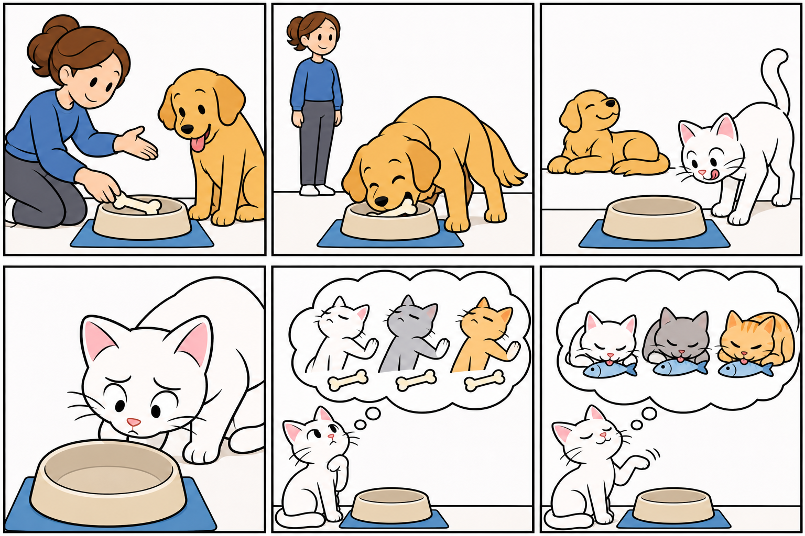

# 1. Percepción visual y conservación del significado

**Juan Antonio Lloret Egea** · <a href="https://orcid.org/0000-0002-6634-3351" target="_blank" rel="noopener noreferrer">Identificador de investigador (ORCID): 0000-0002-6634-3351</a>. Instituto Tecnológico Virtual de la Inteligencia Artificial para el Español (ITVIA).

**Tratado Lenguaje Basado en Imágenes (LBI)** · V.10 · 7 de noviembre de 2026.

Publicación académica vinculada: <a href="https://doi.org/10.21428/39829d0b.8b9c0155" target="_blank" rel="noopener noreferrer">Lenguaje Basado en Imágenes (LBI): representación trazable y conservación semántica en el Sistema Vectorial (SV)</a>. [Autoría y licencia](16-fuentes.md).

Una imagen puede permitir reconocer un animal, un recipiente o un gesto sin leer sus nombres. Comprender una escena exige, además, distinguir las relaciones: quién actúa, sobre qué, con qué destinatario y con qué finalidad. Dos imágenes con los mismos objetos pueden expresar acontecimientos diferentes si se intercambian el agente y el receptor.

El Lenguaje Basado en Imágenes investiga una representación explícita de esas relaciones. La imagen aporta la evidencia perceptiva; el glifo organiza su contenido visual; el texto permite expresarlo en distintas lenguas; la célula conserva estados ternarios ordenados; y el potencial ofrece una representación matemática cuya definición debe permitir comprobar el retorno.

**Imagen real ↔ (glifo, texto) ↔ Célula del Sistema Vectorial (SV) ↔ Potencial de un *frame* del Sistema Vectorial (SV)**

El término *frame* designa la configuración visual y matemática constituida. El acontecimiento físico, su captura y su representación no son objetos intercambiables. Una ilustración sintética puede servir para experimentar, pero no testimonia por sí misma un hecho ocurrido en el mundo.

La cadena expresa las correspondencias que deben constituirse y comprobarse. El retorno exacto de una codificación no garantiza que un observador o un modelo interprete correctamente el glifo, ni que su texto libre conserve el significado. Esa conservación constituye una propiedad distinta, cuya evaluación exige relaciones de referencia explícitas y evidencia de comprensión.

<strong>Desarrollo del razonamiento visual</strong>
El <a href="24-inteligencia-artificial.html">capítulo 21</a> explica la relación con la Inteligencia Artificial del Sistema Vectorial, sus fundamentos y las condiciones de avance entre ambas investigaciones.

<a href="https://documentos-sv.itvia.online/investigacion/inteligencia-artificial-sv/" target="_blank" rel="noopener noreferrer">Abrir el libro independiente de la Inteligencia Artificial del Sistema Vectorial</a>

## Un ejemplo inicial

Una mujer deposita un hueso en un plato para alimentar a un perro. El contenido no queda conservado por representar únicamente mujer, hueso, plato y perro. Deben mantenerse el depósito, sus papeles y el propósito de alimentación. Dibujar al perro comiendo dentro de un ámbito mental ligado a la mujer expresa un resultado pretendido; dibujarlo comiendo en la escena exterior expresa una acción del relato.

<figure id="figura-1-1" class="figura-tratado">

<figcaption class="pie-figura"><strong>Figura 1.1.</strong> Ilustración inicial del perro, el gato y la dueña. Las escenas y los pensamientos motivan la constitución del caso; no son fotografías ni equivalen por sí solos a los once <em>frames</em> canónicos. Fuente: material inicial del estudio.<small class="autoria-figura">© 2026 Juan Antonio Lloret Egea. Algunos derechos reservados. | Open Researcher and Contributor ID (ORCID): 0000-0002-6634-3351 | Instituto Tecnológico Virtual de la Inteligencia Artificial para el Español™ (ITVIA) | IA eñ™ – La Biblia de la IA™ | Número Internacional Normalizado de Publicaciones Seriadas (ISSN) 2695-6411 | Licencia Creative Commons Atribución-NoComercial-SinDerivadas 4.0 Internacional (CC BY-NC-ND 4.0). Los componentes y fuentes de terceros conservan sus avisos.</small>Versiones: <a href="formatos/01-01-relato-inicial.svg" target="_blank" rel="noopener noreferrer">Scalable Vector Graphics (SVG), aproximación visual</a> · <a href="imagenes/01-01-relato-inicial.png" target="_blank" rel="noopener noreferrer">Portable Network Graphics (PNG)</a> · <a href="formatos/01-01-relato-inicial.jpg" target="_blank" rel="noopener noreferrer">Joint Photographic Experts Group (JPEG; .jpg)</a> · <a href="formatos/01-01-relato-inicial.webp" target="_blank" rel="noopener noreferrer">WebP sin pérdida</a>.</figcaption>
</figure>

La historia se amplía con un gato y una entrega de pescado. Otro caso introduce un televisor que antes funcionaba, después falla y requiere una intervención. Este segundo dominio permite estudiar negación, hipótesis causal y finalidad sin depender exclusivamente del repertorio de animales y alimentos.

## Recorrido de lectura

Los principios rectores conducen a la célula, la terna y la gramática visual. A continuación se precisan la reconstrucción, los parámetros críticos y la economía de representación. Los casos muestran las relaciones y sus vectores. La evaluación distingue comprensión de objetos, acciones, orden y finalidad. El potencial se define con ejemplos calculados; el capítulo de correspondencias permite localizar las imágenes y sus representaciones asociadas. Cierran el desarrollo la organización matemática de los datos, la programación visual y las condiciones de validez. El diccionario aparece al final como un atlas de imágenes y glifos, sin definiciones verbales junto a los signos.

La investigación combina percepción, lógica, semántica y computación. Se han comprobado representaciones canónicas y cálculos reversibles sobre datos digitales finitos. La comprensión de fotografías nuevas, la generalización entre observadores y la equivalencia entre idiomas requieren contrastes propios. La disponibilidad de una figura o de una traducción no acredita por sí sola esas capacidades.

<!-- Autoría: © 2026 Juan Antonio Lloret Egea. CC BY-NC-ND 4.0. https://doi.org/10.21428/39829d0b.8b9c0155. -->
