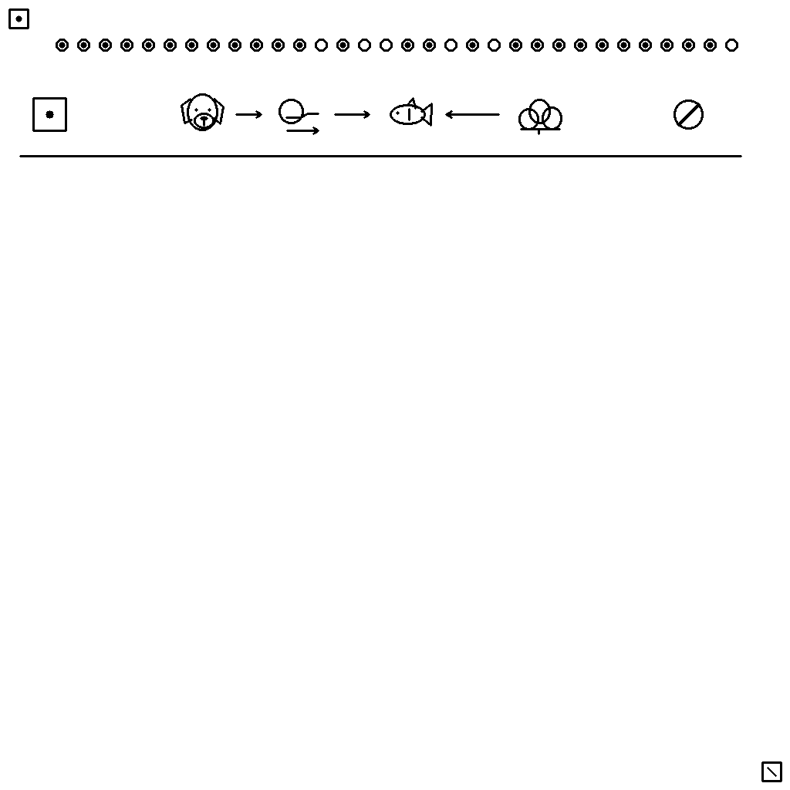
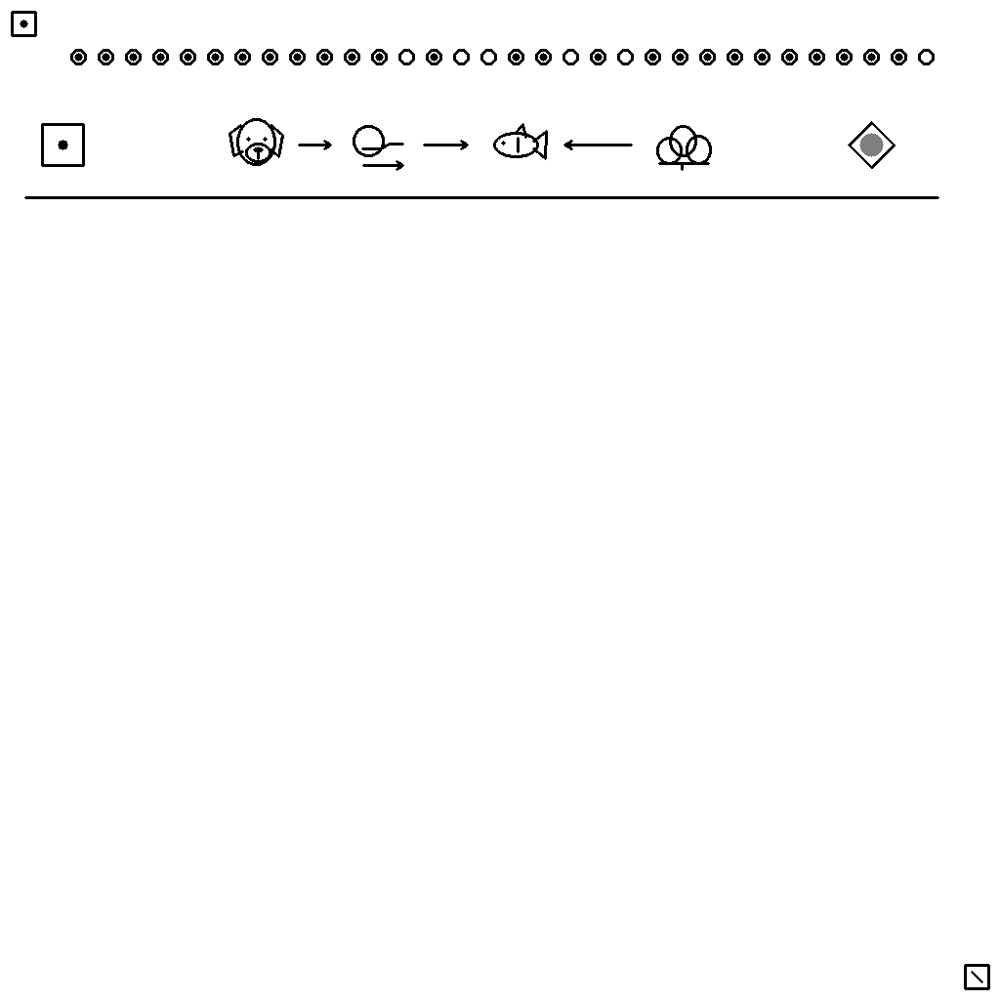

# 4. La terna y los ámbitos de significado

Los símbolos conservan su identidad, pero su interpretación depende de la cuestión constituida. En los estados semánticos del repertorio experimental, 0 afirma la relación, 1 la niega y U expresa indeterminación. En la corrección de un examen, 0 representa acierto, 1 error y U indeterminación conforme a su contrato. Confundir ambos niveles transforma el resultado.

| Nivel | Qué se conserva |
| --- | --- |
| Escena constituida | Estado de una relación del dominio. |
| Respuesta del candidato | Pronunciamiento recibido ante una pregunta. |
| Calificación | Comparación con la clave y aplicación de las reglas. |
| Dictamen | Resultado contractual, incluida la criticidad. |

Una respuesta 1 puede ser correcta ante un enunciado que no sea conforme a la fuente; su calificación será entonces 0. El candidato no declara su propio acierto.

## Afirmación, negación e indeterminación

<figure id="figura-4-1" class="figura-tratado">

<figcaption class="pie-figura"><strong>Figura 4.1.</strong> Alternativa de control con estado 0. Los contrastes son instrumentos de comprobación y no nuevos acontecimientos de la historia.<small class="autoria-figura">© 2026 Juan Antonio Lloret Egea. Algunos derechos reservados. | Open Researcher and Contributor ID (ORCID): 0000-0002-6634-3351 | Instituto Tecnológico Virtual de la Inteligencia Artificial para el Español™ (ITVIA) | IA eñ™ – La Biblia de la IA™ | Número Internacional Normalizado de Publicaciones Seriadas (ISSN) 2695-6411 | Licencia Creative Commons Atribución-NoComercial-SinDerivadas 4.0 Internacional (CC BY-NC-ND 4.0). Los componentes y fuentes de terceros conservan sus avisos.</small>Versiones: <a href="formatos/04-01-afirmado.svg">Scalable Vector Graphics (SVG), muestras exactas</a> · <a href="imagenes/04-01-afirmado.png">Portable Network Graphics (PNG)</a> · <a href="formatos/04-01-afirmado.jpg">Joint Photographic Experts Group (JPEG; .jpg)</a> · <a href="formatos/04-01-afirmado.webp">WebP sin pérdida</a>.</figcaption>
</figure>

<figure id="figura-4-2" class="figura-tratado">

<figcaption class="pie-figura"><strong>Figura 4.2.</strong> La misma relación con estado 1 permite examinar la distinción entre negación y otras interpretaciones, como prohibición o error.<small class="autoria-figura">© 2026 Juan Antonio Lloret Egea. Algunos derechos reservados. | Open Researcher and Contributor ID (ORCID): 0000-0002-6634-3351 | Instituto Tecnológico Virtual de la Inteligencia Artificial para el Español™ (ITVIA) | IA eñ™ – La Biblia de la IA™ | Número Internacional Normalizado de Publicaciones Seriadas (ISSN) 2695-6411 | Licencia Creative Commons Atribución-NoComercial-SinDerivadas 4.0 Internacional (CC BY-NC-ND 4.0). Los componentes y fuentes de terceros conservan sus avisos.</small>Versiones: <a href="formatos/04-02-negado.svg">Scalable Vector Graphics (SVG), muestras exactas</a> · <a href="imagenes/04-02-negado.png">Portable Network Graphics (PNG)</a> · <a href="formatos/04-02-negado.jpg">Joint Photographic Experts Group (JPEG; .jpg)</a> · <a href="formatos/04-02-negado.webp">WebP sin pérdida</a>.</figcaption>
</figure>

<figure id="figura-4-3" class="figura-tratado">

<figcaption class="pie-figura"><strong>Figura 4.3.</strong> La marca U expresa indeterminación de la relación constituida. No significa ausencia de pregunta, fallo de lectura ni posición sin contenido.<small class="autoria-figura">© 2026 Juan Antonio Lloret Egea. Algunos derechos reservados. | Open Researcher and Contributor ID (ORCID): 0000-0002-6634-3351 | Instituto Tecnológico Virtual de la Inteligencia Artificial para el Español™ (ITVIA) | IA eñ™ – La Biblia de la IA™ | Número Internacional Normalizado de Publicaciones Seriadas (ISSN) 2695-6411 | Licencia Creative Commons Atribución-NoComercial-SinDerivadas 4.0 Internacional (CC BY-NC-ND 4.0). Los componentes y fuentes de terceros conservan sus avisos.</small>Versiones: <a href="formatos/04-03-indeterminado.svg">Scalable Vector Graphics (SVG), muestras exactas</a> · <a href="imagenes/04-03-indeterminado.png">Portable Network Graphics (PNG)</a> · <a href="formatos/04-03-indeterminado.jpg">Joint Photographic Experts Group (JPEG; .jpg)</a> · <a href="formatos/04-03-indeterminado.webp">WebP sin pérdida</a>.</figcaption>
</figure>

## Hechos, pensamiento, finalidad y percepción

El ámbito físico expresa hechos del relato. El pensamiento atribuye un contenido a un participante. La finalidad presenta un resultado pretendido. La percepción vincula a un observador con aquello que percibe. Afirmar un propósito no afirma su cumplimiento; representar una creencia no convierte su contenido en un hecho universal.

La plantilla blanca indica un emplazamiento sin argumento aplicable. No sustituye U. Asimismo, una figura que el lector no entiende genera una limitación de comprensión del lector; no cambia automáticamente el estado semántico de la escena.

