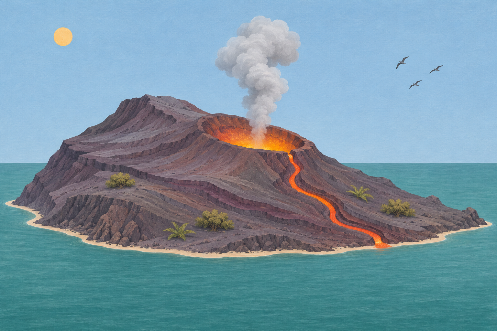
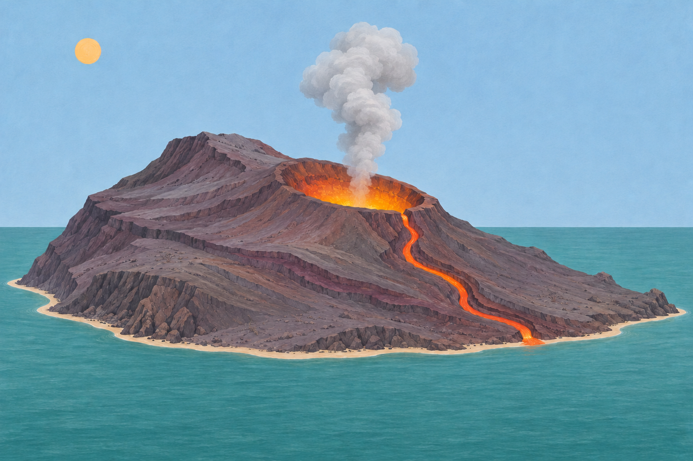
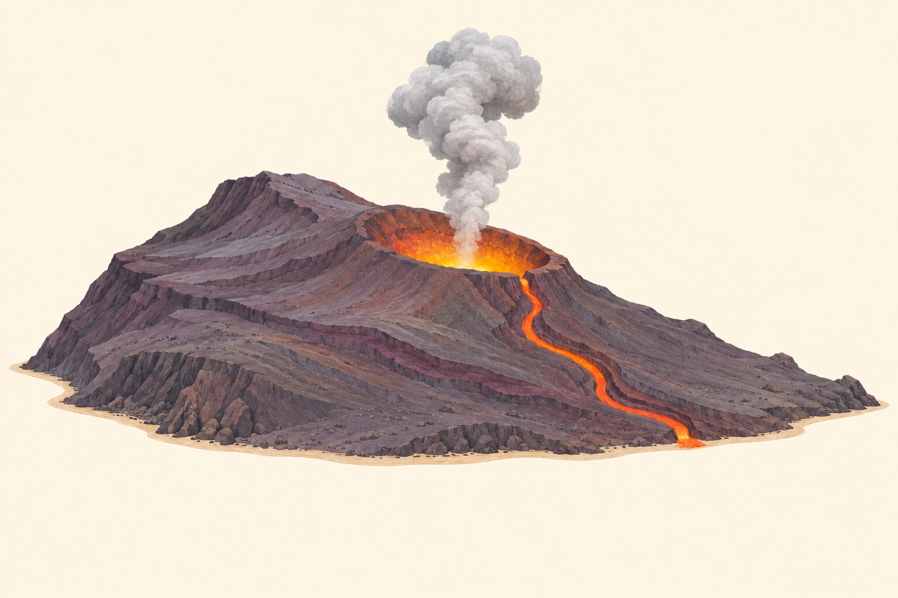
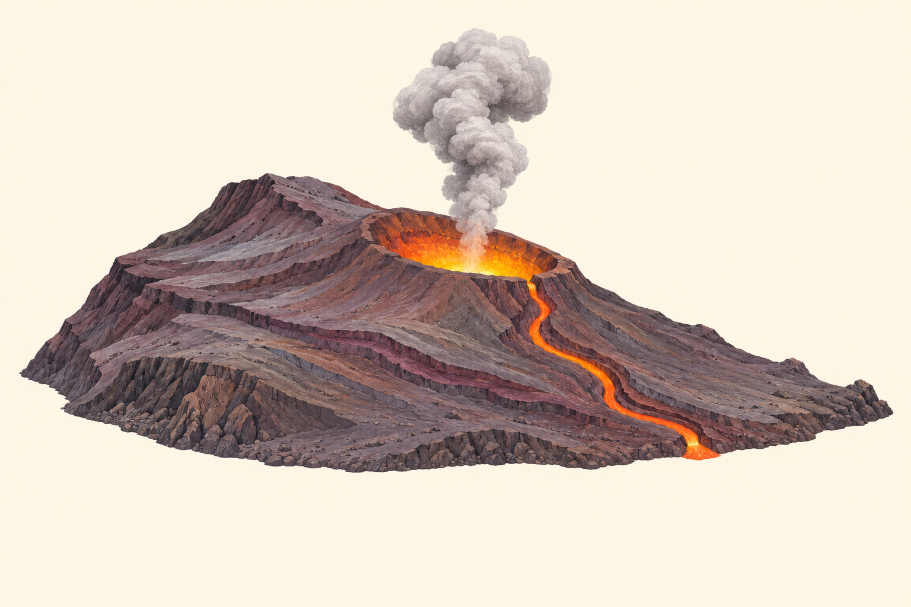
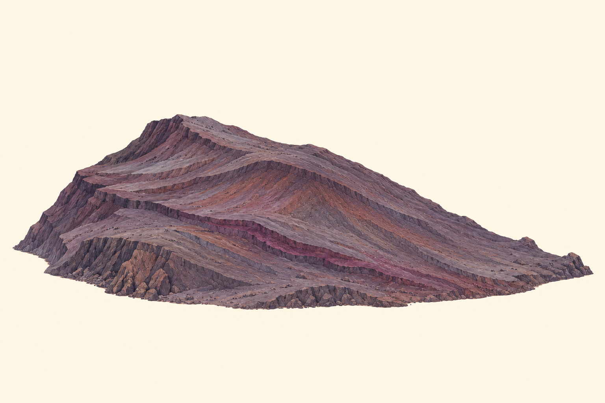

# 7. Parámetros críticos y pérdida admisible

Un parámetro es crítico por su función en el significado o en la decisión que se pretende conservar. No lo es necesariamente por ocupar una región grande de la imagen. El tamaño, la saliencia y la criticidad son propiedades distintas.

El ejemplo documental del volcán motivó esta comparación. Para el presente tratado se ha generado una **secuencia nueva e independiente de sus imágenes**. La escena inicial procede de una descripción propia; las cinco variantes utilizan exclusivamente esa nueva escena. Son ilustraciones sintéticas con finalidad didáctica y no fotografías de un fenómeno real.

## La cuestión que determina la criticidad

Si se pretende conservar la afirmación «la imagen representa un relieve con actividad volcánica visible», el cráter abierto, la emisión y la lava aportan evidencia pertinente. La ausencia de aves no altera esa afirmación. En cambio, eliminar los indicios de actividad modifica sustancialmente lo que puede sostenerse a partir de la figura.

La criticidad depende de la cuestión. Si se estudia un paisaje costero, perder el mar puede ser decisivo. La secuencia no establece que un volcán real deba mostrar siempre lava o un cráter abierto para serlo; la ausencia de esos rasgos en una imagen aislada no demuestra por sí sola su naturaleza geológica.

## Comparación visual

<figure id="figura-6-1" class="figura-tratado">

<figcaption class="pie-figura"><strong>Figura 7.1.</strong> La escena contiene aves, vegetación, sol, mar, relieve volcánico, cráter abierto, emisión y lava. Ilustración sintética.<small class="autoria-figura">© 2026 Juan Antonio Lloret Egea. Algunos derechos reservados. | Open Researcher and Contributor ID (ORCID): 0000-0002-6634-3351 | Instituto Tecnológico Virtual de la Inteligencia Artificial para el Español™ (ITVIA) | IA eñ™ – La Biblia de la IA™ | Número Internacional Normalizado de Publicaciones Seriadas (ISSN) 2695-6411 | Licencia Creative Commons Atribución-NoComercial-SinDerivadas 4.0 Internacional (CC BY-NC-ND 4.0). Los componentes y fuentes de terceros conservan sus avisos.</small>Versiones: <a href="formatos/06-nueva-01-escena-completa.svg" target="_blank" rel="noopener noreferrer">Scalable Vector Graphics (SVG), aproximación visual</a> · <a href="imagenes/06-nueva-01-escena-completa.png" target="_blank" rel="noopener noreferrer">Portable Network Graphics (PNG)</a> · <a href="formatos/06-nueva-01-escena-completa.jpg" target="_blank" rel="noopener noreferrer">Joint Photographic Experts Group (JPEG; .jpg)</a> · <a href="formatos/06-nueva-01-escena-completa.webp" target="_blank" rel="noopener noreferrer">WebP sin pérdida</a>.</figcaption>
</figure>

<figure id="figura-6-2" class="figura-tratado">

<figcaption class="pie-figura"><strong>Figura 7.2.</strong> Desaparecen las aves. Permanecen los elementos que representan actividad volcánica y el resto del contexto. Ilustración sintética.<small class="autoria-figura">© 2026 Juan Antonio Lloret Egea. Algunos derechos reservados. | Open Researcher and Contributor ID (ORCID): 0000-0002-6634-3351 | Instituto Tecnológico Virtual de la Inteligencia Artificial para el Español™ (ITVIA) | IA eñ™ – La Biblia de la IA™ | Número Internacional Normalizado de Publicaciones Seriadas (ISSN) 2695-6411 | Licencia Creative Commons Atribución-NoComercial-SinDerivadas 4.0 Internacional (CC BY-NC-ND 4.0). Los componentes y fuentes de terceros conservan sus avisos.</small>Versiones: <a href="formatos/06-nueva-02-sin-aves.svg" target="_blank" rel="noopener noreferrer">Scalable Vector Graphics (SVG), aproximación visual</a> · <a href="imagenes/06-nueva-02-sin-aves.png" target="_blank" rel="noopener noreferrer">Portable Network Graphics (PNG)</a> · <a href="formatos/06-nueva-02-sin-aves.jpg" target="_blank" rel="noopener noreferrer">Joint Photographic Experts Group (JPEG; .jpg)</a> · <a href="formatos/06-nueva-02-sin-aves.webp" target="_blank" rel="noopener noreferrer">WebP sin pérdida</a>.</figcaption>
</figure>

<figure id="figura-6-3" class="figura-tratado">

<figcaption class="pie-figura"><strong>Figura 7.3.</strong> Se elimina también la vegetación. El cráter abierto, la emisión y la lava continúan visibles. Ilustración sintética.<small class="autoria-figura">© 2026 Juan Antonio Lloret Egea. Algunos derechos reservados. | Open Researcher and Contributor ID (ORCID): 0000-0002-6634-3351 | Instituto Tecnológico Virtual de la Inteligencia Artificial para el Español™ (ITVIA) | IA eñ™ – La Biblia de la IA™ | Número Internacional Normalizado de Publicaciones Seriadas (ISSN) 2695-6411 | Licencia Creative Commons Atribución-NoComercial-SinDerivadas 4.0 Internacional (CC BY-NC-ND 4.0). Los componentes y fuentes de terceros conservan sus avisos.</small>Versiones: <a href="formatos/06-nueva-03-sin-vegetacion.svg" target="_blank" rel="noopener noreferrer">Scalable Vector Graphics (SVG), aproximación visual</a> · <a href="imagenes/06-nueva-03-sin-vegetacion.png" target="_blank" rel="noopener noreferrer">Portable Network Graphics (PNG)</a> · <a href="formatos/06-nueva-03-sin-vegetacion.jpg" target="_blank" rel="noopener noreferrer">Joint Photographic Experts Group (JPEG; .jpg)</a> · <a href="formatos/06-nueva-03-sin-vegetacion.webp" target="_blank" rel="noopener noreferrer">WebP sin pérdida</a>.</figcaption>
</figure>

<figure id="figura-6-4" class="figura-tratado">

<figcaption class="pie-figura"><strong>Figura 7.4.</strong> Se retiran además el sol, el mar y el fondo celeste. Se conserva el relieve con la franja de suelo y los indicios de actividad. Ilustración sintética.<small class="autoria-figura">© 2026 Juan Antonio Lloret Egea. Algunos derechos reservados. | Open Researcher and Contributor ID (ORCID): 0000-0002-6634-3351 | Instituto Tecnológico Virtual de la Inteligencia Artificial para el Español™ (ITVIA) | IA eñ™ – La Biblia de la IA™ | Número Internacional Normalizado de Publicaciones Seriadas (ISSN) 2695-6411 | Licencia Creative Commons Atribución-NoComercial-SinDerivadas 4.0 Internacional (CC BY-NC-ND 4.0). Los componentes y fuentes de terceros conservan sus avisos.</small>Versiones: <a href="formatos/06-nueva-04-sin-sol-ni-mar.svg" target="_blank" rel="noopener noreferrer">Scalable Vector Graphics (SVG), aproximación visual</a> · <a href="imagenes/06-nueva-04-sin-sol-ni-mar.png" target="_blank" rel="noopener noreferrer">Portable Network Graphics (PNG)</a> · <a href="formatos/06-nueva-04-sin-sol-ni-mar.jpg" target="_blank" rel="noopener noreferrer">Joint Photographic Experts Group (JPEG; .jpg)</a> · <a href="formatos/06-nueva-04-sin-sol-ni-mar.webp" target="_blank" rel="noopener noreferrer">WebP sin pérdida</a>.</figcaption>
</figure>

<figure id="figura-6-5" class="figura-tratado">

<figcaption class="pie-figura"><strong>Figura 7.5.</strong> El contexto y la franja de suelo desaparecen. El relieve conserva cráter abierto, emisión y lava. Ilustración sintética.<small class="autoria-figura">© 2026 Juan Antonio Lloret Egea. Algunos derechos reservados. | Open Researcher and Contributor ID (ORCID): 0000-0002-6634-3351 | Instituto Tecnológico Virtual de la Inteligencia Artificial para el Español™ (ITVIA) | IA eñ™ – La Biblia de la IA™ | Número Internacional Normalizado de Publicaciones Seriadas (ISSN) 2695-6411 | Licencia Creative Commons Atribución-NoComercial-SinDerivadas 4.0 Internacional (CC BY-NC-ND 4.0). Los componentes y fuentes de terceros conservan sus avisos.</small>Versiones: <a href="formatos/06-nueva-05-volcan-aislado.svg" target="_blank" rel="noopener noreferrer">Scalable Vector Graphics (SVG), aproximación visual</a> · <a href="imagenes/06-nueva-05-volcan-aislado.png" target="_blank" rel="noopener noreferrer">Portable Network Graphics (PNG)</a> · <a href="formatos/06-nueva-05-volcan-aislado.jpg" target="_blank" rel="noopener noreferrer">Joint Photographic Experts Group (JPEG; .jpg)</a> · <a href="formatos/06-nueva-05-volcan-aislado.webp" target="_blank" rel="noopener noreferrer">WebP sin pérdida</a>.</figcaption>
</figure>

<figure id="figura-6-6" class="figura-tratado">

<figcaption class="pie-figura"><strong>Figura 7.6.</strong> Se eliminan el cráter abierto, la emisión y la lava. La nueva figura ya no conserva la evidencia visual de actividad de la escena inicial. Ilustración sintética.<small class="autoria-figura">© 2026 Juan Antonio Lloret Egea. Algunos derechos reservados. | Open Researcher and Contributor ID (ORCID): 0000-0002-6634-3351 | Instituto Tecnológico Virtual de la Inteligencia Artificial para el Español™ (ITVIA) | IA eñ™ – La Biblia de la IA™ | Número Internacional Normalizado de Publicaciones Seriadas (ISSN) 2695-6411 | Licencia Creative Commons Atribución-NoComercial-SinDerivadas 4.0 Internacional (CC BY-NC-ND 4.0). Los componentes y fuentes de terceros conservan sus avisos.</small>Versiones: <a href="formatos/06-nueva-06-relieve-cerrado.svg" target="_blank" rel="noopener noreferrer">Scalable Vector Graphics (SVG), aproximación visual</a> · <a href="imagenes/06-nueva-06-relieve-cerrado.png" target="_blank" rel="noopener noreferrer">Portable Network Graphics (PNG)</a> · <a href="formatos/06-nueva-06-relieve-cerrado.jpg" target="_blank" rel="noopener noreferrer">Joint Photographic Experts Group (JPEG; .jpg)</a> · <a href="formatos/06-nueva-06-relieve-cerrado.webp" target="_blank" rel="noopener noreferrer">WebP sin pérdida</a>.</figcaption>
</figure>

## Criterio previo de fidelidad

Antes de evaluar una reconstrucción se fijan el dominio, los parámetros, su orden, la clave y las criticidades. No se decide después qué pérdida era aceptable porque el resultado parezca convincente.

También deben examinarse las pérdidas conjuntas. Dos rasgos prescindibles por separado pueden ser necesarios cuando desaparecen a la vez. La conservación de un porcentaje de detalles no garantiza por sí sola que sobreviva el significado nuclear.

En el relato de los animales, identificar a quien deposita el alimento, a quien lo recibe y a quien lo consume puede ser decisivo. «El perro pone el pescado para el gato» cambia de contenido si se invierten los animales, aunque todos los objetos permanezcan presentes. Lo mismo sucede al sustituir una finalidad por un hecho cumplido.

La pérdida admisible conserva **todos los parámetros críticos**. La regla agregada no compensa una alteración crítica mediante aciertos en detalles accesorios.

## Alcance de esta comparación

Las variantes permiten una comparación ilustrativa; no constituyen una eliminación controlada píxel por píxel, porque la generación puede introducir variaciones adicionales de textura o contorno. No se les asigna un dictamen celular sin una constitución previa de sus parámetros. Las versiones vectoriales se documentan separadamente de los originales de puntos.

La secuencia permite preparar ese contraste manteniendo la directriz **Imagen real ↔ (glifo, texto) ↔ Célula del Sistema Vectorial (SV) ↔ Potencial de un *frame* del Sistema Vectorial (SV)**. La imagen sintética no sustituye el extremo de imagen real que el procedimiento deberá comprobar posteriormente.

Antecedente conceptual: <a href="https://github.com/juantoniolloretegea/SV-lenguaje-de-computacion/blob/ce5aad1125460263904acb91142f33324ce89dfc/docs/calidad/tuberias-ia/frame-significado-humano-trazabilidad-y-fidelidad/FRAME_SIGNIFICADO_HUMANO_TRAZABILIDAD_Y_FIDELIDAD_2026_09_11.md" target="_blank" rel="noopener noreferrer">significado humano, trazabilidad y fidelidad</a>. Las imágenes de ese documento no forman parte de esta edición.

<!-- Autoría: © 2026 Juan Antonio Lloret Egea. CC BY-NC-ND 4.0. https://doi.org/10.21428/39829d0b.8b9c0155. -->
