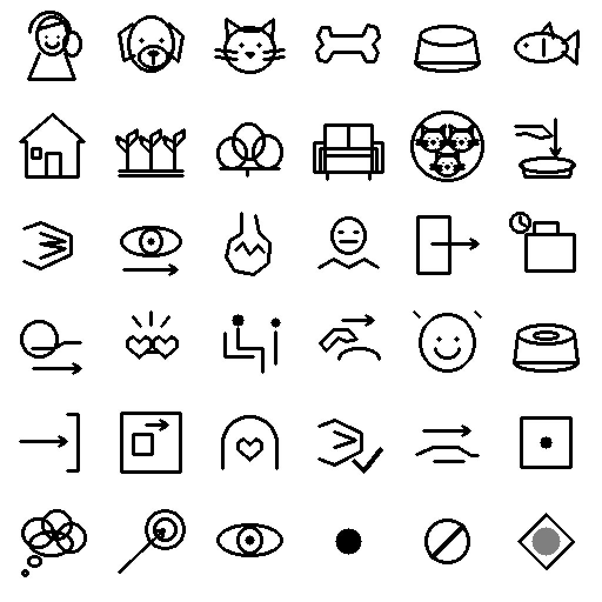

# 8. Repertorio visual y gramática de la escena

El repertorio visible reúne treinta y seis signos: once figuras referenciales, dieciocho relaciones, cuatro ámbitos y tres estados. Se conserva además una plantilla blanca para emplazamientos sin argumento aplicable.

<figure id="figura-8-1" class="figura-tratado">

<figcaption class="pie-figura"><strong>Figura 8.1.</strong> Atlas experimental empleado en la prueba. El recorrido documental de la tabla siguiente es de izquierda a derecha y de arriba abajo. La explicación pertenece al tratado y no estaba incluida como clave en las láminas del candidato.<small class="autoria-figura">© 2026 Juan Antonio Lloret Egea. Algunos derechos reservados. | Open Researcher and Contributor ID (ORCID): 0000-0002-6634-3351 | Instituto Tecnológico Virtual de la Inteligencia Artificial para el Español™ (ITVIA) | IA eñ™ – La Biblia de la IA™ | Número Internacional Normalizado de Publicaciones Seriadas (ISSN) 2695-6411 | Licencia Creative Commons Atribución-NoComercial-SinDerivadas 4.0 Internacional (CC BY-NC-ND 4.0). Los componentes y fuentes de terceros conservan sus avisos.</small>Versiones: <a href="formatos/08-01-repertorio.svg" target="_blank" rel="noopener noreferrer">Scalable Vector Graphics (SVG), muestras exactas</a> · <a href="imagenes/08-01-repertorio.png" target="_blank" rel="noopener noreferrer">Portable Network Graphics (PNG)</a> · <a href="formatos/08-01-repertorio.jpg" target="_blank" rel="noopener noreferrer">Joint Photographic Experts Group (JPEG; .jpg)</a> · <a href="formatos/08-01-repertorio.webp" target="_blank" rel="noopener noreferrer">WebP sin pérdida</a>.</figcaption>
</figure>

| Fila | Signos en orden |
| --- | --- |
| 1 | Dueña; perro; gato blanco; hueso; plato; pescado. |
| 2 | Casa; jardín; matorrales; sofá; clase de los gatos; depositar. |
| 3 | Consumir; mirar; hambre; indiferencia; salir; guardado previamente. |
| 4 | Recoger con la boca; hacerse amigos; sentarse junto a alguien; acariciar; alegría; vacío. |
| 5 | Llegar; pertenecer espacialmente; ser dueña de; consumo concluido; destinatario del alimento; ámbito físico. |
| 6 | Pensamiento; finalidad; percepción; 0; 1; U. |

## Composición de un renglón

Cada renglón dispone ámbito, perspectiva cuando corresponda, sujeto, relación, restantes referentes ordenados y estado. Los papeles dependen de la relación. Al depositar, los argumentos identifican agente, alimento y recipiente. Al recoger con la boca, distinguen alimento y origen. Al sentarse junto a alguien, conservan asiento y acompañante.

Esta gramática está documentada, pero su mera definición no acredita comprensión espontánea. La prueba permite descubrir dónde los signos propuestos no comunican el contenido esperado.

## Referentes y clases

La figura de tres gatos agrupados representa una clase dentro de la constitución; no añade tres individuos físicos al relato. El pescado pensado como tipo de alimento tampoco es, por esa sola representación, el individuo que el perro recoge después.

La identificación del gato blanco está fijada para este caso. No constituye un sistema general de reconocimiento de color o identidad. Incorporar otros gatos o perros exigiría distinguir sus referentes. Las relaciones de hambre, alegría, amistad o intención se expresan explícitamente; no se deducen de la mera presencia de un animal.

## Ampliación entre dominios

El [capítulo 21](21-diccionario-visual.md) desarrolla la conservación de un repertorio común mediante referencias y relaciones visuales. No exige una nueva figura por cada palabra ni una definición verbal como clave necesaria de lectura. El [caso de la televisión inteligente](22-television.md) introduce estados de funcionamiento, una hipótesis causal y una reparación pendiente, con sus límites de reconocimiento explícitos.

<!-- Autoría: © 2026 Juan Antonio Lloret Egea. Licencia: CC-BY-NC-ND-4.0 para contenidos propios. Publicación académica vinculada: https://doi.org/10.21428/39829d0b.8b9c0155. -->
