# 9. El caso completo: once frames

La siguiente sucesión conserva la identidad de las once apariciones. La serie documental es 11 y sus ordinales van de 1 a 11. Las explicaciones son la clave del caso constituido; no son respuestas del candidato.

## Relato de partida

> El perro se ha comido un hueso, que estaba en el plato y que su dueña le puso antes para que se lo comiese. Luego vino un gato blanco, que tenía hambre también, miró en el plato y vio que estaba vacío. Y pensó: «Da igual, los gatos no comemos huesos, comemos pescado».
>
> Entonces el perro salió al jardín de la casa, donde tenía guardado un pescado entre unos matorrales; lo cogió con la boca y se lo puso al gato en el plato. El gato se lo comió.
>
> Finalmente, ambos animales se hicieron amigos y se sentaron en el sofá al lado de la dueña. Estaban contentos mientras ella los acariciaba a ambos.

La constitución hace explícito el referente del consumo del pescado. El hambre previa del perro se conserva indeterminada: el consumo y la expresión «también» no se utilizan para afirmar sin reserva ese antecedente. Las afirmaciones alimentarias pertenecen al pensamiento del gato; el tratado no las presenta como una regla zoológica universal.

## 1. Depósito del hueso y finalidad

<figure id="figura-9-1" class="figura-tratado">

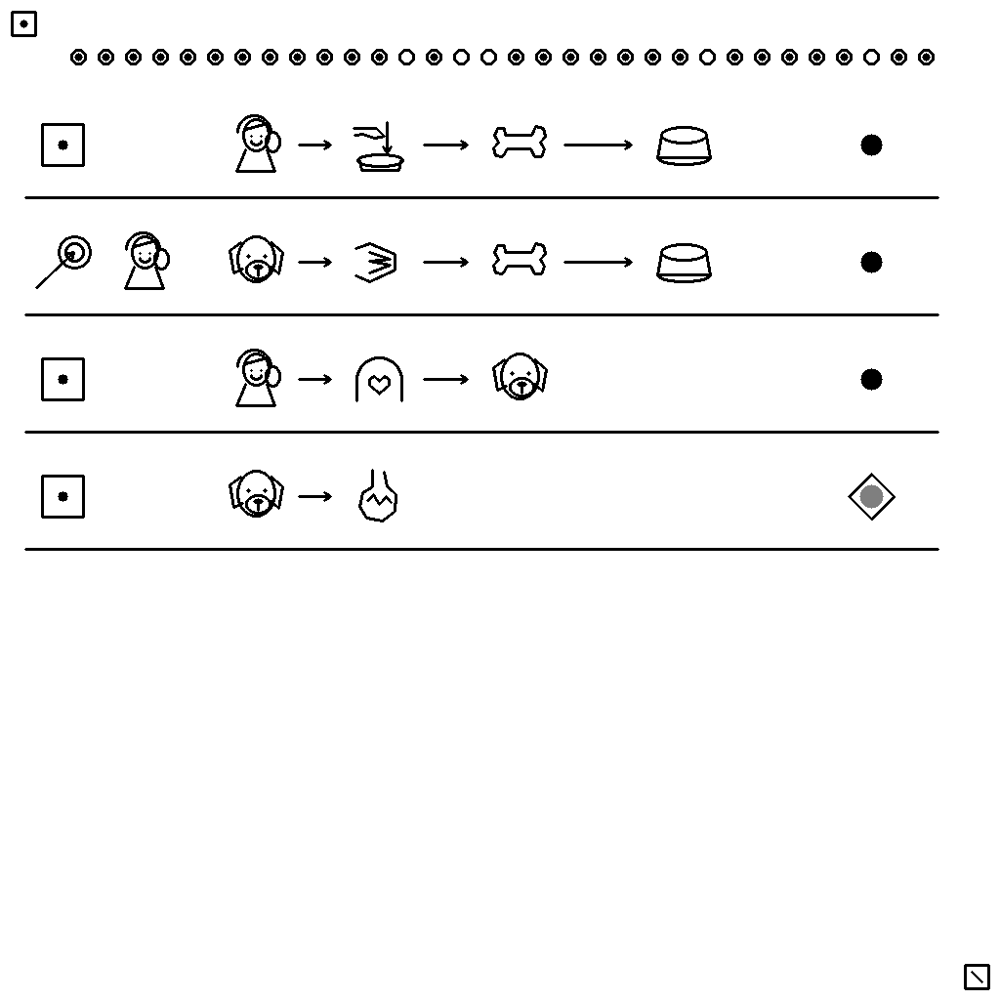

<figcaption class="pie-figura"><strong>Figura 9.1.</strong> Aparición 1 de la serie 11. Correspondencia de la lámina utilizada en la prueba: J. Imagen canónica conservada sin modificar sus muestras.<small class="autoria-figura">© 2026 Juan Antonio Lloret Egea. Algunos derechos reservados. | Open Researcher and Contributor ID (ORCID): 0000-0002-6634-3351 | Instituto Tecnológico Virtual de la Inteligencia Artificial para el Español™ (ITVIA) | IA eñ™ – La Biblia de la IA™ | Número Internacional Normalizado de Publicaciones Seriadas (ISSN) 2695-6411 | Licencia Creative Commons Atribución-NoComercial-SinDerivadas 4.0 Internacional (CC BY-NC-ND 4.0). Los componentes y fuentes de terceros conservan sus avisos.</small>Versiones: <a href="formatos/09-01-frame.svg">Scalable Vector Graphics (SVG), muestras exactas</a> · <a href="imagenes/09-01-frame.png">Portable Network Graphics (PNG)</a> · <a href="formatos/09-01-frame.jpg">Joint Photographic Experts Group (JPEG; .jpg)</a> · <a href="formatos/09-01-frame.webp">WebP sin pérdida</a>.</figcaption>
</figure>

La dueña del perro deposita el hueso en el plato con la finalidad de que el perro lo coma. No está determinado si el perro tiene hambre.

| Relación | Ámbito y perspectiva | Participantes y papeles | Estado |
| --- | --- | --- | --- |
| F01-R01: depositar | físico | agente: dueña; alimento: hueso; recipiente: plato | 0 |
| F01-R02: consumir | finalidad; dueña | consumidor: perro; alimento: hueso; recipiente opcional: plato | 0 |
| F01-R03: ser dueña de | físico | persona: dueña; animal: perro | 0 |
| F01-R04: hambre | físico | sujeto: perro | U |

## 2. Consumo concluido del hueso

<figure id="figura-9-2" class="figura-tratado">

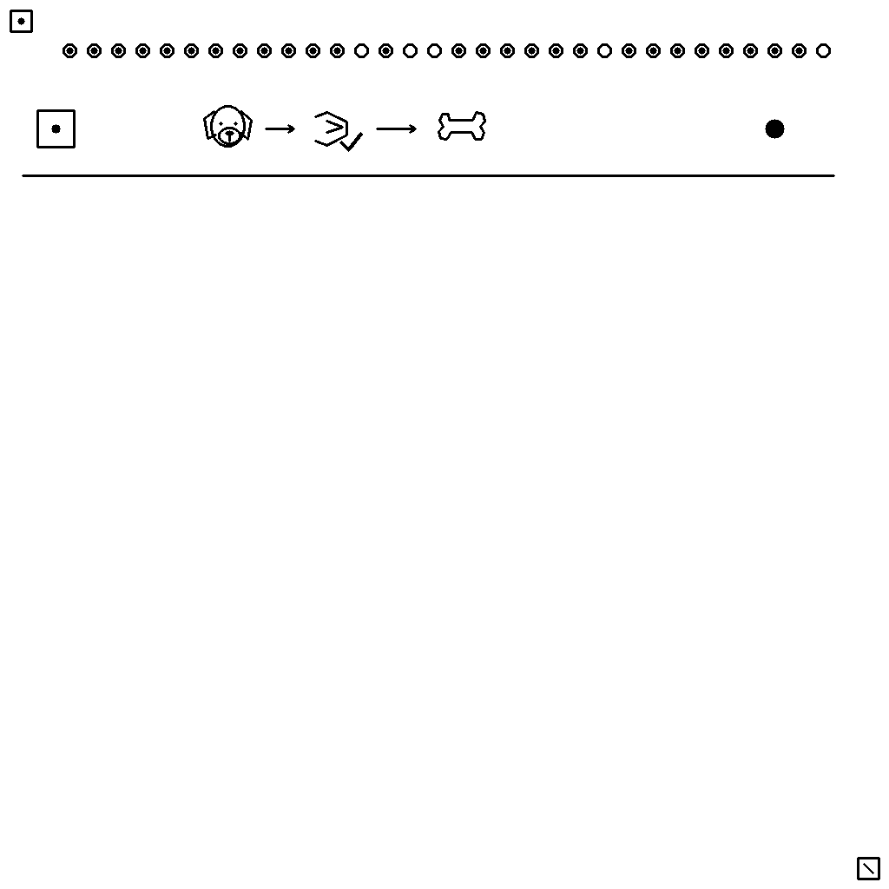

<figcaption class="pie-figura"><strong>Figura 9.2.</strong> Aparición 2 de la serie 11. Correspondencia de la lámina utilizada en la prueba: D. Imagen canónica conservada sin modificar sus muestras.<small class="autoria-figura">© 2026 Juan Antonio Lloret Egea. Algunos derechos reservados. | Open Researcher and Contributor ID (ORCID): 0000-0002-6634-3351 | Instituto Tecnológico Virtual de la Inteligencia Artificial para el Español™ (ITVIA) | IA eñ™ – La Biblia de la IA™ | Número Internacional Normalizado de Publicaciones Seriadas (ISSN) 2695-6411 | Licencia Creative Commons Atribución-NoComercial-SinDerivadas 4.0 Internacional (CC BY-NC-ND 4.0). Los componentes y fuentes de terceros conservan sus avisos.</small>Versiones: <a href="formatos/09-02-frame.svg">Scalable Vector Graphics (SVG), muestras exactas</a> · <a href="imagenes/09-02-frame.png">Portable Network Graphics (PNG)</a> · <a href="formatos/09-02-frame.jpg">Joint Photographic Experts Group (JPEG; .jpg)</a> · <a href="formatos/09-02-frame.webp">WebP sin pérdida</a>.</figcaption>
</figure>

El perro ha terminado de comerse el hueso.

| Relación | Ámbito y perspectiva | Participantes y papeles | Estado |
| --- | --- | --- | --- |
| F02-R01: consumo concluido | físico | consumidor: perro; alimento: hueso | 0 |

## 3. Llegada y hambre del gato

<figure id="figura-9-3" class="figura-tratado">

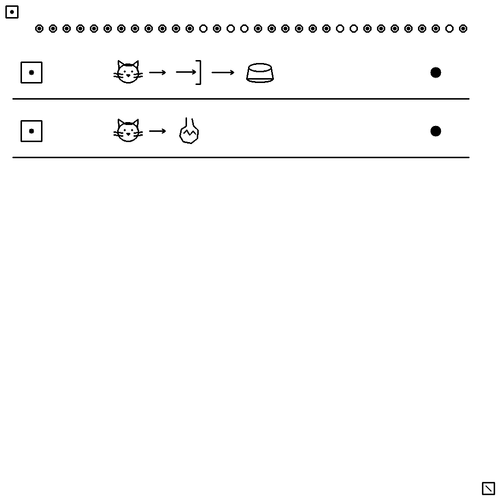

<figcaption class="pie-figura"><strong>Figura 9.3.</strong> Aparición 3 de la serie 11. Correspondencia de la lámina utilizada en la prueba: A. Imagen canónica conservada sin modificar sus muestras.<small class="autoria-figura">© 2026 Juan Antonio Lloret Egea. Algunos derechos reservados. | Open Researcher and Contributor ID (ORCID): 0000-0002-6634-3351 | Instituto Tecnológico Virtual de la Inteligencia Artificial para el Español™ (ITVIA) | IA eñ™ – La Biblia de la IA™ | Número Internacional Normalizado de Publicaciones Seriadas (ISSN) 2695-6411 | Licencia Creative Commons Atribución-NoComercial-SinDerivadas 4.0 Internacional (CC BY-NC-ND 4.0). Los componentes y fuentes de terceros conservan sus avisos.</small>Versiones: <a href="formatos/09-03-frame.svg">Scalable Vector Graphics (SVG), muestras exactas</a> · <a href="imagenes/09-03-frame.png">Portable Network Graphics (PNG)</a> · <a href="formatos/09-03-frame.jpg">Joint Photographic Experts Group (JPEG; .jpg)</a> · <a href="formatos/09-03-frame.webp">WebP sin pérdida</a>.</figcaption>
</figure>

El gato blanco llega al plato y tiene hambre.

| Relación | Ámbito y perspectiva | Participantes y papeles | Estado |
| --- | --- | --- | --- |
| F03-R01: llegar | físico | sujeto: gato blanco; destino: plato | 0 |
| F03-R02: hambre | físico | sujeto: gato blanco | 0 |

## 4. Mirada hacia el plato

<figure id="figura-9-4" class="figura-tratado">

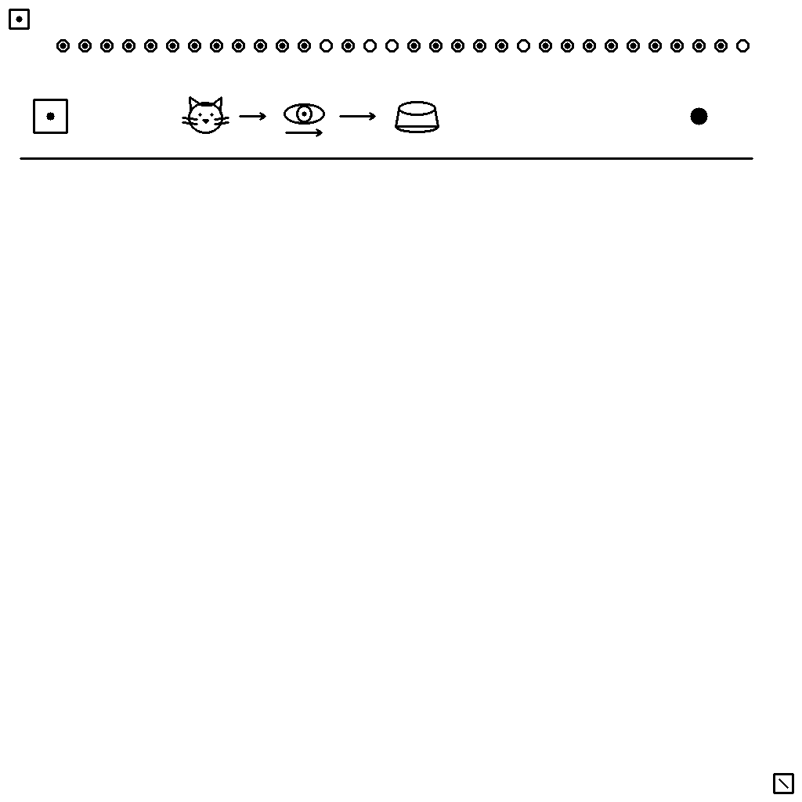

<figcaption class="pie-figura"><strong>Figura 9.4.</strong> Aparición 4 de la serie 11. Correspondencia de la lámina utilizada en la prueba: I. Imagen canónica conservada sin modificar sus muestras.<small class="autoria-figura">© 2026 Juan Antonio Lloret Egea. Algunos derechos reservados. | Open Researcher and Contributor ID (ORCID): 0000-0002-6634-3351 | Instituto Tecnológico Virtual de la Inteligencia Artificial para el Español™ (ITVIA) | IA eñ™ – La Biblia de la IA™ | Número Internacional Normalizado de Publicaciones Seriadas (ISSN) 2695-6411 | Licencia Creative Commons Atribución-NoComercial-SinDerivadas 4.0 Internacional (CC BY-NC-ND 4.0). Los componentes y fuentes de terceros conservan sus avisos.</small>Versiones: <a href="formatos/09-04-frame.svg">Scalable Vector Graphics (SVG), muestras exactas</a> · <a href="imagenes/09-04-frame.png">Portable Network Graphics (PNG)</a> · <a href="formatos/09-04-frame.jpg">Joint Photographic Experts Group (JPEG; .jpg)</a> · <a href="formatos/09-04-frame.webp">WebP sin pérdida</a>.</figcaption>
</figure>

El gato blanco mira el plato.

| Relación | Ámbito y perspectiva | Participantes y papeles | Estado |
| --- | --- | --- | --- |
| F04-R01: mirar | físico | observador: gato blanco; objeto: plato | 0 |

## 5. Vacío y percepción

<figure id="figura-9-5" class="figura-tratado">

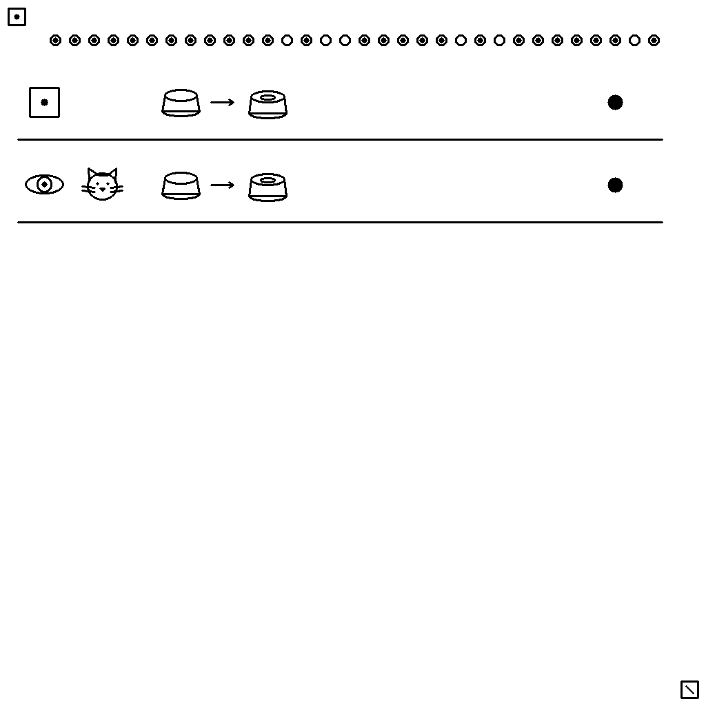

<figcaption class="pie-figura"><strong>Figura 9.5.</strong> Aparición 5 de la serie 11. Correspondencia de la lámina utilizada en la prueba: B. Imagen canónica conservada sin modificar sus muestras.<small class="autoria-figura">© 2026 Juan Antonio Lloret Egea. Algunos derechos reservados. | Open Researcher and Contributor ID (ORCID): 0000-0002-6634-3351 | Instituto Tecnológico Virtual de la Inteligencia Artificial para el Español™ (ITVIA) | IA eñ™ – La Biblia de la IA™ | Número Internacional Normalizado de Publicaciones Seriadas (ISSN) 2695-6411 | Licencia Creative Commons Atribución-NoComercial-SinDerivadas 4.0 Internacional (CC BY-NC-ND 4.0). Los componentes y fuentes de terceros conservan sus avisos.</small>Versiones: <a href="formatos/09-05-frame.svg">Scalable Vector Graphics (SVG), muestras exactas</a> · <a href="imagenes/09-05-frame.png">Portable Network Graphics (PNG)</a> · <a href="formatos/09-05-frame.jpg">Joint Photographic Experts Group (JPEG; .jpg)</a> · <a href="formatos/09-05-frame.webp">WebP sin pérdida</a>.</figcaption>
</figure>

El plato está vacío y el gato blanco percibe ese vacío.

| Relación | Ámbito y perspectiva | Participantes y papeles | Estado |
| --- | --- | --- | --- |
| F05-R01: vacío | físico | recipiente: plato | 0 |
| F05-R02: vacío | percepción atribuida; gato blanco | recipiente: plato | 0 |

## 6. Pensamiento atribuido al gato

<figure id="figura-9-6" class="figura-tratado">

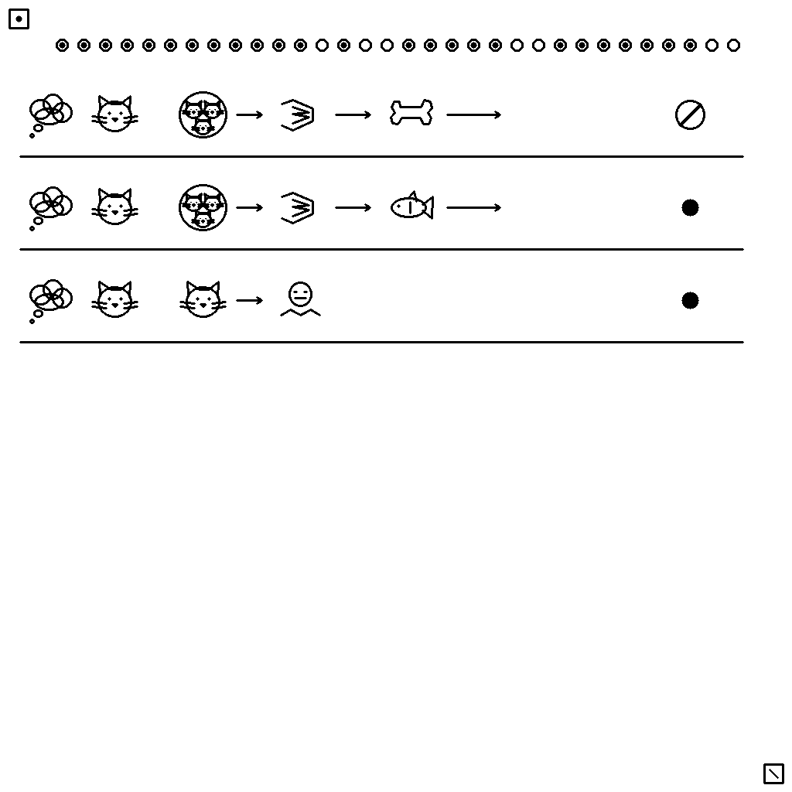

<figcaption class="pie-figura"><strong>Figura 9.6.</strong> Aparición 6 de la serie 11. Correspondencia de la lámina utilizada en la prueba: C. Imagen canónica conservada sin modificar sus muestras.<small class="autoria-figura">© 2026 Juan Antonio Lloret Egea. Algunos derechos reservados. | Open Researcher and Contributor ID (ORCID): 0000-0002-6634-3351 | Instituto Tecnológico Virtual de la Inteligencia Artificial para el Español™ (ITVIA) | IA eñ™ – La Biblia de la IA™ | Número Internacional Normalizado de Publicaciones Seriadas (ISSN) 2695-6411 | Licencia Creative Commons Atribución-NoComercial-SinDerivadas 4.0 Internacional (CC BY-NC-ND 4.0). Los componentes y fuentes de terceros conservan sus avisos.</small>Versiones: <a href="formatos/09-06-frame.svg">Scalable Vector Graphics (SVG), muestras exactas</a> · <a href="imagenes/09-06-frame.png">Portable Network Graphics (PNG)</a> · <a href="formatos/09-06-frame.jpg">Joint Photographic Experts Group (JPEG; .jpg)</a> · <a href="formatos/09-06-frame.webp">WebP sin pérdida</a>.</figcaption>
</figure>

En el pensamiento del gato blanco se expresa indiferencia y la idea de que los gatos no comen huesos y sí comen pescado. Es un contenido atribuido a ese gato, no una afirmación del narrador sobre todos los gatos reales.

| Relación | Ámbito y perspectiva | Participantes y papeles | Estado |
| --- | --- | --- | --- |
| F06-R01: consumir | pensamiento; gato blanco | consumidor: clase de los gatos; alimento: hueso; recipiente opcional: sin argumento | 1 |
| F06-R02: consumir | pensamiento; gato blanco | consumidor: clase de los gatos; alimento: pescado; recipiente opcional: sin argumento | 0 |
| F06-R03: indiferencia | pensamiento; gato blanco | sujeto: gato blanco | 0 |

## 7. Salida al jardín y almacenamiento previo

<figure id="figura-9-7" class="figura-tratado">

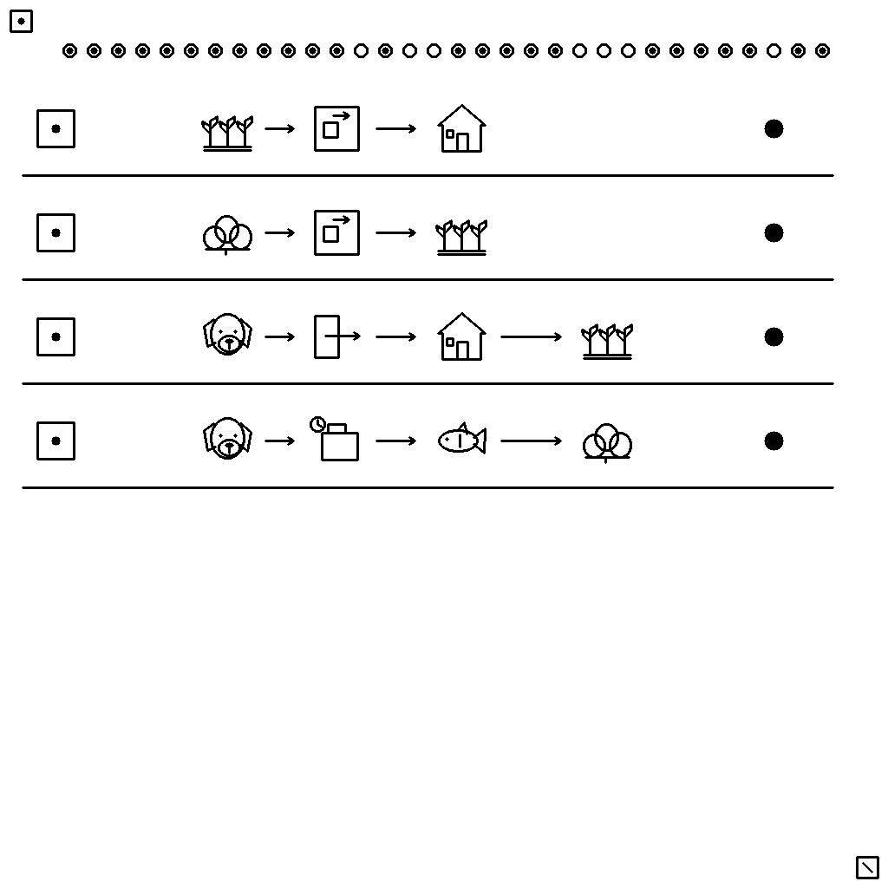

<figcaption class="pie-figura"><strong>Figura 9.7.</strong> Aparición 7 de la serie 11. Correspondencia de la lámina utilizada en la prueba: K. Imagen canónica conservada sin modificar sus muestras.<small class="autoria-figura">© 2026 Juan Antonio Lloret Egea. Algunos derechos reservados. | Open Researcher and Contributor ID (ORCID): 0000-0002-6634-3351 | Instituto Tecnológico Virtual de la Inteligencia Artificial para el Español™ (ITVIA) | IA eñ™ – La Biblia de la IA™ | Número Internacional Normalizado de Publicaciones Seriadas (ISSN) 2695-6411 | Licencia Creative Commons Atribución-NoComercial-SinDerivadas 4.0 Internacional (CC BY-NC-ND 4.0). Los componentes y fuentes de terceros conservan sus avisos.</small>Versiones: <a href="formatos/09-07-frame.svg">Scalable Vector Graphics (SVG), muestras exactas</a> · <a href="imagenes/09-07-frame.png">Portable Network Graphics (PNG)</a> · <a href="formatos/09-07-frame.jpg">Joint Photographic Experts Group (JPEG; .jpg)</a> · <a href="formatos/09-07-frame.webp">WebP sin pérdida</a>.</figcaption>
</figure>

El perro sale de la casa al jardín. El jardín pertenece a la casa y los matorrales están en el jardín. El perro tenía guardado previamente un pescado en esos matorrales.

| Relación | Ámbito y perspectiva | Participantes y papeles | Estado |
| --- | --- | --- | --- |
| F07-R01: pertenecer espacialmente | físico | parte: jardín; conjunto: casa | 0 |
| F07-R02: pertenecer espacialmente | físico | parte: matorrales; conjunto: jardín | 0 |
| F07-R03: salir | físico | sujeto: perro; origen: casa; destino: jardín | 0 |
| F07-R04: guardado previamente | físico | poseedor: perro; alimento: pescado; lugar: matorrales | 0 |

## 8. Recogida del pescado con la boca

<figure id="figura-9-8" class="figura-tratado">

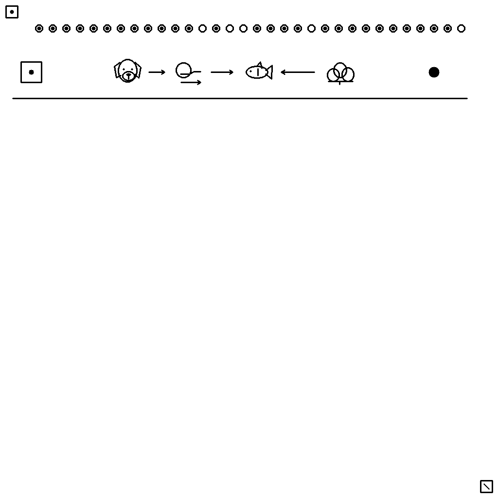

<figcaption class="pie-figura"><strong>Figura 9.8.</strong> Aparición 8 de la serie 11. Correspondencia de la lámina utilizada en la prueba: G. Imagen canónica conservada sin modificar sus muestras.<small class="autoria-figura">© 2026 Juan Antonio Lloret Egea. Algunos derechos reservados. | Open Researcher and Contributor ID (ORCID): 0000-0002-6634-3351 | Instituto Tecnológico Virtual de la Inteligencia Artificial para el Español™ (ITVIA) | IA eñ™ – La Biblia de la IA™ | Número Internacional Normalizado de Publicaciones Seriadas (ISSN) 2695-6411 | Licencia Creative Commons Atribución-NoComercial-SinDerivadas 4.0 Internacional (CC BY-NC-ND 4.0). Los componentes y fuentes de terceros conservan sus avisos.</small>Versiones: <a href="formatos/09-08-frame.svg">Scalable Vector Graphics (SVG), muestras exactas</a> · <a href="imagenes/09-08-frame.png">Portable Network Graphics (PNG)</a> · <a href="formatos/09-08-frame.jpg">Joint Photographic Experts Group (JPEG; .jpg)</a> · <a href="formatos/09-08-frame.webp">WebP sin pérdida</a>.</figcaption>
</figure>

El perro recoge con la boca el pescado de los matorrales.

| Relación | Ámbito y perspectiva | Participantes y papeles | Estado |
| --- | --- | --- | --- |
| F08-R01: recoger con la boca | físico | agente: perro; alimento: pescado; origen: matorrales | 0 |

## 9. Depósito del pescado y destinatario

<figure id="figura-9-9" class="figura-tratado">

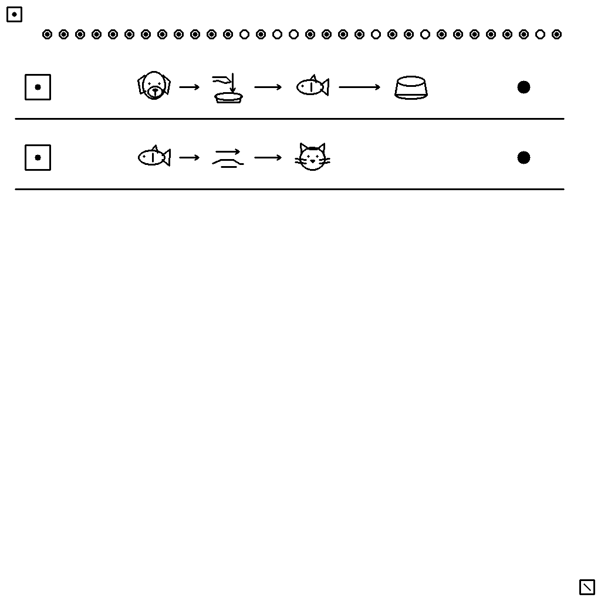

<figcaption class="pie-figura"><strong>Figura 9.9.</strong> Aparición 9 de la serie 11. Correspondencia de la lámina utilizada en la prueba: F. Imagen canónica conservada sin modificar sus muestras.<small class="autoria-figura">© 2026 Juan Antonio Lloret Egea. Algunos derechos reservados. | Open Researcher and Contributor ID (ORCID): 0000-0002-6634-3351 | Instituto Tecnológico Virtual de la Inteligencia Artificial para el Español™ (ITVIA) | IA eñ™ – La Biblia de la IA™ | Número Internacional Normalizado de Publicaciones Seriadas (ISSN) 2695-6411 | Licencia Creative Commons Atribución-NoComercial-SinDerivadas 4.0 Internacional (CC BY-NC-ND 4.0). Los componentes y fuentes de terceros conservan sus avisos.</small>Versiones: <a href="formatos/09-09-frame.svg">Scalable Vector Graphics (SVG), muestras exactas</a> · <a href="imagenes/09-09-frame.png">Portable Network Graphics (PNG)</a> · <a href="formatos/09-09-frame.jpg">Joint Photographic Experts Group (JPEG; .jpg)</a> · <a href="formatos/09-09-frame.webp">WebP sin pérdida</a>.</figcaption>
</figure>

El perro deposita el pescado en el plato. El gato blanco es el destinatario de ese alimento.

| Relación | Ámbito y perspectiva | Participantes y papeles | Estado |
| --- | --- | --- | --- |
| F09-R01: depositar | físico | agente: perro; alimento: pescado; recipiente: plato | 0 |
| F09-R02: destinatario del alimento | físico | alimento: pescado; destinatario: gato blanco | 0 |

## 10. Consumo concluido del pescado

<figure id="figura-9-10" class="figura-tratado">

<figcaption class="pie-figura"><strong>Figura 9.10.</strong> Aparición 10 de la serie 11. Correspondencia de la lámina utilizada en la prueba: H. Imagen canónica conservada sin modificar sus muestras.<small class="autoria-figura">© 2026 Juan Antonio Lloret Egea. Algunos derechos reservados. | Open Researcher and Contributor ID (ORCID): 0000-0002-6634-3351 | Instituto Tecnológico Virtual de la Inteligencia Artificial para el Español™ (ITVIA) | IA eñ™ – La Biblia de la IA™ | Número Internacional Normalizado de Publicaciones Seriadas (ISSN) 2695-6411 | Licencia Creative Commons Atribución-NoComercial-SinDerivadas 4.0 Internacional (CC BY-NC-ND 4.0). Los componentes y fuentes de terceros conservan sus avisos.</small>Versiones: <a href="formatos/09-10-frame.svg">Scalable Vector Graphics (SVG), muestras exactas</a> · <a href="imagenes/09-10-frame.png">Portable Network Graphics (PNG)</a> · <a href="formatos/09-10-frame.jpg">Joint Photographic Experts Group (JPEG; .jpg)</a> · <a href="formatos/09-10-frame.webp">WebP sin pérdida</a>.</figcaption>
</figure>

El gato blanco ha terminado de comerse ese pescado.

| Relación | Ámbito y perspectiva | Participantes y papeles | Estado |
| --- | --- | --- | --- |
| F10-R01: consumo concluido | físico | consumidor: gato blanco; alimento: pescado | 0 |

## 11. Amistad, compañía, alegría y caricias

<figure id="figura-9-11" class="figura-tratado">

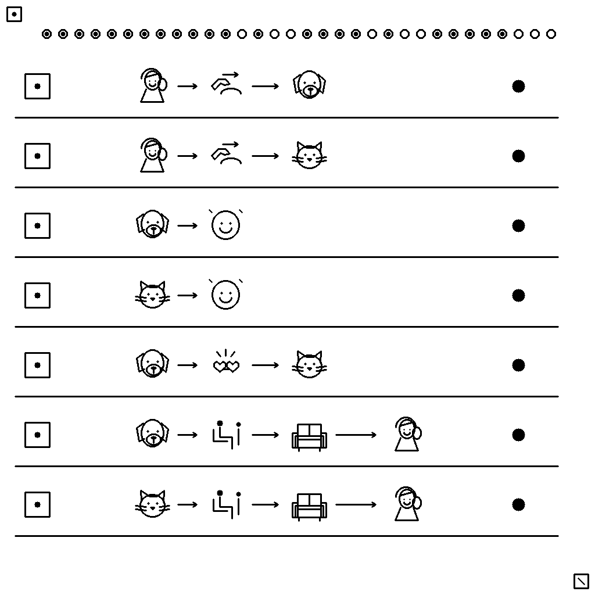

<figcaption class="pie-figura"><strong>Figura 9.11.</strong> Aparición 11 de la serie 11. Correspondencia de la lámina utilizada en la prueba: E. Imagen canónica conservada sin modificar sus muestras.<small class="autoria-figura">© 2026 Juan Antonio Lloret Egea. Algunos derechos reservados. | Open Researcher and Contributor ID (ORCID): 0000-0002-6634-3351 | Instituto Tecnológico Virtual de la Inteligencia Artificial para el Español™ (ITVIA) | IA eñ™ – La Biblia de la IA™ | Número Internacional Normalizado de Publicaciones Seriadas (ISSN) 2695-6411 | Licencia Creative Commons Atribución-NoComercial-SinDerivadas 4.0 Internacional (CC BY-NC-ND 4.0). Los componentes y fuentes de terceros conservan sus avisos.</small>Versiones: <a href="formatos/09-11-frame.svg">Scalable Vector Graphics (SVG), muestras exactas</a> · <a href="imagenes/09-11-frame.png">Portable Network Graphics (PNG)</a> · <a href="formatos/09-11-frame.jpg">Joint Photographic Experts Group (JPEG; .jpg)</a> · <a href="formatos/09-11-frame.webp">WebP sin pérdida</a>.</figcaption>
</figure>

El perro y el gato blanco se hacen amigos. Ambos están sentados en el sofá junto a la dueña; ella acaricia a los dos y ambos están alegres. Las relaciones de esta aparición no establecen una sucesión interna de caricias, posturas o estados.

| Relación | Ámbito y perspectiva | Participantes y papeles | Estado |
| --- | --- | --- | --- |
| F11-R01: acariciar | físico | agente: dueña; destinatario: perro | 0 |
| F11-R02: acariciar | físico | agente: dueña; destinatario: gato blanco | 0 |
| F11-R03: alegría | físico | sujeto: perro | 0 |
| F11-R04: alegría | físico | sujeto: gato blanco | 0 |
| F11-R05: hacerse amigos | físico | participante: perro; participante: gato blanco | 0 |
| F11-R06: sentarse junto a alguien | físico | sujeto: perro; asiento: sofá; acompañante: dueña | 0 |
| F11-R07: sentarse junto a alguien | físico | sujeto: gato blanco; asiento: sofá; acompañante: dueña | 0 |

## Alcance de la secuencia

La llegada, la mirada, la percepción y el pensamiento se conservan como momentos distintos. Los renglones de una misma aparición no forman, por su posición, otra sucesión temporal. «Guardado previamente» establece una anterioridad relativa sin inventar el momento exacto del almacenamiento.

La finalidad de la primera aparición queda ligada al depósito por sus referentes y su perspectiva. En la novena, el destinatario se vincula al mismo pescado depositado. No se añade que el perro conozca el pensamiento del gato ni que la entrega sea la causa demostrada de la amistad.

Las ilustraciones de continuación y desenlace permiten comparar una narración figurativa con la representación constituida:

<figure id="figura-9-12" class="figura-tratado">

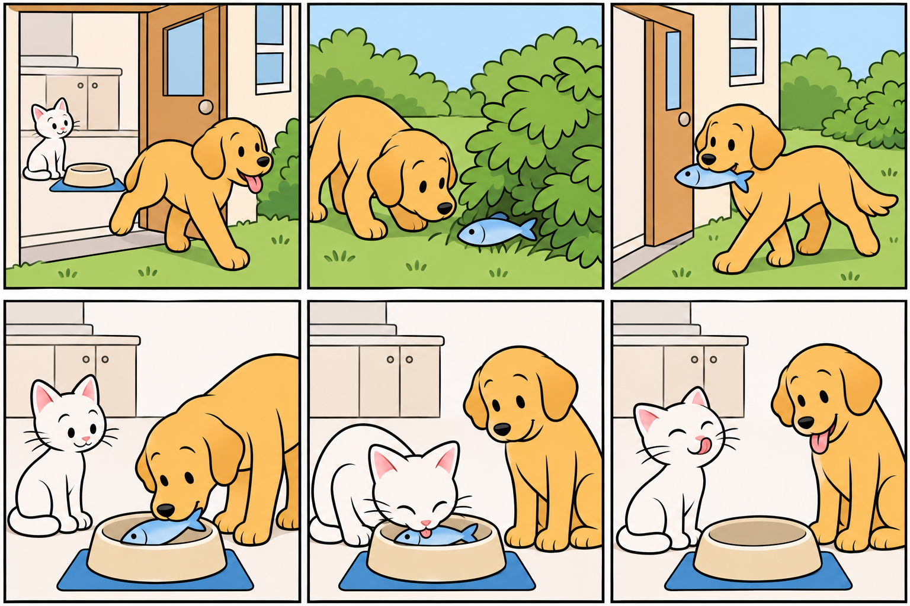

<figcaption class="pie-figura"><strong>Figura 9.12.</strong> Material ilustrado de la continuación. Su lectura se contrasta con las relaciones explícitas de las apariciones 7 a 10; no sustituye sus vectores.<small class="autoria-figura">© 2026 Juan Antonio Lloret Egea. Algunos derechos reservados. | Open Researcher and Contributor ID (ORCID): 0000-0002-6634-3351 | Instituto Tecnológico Virtual de la Inteligencia Artificial para el Español™ (ITVIA) | IA eñ™ – La Biblia de la IA™ | Número Internacional Normalizado de Publicaciones Seriadas (ISSN) 2695-6411 | Licencia Creative Commons Atribución-NoComercial-SinDerivadas 4.0 Internacional (CC BY-NC-ND 4.0). Los componentes y fuentes de terceros conservan sus avisos.</small>Versiones: <a href="formatos/09-12-continuacion.svg">Scalable Vector Graphics (SVG), aproximación visual</a> · <a href="imagenes/09-12-continuacion.png">Portable Network Graphics (PNG)</a> · <a href="formatos/09-12-continuacion.jpg">Joint Photographic Experts Group (JPEG; .jpg)</a> · <a href="formatos/09-12-continuacion.webp">WebP sin pérdida</a>.</figcaption>
</figure>

<figure id="figura-9-13" class="figura-tratado">

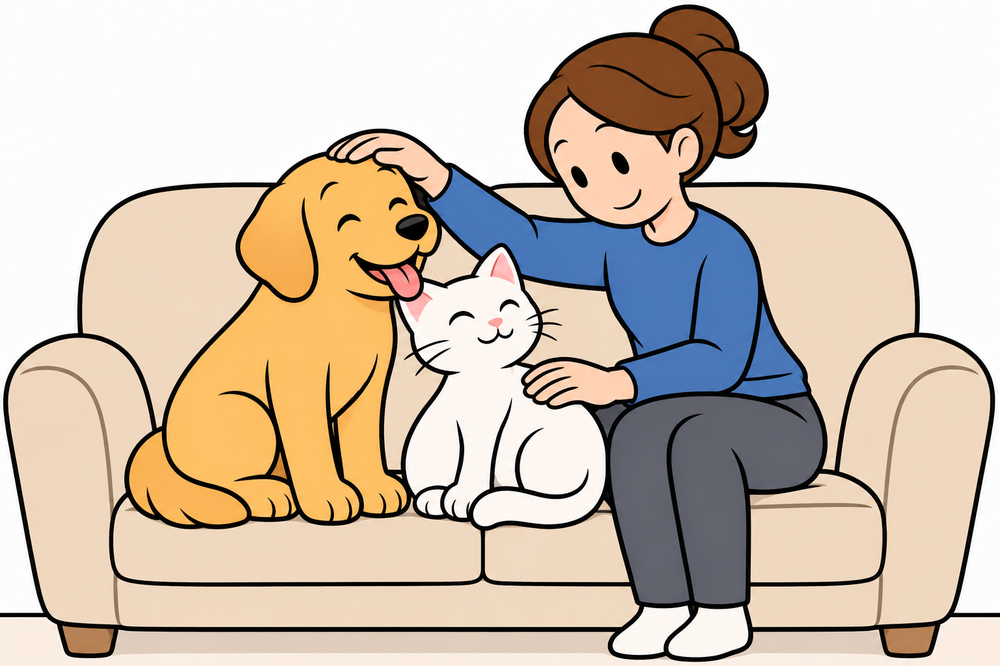

<figcaption class="pie-figura"><strong>Figura 9.13.</strong> Material ilustrado del desenlace. La constitución conserva separadamente la alegría y las caricias de cada animal, además de la amistad y la compañía.<small class="autoria-figura">© 2026 Juan Antonio Lloret Egea. Algunos derechos reservados. | Open Researcher and Contributor ID (ORCID): 0000-0002-6634-3351 | Instituto Tecnológico Virtual de la Inteligencia Artificial para el Español™ (ITVIA) | IA eñ™ – La Biblia de la IA™ | Número Internacional Normalizado de Publicaciones Seriadas (ISSN) 2695-6411 | Licencia Creative Commons Atribución-NoComercial-SinDerivadas 4.0 Internacional (CC BY-NC-ND 4.0). Los componentes y fuentes de terceros conservan sus avisos.</small>Versiones: <a href="formatos/09-13-desenlace.svg">Scalable Vector Graphics (SVG), aproximación visual</a> · <a href="imagenes/09-13-desenlace.png">Portable Network Graphics (PNG)</a> · <a href="formatos/09-13-desenlace.jpg">Joint Photographic Experts Group (JPEG; .jpg)</a> · <a href="formatos/09-13-desenlace.webp">WebP sin pérdida</a>.</figcaption>
</figure>

