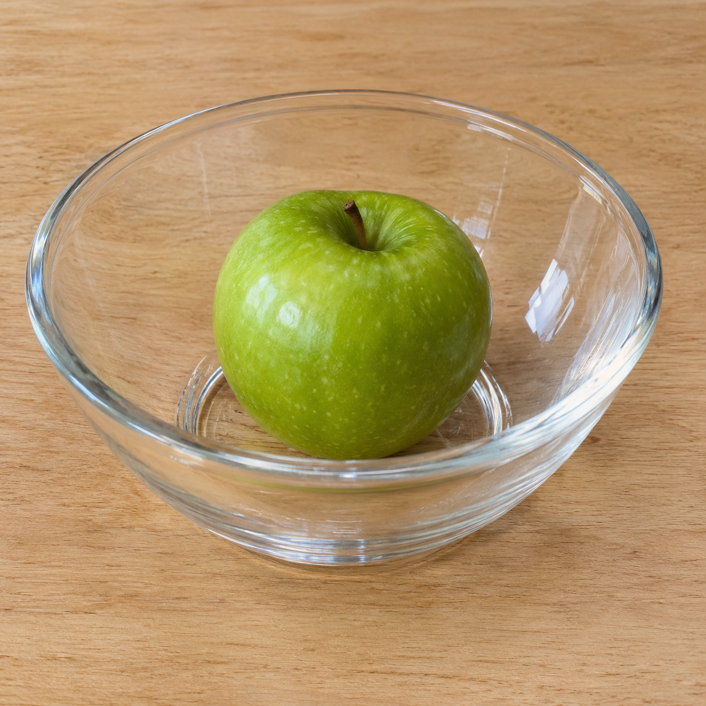

# 13. Escenas sintéticas y futuro contraste con el mundo

El recorrido exige finalmente una imagen del mundo y su célula asociada. Para preparar el procedimiento se produjeron tres escenas de apariencia fotográfica, clasificadas provisionalmente en dificultad baja, media y alta. Son **imágenes sintéticas**, no fotografías de sucesos observados. Su condición debe permanecer visible en cada uso.

La selección se realizó entre escenarios previamente delimitados por nivel. No constituye muestreo aleatorio de todas las escenas posibles del mundo. La dificultad declarada es una hipótesis que todavía debe contrastarse.

## Dificultad baja

<figure id="figura-13-1" class="figura-tratado">

<figcaption class="pie-figura"><strong>Figura 13.1.</strong> Imagen sintética de apariencia fotográfica. Una manzana verde y un recipiente transparente sobre una mesa ofrecen un caso inicial con pocos referentes. Su potencial digital está calculado. El capítulo 21 desarrolla su representación semántica constituida y sus consultas delimitadas.<small class="autoria-figura">© 2026 Juan Antonio Lloret Egea. Algunos derechos reservados. | Open Researcher and Contributor ID (ORCID): 0000-0002-6634-3351 | Instituto Tecnológico Virtual de la Inteligencia Artificial para el Español™ (ITVIA) | IA eñ™ – La Biblia de la IA™ | Número Internacional Normalizado de Publicaciones Seriadas (ISSN) 2695-6411 | Licencia Creative Commons Atribución-NoComercial-SinDerivadas 4.0 Internacional (CC BY-NC-ND 4.0). Los componentes y fuentes de terceros conservan sus avisos.</small>Versiones: <a href="formatos/13-01-bajo.svg" target="_blank" rel="noopener noreferrer">Scalable Vector Graphics (SVG), aproximación visual</a> · <a href="imagenes/13-01-bajo.png" target="_blank" rel="noopener noreferrer">Portable Network Graphics (PNG)</a> · <a href="formatos/13-01-bajo.jpg" target="_blank" rel="noopener noreferrer">Joint Photographic Experts Group (JPEG; .jpg)</a> · <a href="formatos/13-01-bajo.webp" target="_blank" rel="noopener noreferrer">WebP sin pérdida</a>.</figcaption>
</figure>

## Dificultad media

<figure id="figura-13-2" class="figura-tratado">

<figcaption class="pie-figura"><strong>Figura 13.2.</strong> Imagen sintética de apariencia fotográfica. El contacto entre manos, libro y mochila permite estudiar papeles y relaciones espaciales. Una sola imagen no determina si el libro está entrando o saliendo.<small class="autoria-figura">© 2026 Juan Antonio Lloret Egea. Algunos derechos reservados. | Open Researcher and Contributor ID (ORCID): 0000-0002-6634-3351 | Instituto Tecnológico Virtual de la Inteligencia Artificial para el Español™ (ITVIA) | IA eñ™ – La Biblia de la IA™ | Número Internacional Normalizado de Publicaciones Seriadas (ISSN) 2695-6411 | Licencia Creative Commons Atribución-NoComercial-SinDerivadas 4.0 Internacional (CC BY-NC-ND 4.0). Los componentes y fuentes de terceros conservan sus avisos.</small>Versiones: <a href="formatos/13-02-medio.svg" target="_blank" rel="noopener noreferrer">Scalable Vector Graphics (SVG), aproximación visual</a> · <a href="imagenes/13-02-medio.png" target="_blank" rel="noopener noreferrer">Portable Network Graphics (PNG)</a> · <a href="formatos/13-02-medio.jpg" target="_blank" rel="noopener noreferrer">Joint Photographic Experts Group (JPEG; .jpg)</a> · <a href="formatos/13-02-medio.webp" target="_blank" rel="noopener noreferrer">WebP sin pérdida</a>.</figcaption>
</figure>

## Dificultad alta

<figure id="figura-13-3" class="figura-tratado">

<figcaption class="pie-figura"><strong>Figura 13.3.</strong> Imagen sintética de apariencia fotográfica con varios participantes, objetos y acciones. Permite preparar un contraste de asociación entre agentes y acciones. No acredita todavía una representación celular del conjunto.<small class="autoria-figura">© 2026 Juan Antonio Lloret Egea. Algunos derechos reservados. | Open Researcher and Contributor ID (ORCID): 0000-0002-6634-3351 | Instituto Tecnológico Virtual de la Inteligencia Artificial para el Español™ (ITVIA) | IA eñ™ – La Biblia de la IA™ | Número Internacional Normalizado de Publicaciones Seriadas (ISSN) 2695-6411 | Licencia Creative Commons Atribución-NoComercial-SinDerivadas 4.0 Internacional (CC BY-NC-ND 4.0). Los componentes y fuentes de terceros conservan sus avisos.</small>Versiones: <a href="formatos/13-03-alto.svg" target="_blank" rel="noopener noreferrer">Scalable Vector Graphics (SVG), aproximación visual</a> · <a href="imagenes/13-03-alto.png" target="_blank" rel="noopener noreferrer">Portable Network Graphics (PNG)</a> · <a href="formatos/13-03-alto.jpg" target="_blank" rel="noopener noreferrer">Joint Photographic Experts Group (JPEG; .jpg)</a> · <a href="formatos/13-03-alto.webp" target="_blank" rel="noopener noreferrer">WebP sin pérdida</a>.</figcaption>
</figure>

## Correspondencia de cada imagen

Cada caso deberá conservar su imagen de origen y la célula que realmente le corresponda, con la constitución, la evidencia intermedia y la comprobación de retorno. Una pareja no se declara completada por colocar dos archivos en una misma carpeta.

La interpretación se confrontará con lo visible. Las oclusiones, las acciones temporalmente ambiguas y las intenciones no observables necesitan tratamiento explícito. La generalización a fotografías reales exigirá casos captados y documentados como tales, separados de este lote sintético.

Las tres imágenes tienen potencial digital calculado y retorno exacto comprobado. El caso de la manzana dispone de un perfil de escena, glifo, célula y consultas delimitadas, desarrollados en el [capítulo 21](25-desarrollo.md). Las escenas de dificultad media y alta continúan pendientes de constitución semántica propia; no se les asignan las células del relato animal por semejanza temática. El [registro de correspondencias](23-correspondencias.md) muestra cada imagen, su valor y la situación de los demás componentes.

## Ampliación al dominio de los aparatos

El [capítulo 12](22-television.md) añade una comparación sintética de televisión inteligente y cuatro unidades canónicas constituidas. La asociación entre imagen y representación se ha establecido manualmente; las condiciones no observables de sistema, causa y reparación proceden del caso narrativo. Esta ampliación no acredita un transductor general de fotografías.

<!-- Autoría: © 2026 Juan Antonio Lloret Egea. CC BY-NC-ND 4.0. https://doi.org/10.21428/39829d0b.8b9c0155. -->
