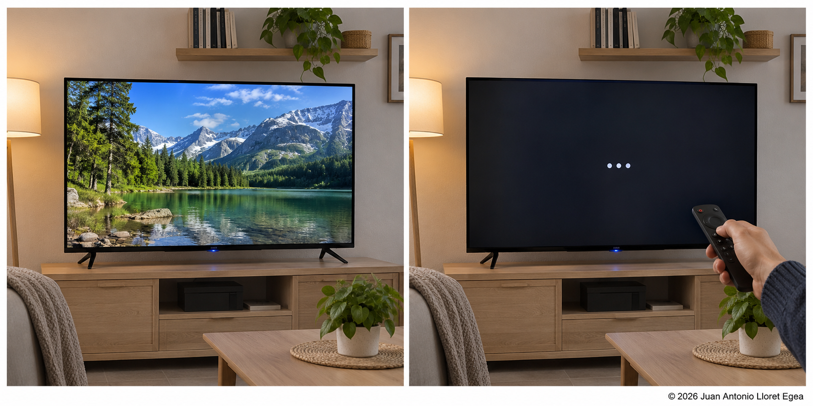
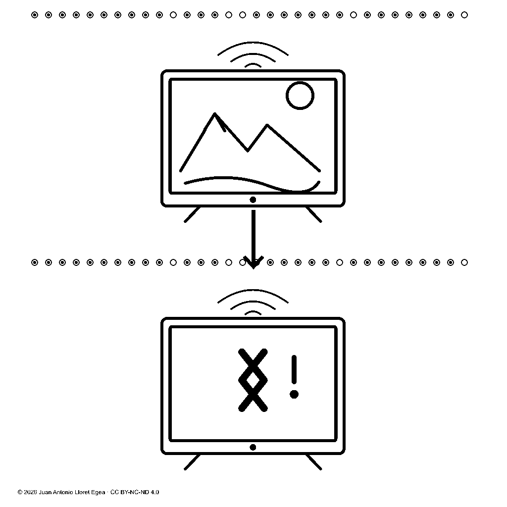
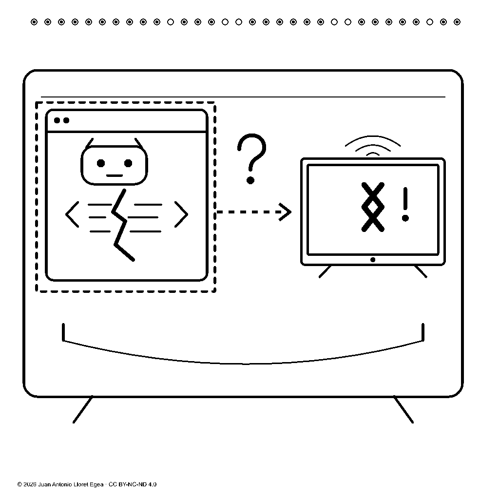
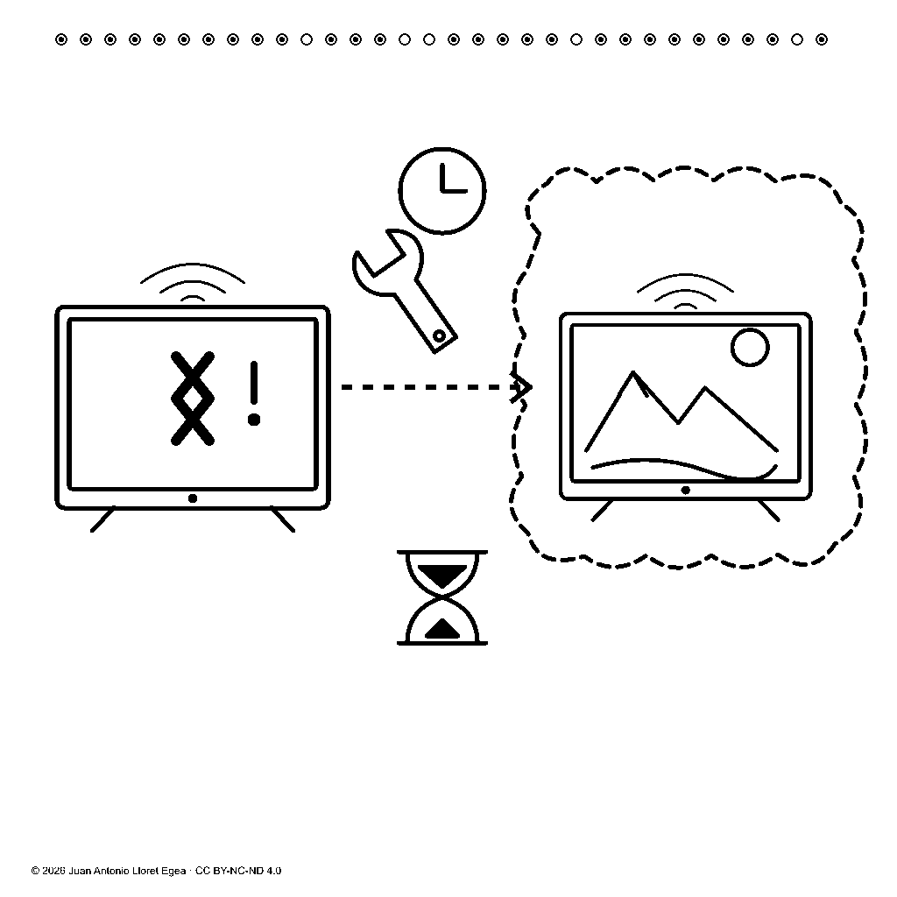

# 12. Televisión inteligente: estados, hipótesis causal y reparación pendiente

## Objeto del nuevo dominio

Este caso introduce una televisión inteligente, habitualmente denominada **Smart TV**, para estudiar la ampliación del repertorio a objetos técnicos. El contenido de referencia establece que el mismo aparato funcionaba anteriormente y ahora no funciona; se plantea como posible causa la corrupción de su sistema Android y se requiere repararlo. La recuperación del funcionamiento se representa como finalidad de la intervención.

La escena constituye un caso narrativo de investigación. No describe un diagnóstico técnico realizado sobre un televisor concreto. Su interés reside en conservar tres distinciones: negación del funcionamiento, indeterminación de la causa y carácter pendiente de la reparación.

## Imagen de referencia y evidencia disponible

<figure id="figura-22-1" class="figura-tratado">

<figcaption class="pie-figura"><strong>Figura 12.1.</strong> Comparación sintética de apariencia fotográfica. La imagen ilustra dos estados del caso; no es evidencia de diagnóstico ni una captura de un aparato real.<small class="autoria-figura">© 2026 Juan Antonio Lloret Egea. Algunos derechos reservados. | Open Researcher and Contributor ID (ORCID): 0000-0002-6634-3351 | Instituto Tecnológico Virtual de la Inteligencia Artificial para el Español™ (ITVIA) | IA eñ™ – La Biblia de la IA™ | Número Internacional Normalizado de Publicaciones Seriadas (ISSN) 2695-6411 | Licencia Creative Commons Atribución-NoComercial-SinDerivadas 4.0 Internacional (CC BY-NC-ND 4.0). Los componentes y fuentes de terceros conservan sus avisos.</small></figcaption>
</figure>

La imagen es sintética y tiene apariencia fotográfica. En la primera mitad, la pantalla muestra un paisaje. En la segunda aparecen tres puntos, un indicador luminoso y un mando dirigido al aparato. Una captura estática no permite determinar cuánto tiempo lleva en ese estado ni si el arranque está detenido. El fallo presente se constituye mediante el contenido narrativo de referencia.

La imagen tampoco identifica el sistema operativo, acredita corrupción de sus datos ni demuestra una relación causal. Esas condiciones proceden del caso constituido y deben conservar su origen. La hipótesis causal se representa como indeterminada. No se deduce de la apariencia de la pantalla.

## Tres láminas y cuatro unidades representadas

<figure id="figura-22-2" class="figura-tratado">

<figcaption class="pie-figura"><strong>Figura 12.2.</strong> Dos apariciones con precedencia explícita. La representación conserva la diferencia entre funcionamiento afirmado y negado.<small class="autoria-figura">© 2026 Juan Antonio Lloret Egea. Algunos derechos reservados. | Open Researcher and Contributor ID (ORCID): 0000-0002-6634-3351 | Instituto Tecnológico Virtual de la Inteligencia Artificial para el Español™ (ITVIA) | IA eñ™ – La Biblia de la IA™ | Número Internacional Normalizado de Publicaciones Seriadas (ISSN) 2695-6411 | Licencia Creative Commons Atribución-NoComercial-SinDerivadas 4.0 Internacional (CC BY-NC-ND 4.0). Los componentes y fuentes de terceros conservan sus avisos.</small>Versiones: <a href="formatos/22-02-funcionamiento-y-fallo.svg" target="_blank" rel="noopener noreferrer">Gráficos vectoriales escalables (SVG), geometría de origen</a> · <a href="formatos/22-02-funcionamiento-y-fallo-muestras.svg" target="_blank" rel="noopener noreferrer">Muestras exactas en geometría vectorial</a> · <a href="formatos/22-02-funcionamiento-y-fallo.webp" target="_blank" rel="noopener noreferrer">WebP sin pérdida</a>.</figcaption>
</figure>

La primera lámina dispone dos apariciones del mismo aparato con precedencia explícita. El funcionamiento anterior se afirma y el presente se niega. Los arcos de conectividad pretenden caracterizar el aparato inteligente; no prueban que exista una conexión activa ni que el fallo sea de red.

<figure id="figura-22-3" class="figura-tratado">

<figcaption class="pie-figura"><strong>Figura 12.3.</strong> Propuesta de representación del sistema del aparato y de una hipótesis causal. El signo de robot no acredita identificación de Android.<small class="autoria-figura">© 2026 Juan Antonio Lloret Egea. Algunos derechos reservados. | Open Researcher and Contributor ID (ORCID): 0000-0002-6634-3351 | Instituto Tecnológico Virtual de la Inteligencia Artificial para el Español™ (ITVIA) | IA eñ™ – La Biblia de la IA™ | Número Internacional Normalizado de Publicaciones Seriadas (ISSN) 2695-6411 | Licencia Creative Commons Atribución-NoComercial-SinDerivadas 4.0 Internacional (CC BY-NC-ND 4.0). Los componentes y fuentes de terceros conservan sus avisos.</small>Versiones: <a href="formatos/22-03-hipotesis-causal.svg" target="_blank" rel="noopener noreferrer">Gráficos vectoriales escalables (SVG), geometría de origen</a> · <a href="formatos/22-03-hipotesis-causal-muestras.svg" target="_blank" rel="noopener noreferrer">Muestras exactas en geometría vectorial</a> · <a href="formatos/22-03-hipotesis-causal.webp" target="_blank" rel="noopener noreferrer">WebP sin pérdida</a>.</figcaption>
</figure>

La segunda lámina representa el sistema del aparato, una posible alteración y un vínculo causal hipotético hacia el fallo. El pequeño robot es un signo experimental de referencia para Android; no es un logotipo oficial. El reconocimiento nominal obtenido posteriormente no basta para establecer su pertenencia como sistema del aparato. Puede confundirse con un agente artificial o una aplicación. Es una limitación del signo propuesto, no una razón para sustituir su interpretación por una definición verbal obligatoria.

<figure id="figura-22-4" class="figura-tratado">

<figcaption class="pie-figura"><strong>Figura 12.4.</strong> Propuesta de reparación requerida con recuperación del funcionamiento como finalidad. Su interpretación se contrasta con las distinciones de acción, estado pendiente y finalidad.<small class="autoria-figura">© 2026 Juan Antonio Lloret Egea. Algunos derechos reservados. | Open Researcher and Contributor ID (ORCID): 0000-0002-6634-3351 | Instituto Tecnológico Virtual de la Inteligencia Artificial para el Español™ (ITVIA) | IA eñ™ – La Biblia de la IA™ | Número Internacional Normalizado de Publicaciones Seriadas (ISSN) 2695-6411 | Licencia Creative Commons Atribución-NoComercial-SinDerivadas 4.0 Internacional (CC BY-NC-ND 4.0). Los componentes y fuentes de terceros conservan sus avisos.</small>Versiones: <a href="formatos/22-04-reparacion-pendiente.svg" target="_blank" rel="noopener noreferrer">Gráficos vectoriales escalables (SVG), geometría de origen</a> · <a href="formatos/22-04-reparacion-pendiente-muestras.svg" target="_blank" rel="noopener noreferrer">Muestras exactas en geometría vectorial</a> · <a href="formatos/22-04-reparacion-pendiente.webp" target="_blank" rel="noopener noreferrer">WebP sin pérdida</a>.</figcaption>
</figure>

La tercera lámina relaciona el aparato con fallo, una intervención y el funcionamiento pretendido. La herramienta, las referencias temporales y el contorno discontinuo intentan distinguir reparación pendiente y resultado deseado. Queda por contrastar si comunican necesidad, posibilidad o una reparación ya realizada. La existencia del dibujo no resuelve esa ambigüedad. El reloj y el reloj de arena son convenciones visuales propuestas para la condición pendiente; no establecen una duración ni convierten el tiempo en primitiva.

Las unidades representadas tienen identidad propia. Los dos primeros estados expresan la precedencia indicada por el relato. Esa ordenación no introduce tiempo como primitiva matemática. Las unidades de hipótesis y finalidad no constituyen, por su posición documental, hechos físicos posteriores ya consumados.

## Constitución y estados ternarios

En las relaciones semánticas de este caso, 0 afirma, 1 niega y U conserva indeterminación. Los campos que seleccionan identidades, referentes y operadores utilizan 0 y 1 como información estructural. Su papel debe mantenerse separado del significado de una calificación de aptitud.

| Unidad | Contenido constituido | Estados de las relaciones |
| --- | --- | --- |
| 1 | El aparato funcionaba en el estado anterior | Funcionamiento: 0. |
| 2 | El mismo aparato no funciona en el estado presente | Funcionamiento: 1. |
| 3 | Sistema del aparato, posible corrupción y posible causa del fallo | Funcionamiento: 1; pertenencia del sistema: 0; corrupción: U; vínculo causal: U. |
| 4 | Reparación requerida y pendiente, con recuperación pretendida | Necesidad pendiente: 0; finalidad de recuperación: 0. |

Las cuatro afirmaciones, dos negaciones y dos indeterminaciones de esta tabla son estados narrativos. No constituyen una evaluación de ocho preguntas ni una célula de ocho posiciones. Cada composición conserva su propia estructura e identidad.

## Composiciones y economía comprobada

| Unidad | Posiciones de contenido | Capacidad | Composición |
| --- | ---: | ---: | --- |
| 1 | 44 | 45 | Cinco células (9,3). |
| 2 | 44 | 45 | Cinco células (9,3). |
| 3 | 88 | 88 | Ocho células (9,3) y una (16,4). |
| 4 | 56 | 57 | Una célula (9,3) y tres (16,4). |
| Total | 232 | 235 | Diecinueve células (9,3) y cuatro (16,4). |

Se conservan veintitrés células. Las tres posiciones de reserva pertenecen a la realización experimental y quedan identificadas; no son preguntas, relaciones adicionales ni valores U. Su existencia impide presentar el resultado como conformidad semántica integral de todas las posiciones. La economía se refiere a una distribución mínima bajo la codificación adoptada, no a un mínimo universal entre todas las gramáticas posibles.

Los <a href="datos/22-television-celulas.json" target="_blank" rel="noopener noreferrer">vectores y sus correspondencias</a> permiten inspeccionar las cuatro composiciones. La recuperación formal se ha cotejado con los registros conservados. Los archivos de muestras, las representaciones vectoriales exactas y las copias WebP conservan igualdad a la resolución canónica. La geometría de los glifos no debe confundirse con la representación polar interactiva de una célula.

## Correspondencia formal y alcance perceptivo

La comprobación de correspondencias verificó cuatro retornos celulares, rechazó un símbolo ajeno a la terna en cada una de las 235 posiciones, detectó alteraciones de las tres reservas y comprobó rechazo de truncamientos y morfologías incompatibles. Se cotejaron las imágenes, sus representaciones exactas, los registros persistentes y las asociaciones del catálogo visual. Estas comprobaciones acreditan conservación formal en el catálogo examinado.

La recuperación visual existente compara imágenes canónicas con las del catálogo admitido. No interpreta fotografías desconocidas ni demuestra comprensión del significado de una escena nueva. Asimismo, el catálogo visual conserva asociaciones; retirar sus glosas verbales no lo convierte por sí solo en un sistema de aprendizaje. La observación de objetos, la identificación de Android y la interpretación de causa y necesidad siguen requiriendo contraste.

La imagen sintética queda asociada manualmente a las dos primeras unidades. Las otras dos no disponen de una fotografía que testimonie corrupción o reparación. La correspondencia documental no se presenta como extracción automática desde la imagen ni como reconstrucción de la fotografía a partir del vector.

La imagen de referencia y los cuatro glifos disponen de potenciales calculados. El [capítulo de potencial](17-potencial.md) define su proyección y el [registro de correspondencias](23-correspondencias.md) permite consultar sus valores exactos, células y alcance. El potencial de la imagen completa no se atribuye indistintamente a sus regiones ni a sus glifos.

## Comprensión observada

La batería inicial de nueve preguntas obtuvo U000UUUU0, con cuatro conformidades y cinco indeterminaciones. Las revisiones posteriores aislaron relaciones de intervención, estado pendiente y finalidad. El último contraste de transiciones obtuvo 000000000 para sus nueve condiciones críticas, con distinción entre reparar para recuperar funcionamiento y actuar para apagar.

Ese resultado corresponde a una composición específica y a un candidato con exposición previa. No demuestra que se haya comprendido íntegramente la narración original: la pertenencia de Android al aparato, la corrupción sospechada y la causalidad hipotética siguen requiriendo contraste. El [capítulo de resultados](12-prueba.md) expone estas distinciones.

La lectura se realiza sobre imágenes. El candidato produce la descripción verbal; la evaluación comprueba si conserva el contenido, sin enseñar una glosa como definición necesaria de cada signo. La regla de aptitud se aplica a parámetros previamente constituidos y no permite compensar una indeterminación crítica con aciertos accesorios.

<!-- Autoría: © 2026 Juan Antonio Lloret Egea. CC BY-NC-ND 4.0. https://doi.org/10.21428/39829d0b.8b9c0155. -->
