# 17. Correspondencias entre imagen, glifo, texto, célula y potencial

**Imagen real ↔ (glifo, texto) ↔ Célula del Sistema Vectorial (SV) ↔ Potencial de un *frame* del Sistema Vectorial (SV)**

La correspondencia se consulta mediante un registro estable. S1, S2… identifican sucesos dentro del conjunto cuyo identificador completo se conserva en los datos. El mismo registro enlaza glifo, constitución, texto de referencia, células y potencial exacto. La imagen fuente puede contener varias regiones vinculadas a sucesos distintos; esa relación se declara expresamente.

## Cómo recorrer una correspondencia

En el ejemplo del televisor, Imagen4 es la imagen sintética de dos paneles. Su mitad izquierda se vincula a S40 y la derecha a S41. Cada suceso tiene un glifo propio, sus células y el potencial de ese glifo. La imagen completa tiene otro potencial, calculado sobre todas sus muestras. No se utiliza el potencial de la imagen completa como si fuera el de cada recorte.

Al abrir S40 se ve el glifo y el texto de referencia, seguido de las células ordenadas. La sucesión de símbolos de cada célula se lee de P1 a Pn. Su potencia de representación procede de la constitución, no de interpretar esos símbolos como palabras. El enlace de potencial exacto contiene el entero del convenio definido en el capítulo anterior; el valor decimal mostrado es una aproximación.

El retorno desde una referencia completa permite recuperar el recurso visual, su composición y su expresión asociada. El retorno numérico exacto recupera las muestras normalizadas. El retorno desde una frase libre exige interpretar sus relaciones y determinar a qué suceso se refiere; no basta con que el texto mencione objetos semejantes.

## Imágenes fuente

Las cuatro entradas siguientes son sintéticas de apariencia fotográfica. El registro diferencia esta procedencia de una captura real. Las tres primeras tienen potencial calculado, pero todavía no tienen glifos semánticos ni células propios constituidos. Esa ausencia no se sustituye con células de otro caso ni con el valor U.

<section id="imagen-1">
<h3>Imagen1</h3>
<figure id="figura-17-1" class="figura-tratado"><a href="imagenes/origen/Imagen1.png" target="_blank" rel="noopener noreferrer">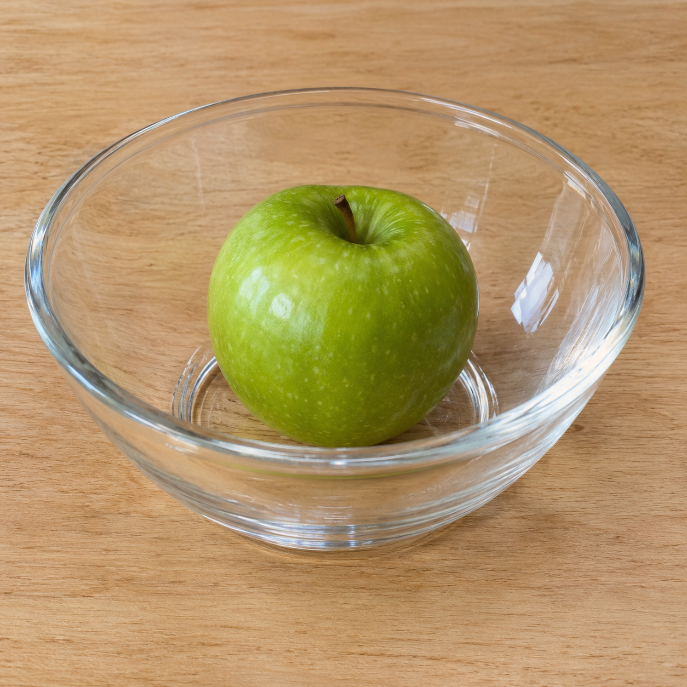</a><figcaption>Figura 17.1. Imagen fuente sintética.<small class="autoria-figura">© 2026 Juan Antonio Lloret Egea · Instituto Tecnológico Virtual de la Inteligencia Artificial para el Español (ITVIA) · CC BY-NC-ND 4.0</small></figcaption></figure>

Resolución: 1254 × 1254; cuatro componentes de ocho bits. Potencial Atlas aproximado: **61.605970658723**. <a href="datos/potenciales/Imagen1.potencial-be.gz" target="_blank" rel="noopener noreferrer">Valor exacto comprimido</a>.

Glifo semántico y célula todavía no constituidos. 

</section>

<section id="imagen-2">
<h3>Imagen2</h3>
<figure id="figura-17-2" class="figura-tratado"><figcaption>Figura 17.2. Imagen fuente sintética.<small class="autoria-figura">© 2026 Juan Antonio Lloret Egea · Instituto Tecnológico Virtual de la Inteligencia Artificial para el Español (ITVIA) · CC BY-NC-ND 4.0</small></figcaption></figure>

Resolución: 1254 × 1254; cuatro componentes de ocho bits. Potencial Atlas aproximado: **57.086992578431**. <a href="datos/potenciales/Imagen2.potencial-be.gz" target="_blank" rel="noopener noreferrer">Valor exacto comprimido</a>.

Glifo semántico y célula todavía no constituidos. 

</section>

<section id="imagen-3">
<h3>Imagen3</h3>
<figure id="figura-17-3" class="figura-tratado"><figcaption>Figura 17.3. Imagen fuente sintética.<small class="autoria-figura">© 2026 Juan Antonio Lloret Egea · Instituto Tecnológico Virtual de la Inteligencia Artificial para el Español (ITVIA) · CC BY-NC-ND 4.0</small></figcaption></figure>

Resolución: 1254 × 1254; cuatro componentes de ocho bits. Potencial Atlas aproximado: **53.818723459128**. <a href="datos/potenciales/Imagen3.potencial-be.gz" target="_blank" rel="noopener noreferrer">Valor exacto comprimido</a>.

Glifo semántico y célula todavía no constituidos. 

</section>

<section id="imagen-4">
<h3>Imagen4</h3>
<figure id="figura-17-4" class="figura-tratado"><a href="imagenes/origen/Imagen4.png" target="_blank" rel="noopener noreferrer">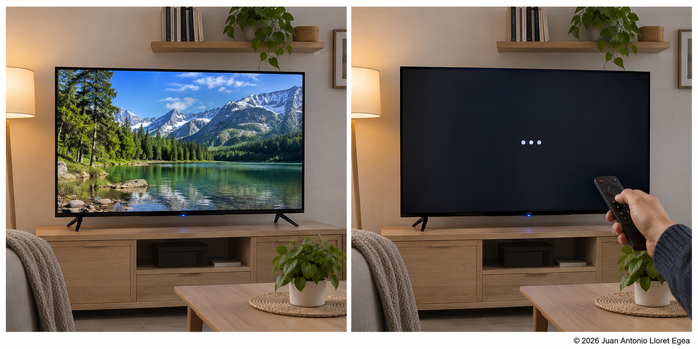</a><figcaption>Figura 17.4. Imagen fuente sintética.<small class="autoria-figura">© 2026 Juan Antonio Lloret Egea · Instituto Tecnológico Virtual de la Inteligencia Artificial para el Español (ITVIA) · CC BY-NC-ND 4.0</small></figcaption></figure>

Resolución: 1774 × 887; cuatro componentes de ocho bits. Potencial Atlas aproximado: **63.904678214892**. <a href="datos/potenciales/Imagen4.potencial-be.gz" target="_blank" rel="noopener noreferrer">Valor exacto comprimido</a>.

Las dos mitades ilustran S40 y S41; causa y reparación no son observables en esta imagen. [S40](#suceso-S40) · [S41](#suceso-S41).

</section>

## Sucesos y composiciones celulares

Las quince fichas siguientes corresponden al caso completo de once apariciones y a las cuatro unidades del televisor. Cada ficha desplegable reúne su glifo, la expresión de referencia y las células. El texto de referencia expresa la constitución del caso; no se atribuye al candidato. El candidato produce una respuesta independiente durante la prueba y esa respuesta se contrasta con la referencia. Sus resultados se presentan en el capítulo de comprensión.

Las expresiones «anterior» y «posterior» describen relaciones constituidas, sin introducir tiempo como primitiva. Los números de inscripción conservan identidad documental y no demuestran por sí solos causalidad ni una cronología física.

S1 · Alimentación y convivencia · 10 células

<a href="imagenes/sucesos/S1.png" target="_blank" rel="noopener noreferrer">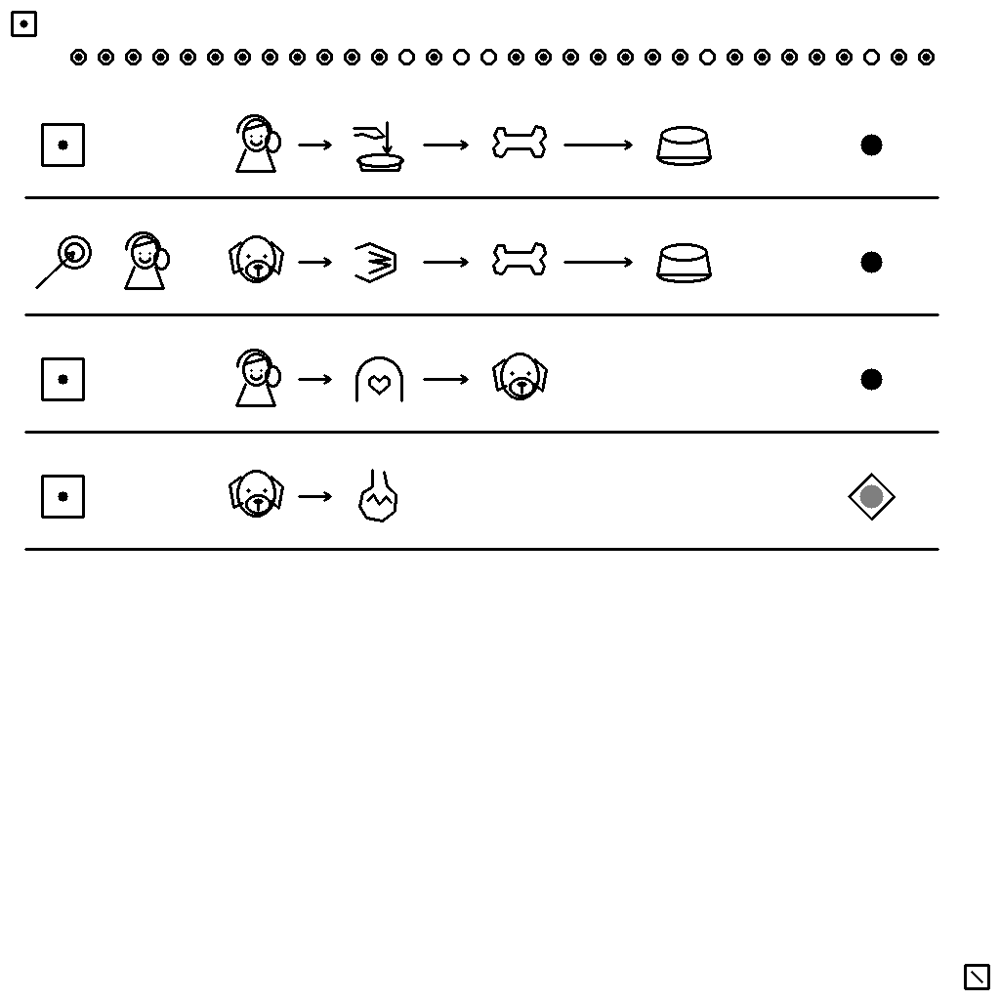</a><small class="autoria-figura">© 2026 Juan Antonio Lloret Egea · Instituto Tecnológico Virtual de la Inteligencia Artificial para el Español (ITVIA) · CC BY-NC-ND 4.0</small>

<strong>Expresión de referencia:</strong> La dueña del perro deposita el hueso en el plato con la finalidad de que el perro lo coma. No está determinado si el perro tiene hambre.

<strong>Constitución:</strong> LBI09-V2. <strong>Terna:</strong> 78 valores 0, 25 valores 1, 1 valores U.

<strong>Imagen fuente:</strong> No hay captura real asociada; el contenido procede de la constitución narrativa o del contraste visual.

<strong>Potencial Atlas aproximado del glifo:</strong> 64.000000000000. <a href="datos/potenciales/Recurso5.potencial-be.gz" target="_blank" rel="noopener noreferrer">Valor exacto comprimido</a>. Longitud del entero: 33554562 bits.

<table><thead><tr><th>Célula</th><th>Morfología</th><th>P1…Pn</th></tr></thead><tbody><tr><td>1</td><td>(9,3)</td><td class="registro-vector">000000000</td></tr><tr><td>2</td><td>(9,3)</td><td class="registro-vector">000101100</td></tr><tr><td>3</td><td>(9,3)</td><td class="registro-vector">000001000</td></tr><tr><td>4</td><td>(9,3)</td><td class="registro-vector">001000000</td></tr><tr><td>5</td><td>(9,3)</td><td class="registro-vector">000010100</td></tr><tr><td>6</td><td>(9,3)</td><td class="registro-vector">010100000</td></tr><tr><td>7</td><td>(9,3)</td><td class="registro-vector">001001001</td></tr><tr><td>8</td><td>(9,3)</td><td class="registro-vector">000101100</td></tr><tr><td>9</td><td>(16,4)</td><td class="registro-vector">0010011110001001</td></tr><tr><td>10</td><td>(16,4)</td><td class="registro-vector">000000011001000U</td></tr></tbody></table>

S2 · Alimentación y convivencia · 3 células

<a href="imagenes/sucesos/S2.png" target="_blank" rel="noopener noreferrer">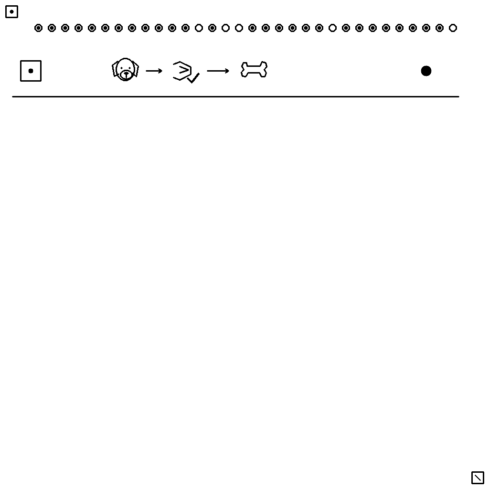</a><small class="autoria-figura">© 2026 Juan Antonio Lloret Egea · Instituto Tecnológico Virtual de la Inteligencia Artificial para el Español (ITVIA) · CC BY-NC-ND 4.0</small>

<strong>Expresión de referencia:</strong> El perro ha terminado de comerse el hueso.

<strong>Constitución:</strong> LBI09-V2. <strong>Terna:</strong> 40 valores 0, 8 valores 1, 0 valores U.

<strong>Imagen fuente:</strong> No hay captura real asociada; el contenido procede de la constitución narrativa o del contraste visual.

<strong>Potencial Atlas aproximado del glifo:</strong> 64.000000000000. <a href="datos/potenciales/Recurso36.potencial-be.gz" target="_blank" rel="noopener noreferrer">Valor exacto comprimido</a>. Longitud del entero: 33554562 bits.

<table><thead><tr><th>Célula</th><th>Morfología</th><th>P1…Pn</th></tr></thead><tbody><tr><td>1</td><td>(16,4)</td><td class="registro-vector">0000000000001011</td></tr><tr><td>2</td><td>(16,4)</td><td class="registro-vector">0000001000000001</td></tr><tr><td>3</td><td>(16,4)</td><td class="registro-vector">1000000100100000</td></tr></tbody></table>

S3 · Alimentación y convivencia · 6 células

<a href="imagenes/sucesos/S3.png" target="_blank" rel="noopener noreferrer">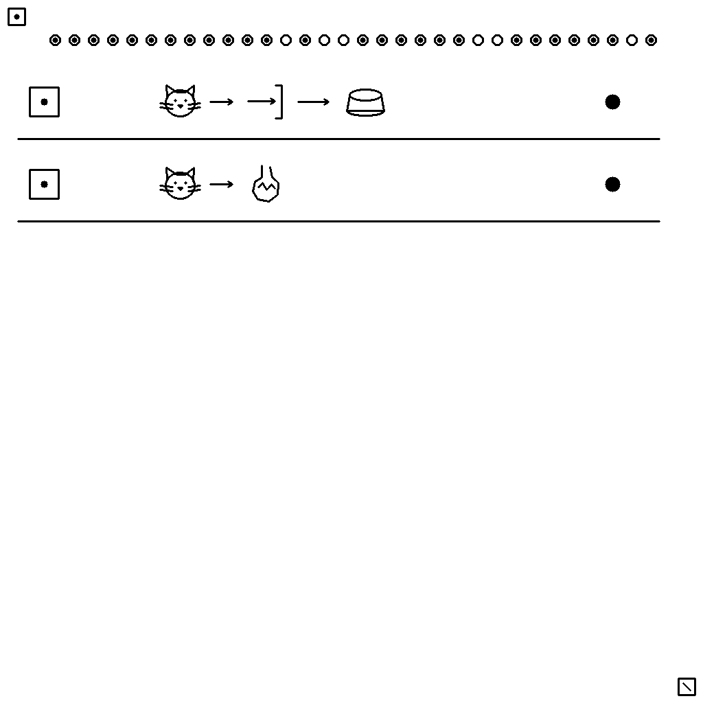</a><small class="autoria-figura">© 2026 Juan Antonio Lloret Egea · Instituto Tecnológico Virtual de la Inteligencia Artificial para el Español (ITVIA) · CC BY-NC-ND 4.0</small>

<strong>Expresión de referencia:</strong> El gato blanco llega al plato y tiene hambre.

<strong>Constitución:</strong> LBI09-V2. <strong>Terna:</strong> 43 valores 0, 18 valores 1, 0 valores U.

<strong>Imagen fuente:</strong> No hay captura real asociada; el contenido procede de la constitución narrativa o del contraste visual.

<strong>Potencial Atlas aproximado del glifo:</strong> 64.000000000000. <a href="datos/potenciales/Recurso77.potencial-be.gz" target="_blank" rel="noopener noreferrer">Valor exacto comprimido</a>. Longitud del entero: 33554562 bits.

<table><thead><tr><th>Célula</th><th>Morfología</th><th>P1…Pn</th></tr></thead><tbody><tr><td>1</td><td>(9,3)</td><td class="registro-vector">000000000</td></tr><tr><td>2</td><td>(9,3)</td><td class="registro-vector">000101100</td></tr><tr><td>3</td><td>(9,3)</td><td class="registro-vector">000011000</td></tr><tr><td>4</td><td>(9,3)</td><td class="registro-vector">000100110</td></tr><tr><td>5</td><td>(9,3)</td><td class="registro-vector">100110101</td></tr><tr><td>6</td><td>(16,4)</td><td class="registro-vector">0000001100110001</td></tr></tbody></table>

S4 · Alimentación y convivencia · 3 células

<a href="imagenes/sucesos/S4.png" target="_blank" rel="noopener noreferrer">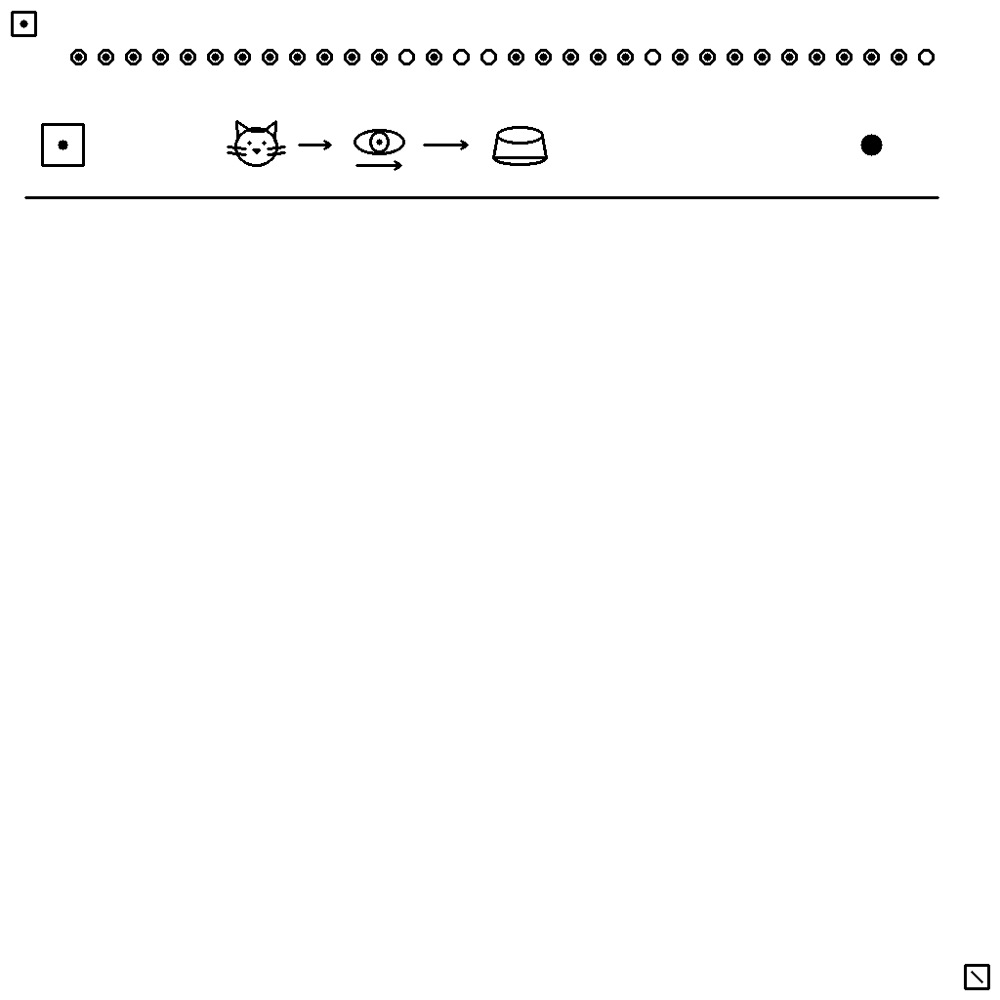</a><small class="autoria-figura">© 2026 Juan Antonio Lloret Egea · Instituto Tecnológico Virtual de la Inteligencia Artificial para el Español (ITVIA) · CC BY-NC-ND 4.0</small>

<strong>Expresión de referencia:</strong> El gato blanco mira el plato.

<strong>Constitución:</strong> LBI09-V2. <strong>Terna:</strong> 38 valores 0, 10 valores 1, 0 valores U.

<strong>Imagen fuente:</strong> No hay captura real asociada; el contenido procede de la constitución narrativa o del contraste visual.

<strong>Potencial Atlas aproximado del glifo:</strong> 64.000000000000. <a href="datos/potenciales/Recurso118.potencial-be.gz" target="_blank" rel="noopener noreferrer">Valor exacto comprimido</a>. Longitud del entero: 33554562 bits.

<table><thead><tr><th>Célula</th><th>Morfología</th><th>P1…Pn</th></tr></thead><tbody><tr><td>1</td><td>(16,4)</td><td class="registro-vector">0000000000001011</td></tr><tr><td>2</td><td>(16,4)</td><td class="registro-vector">0000010000000001</td></tr><tr><td>3</td><td>(16,4)</td><td class="registro-vector">0001000110101000</td></tr></tbody></table>

S5 · Alimentación y convivencia · 6 células

<a href="imagenes/sucesos/S5.png" target="_blank" rel="noopener noreferrer">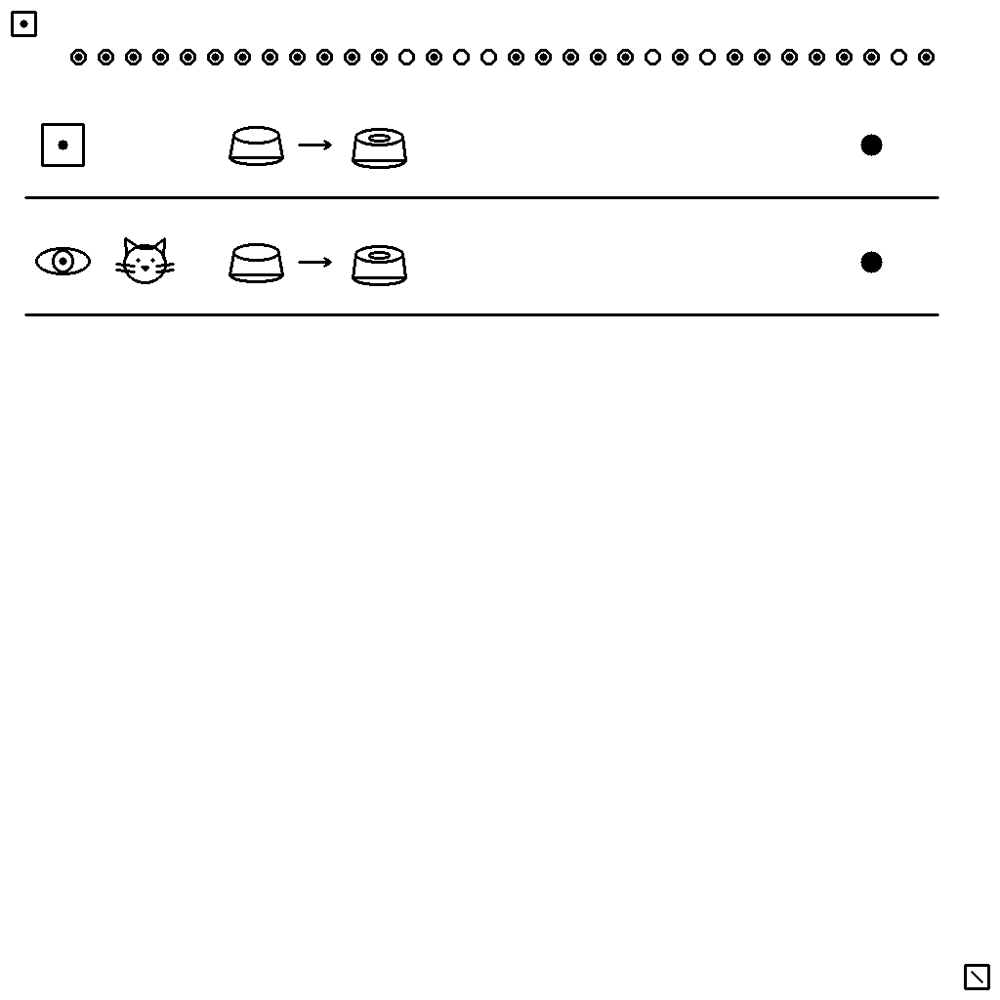</a><small class="autoria-figura">© 2026 Juan Antonio Lloret Egea · Instituto Tecnológico Virtual de la Inteligencia Artificial para el Español (ITVIA) · CC BY-NC-ND 4.0</small>

<strong>Expresión de referencia:</strong> El plato está vacío y el gato blanco percibe ese vacío.

<strong>Constitución:</strong> LBI09-V2. <strong>Terna:</strong> 42 valores 0, 19 valores 1, 0 valores U.

<strong>Imagen fuente:</strong> No hay captura real asociada; el contenido procede de la constitución narrativa o del contraste visual.

<strong>Potencial Atlas aproximado del glifo:</strong> 64.000000000000. <a href="datos/potenciales/Recurso159.potencial-be.gz" target="_blank" rel="noopener noreferrer">Valor exacto comprimido</a>. Longitud del entero: 33554562 bits.

<table><thead><tr><th>Célula</th><th>Morfología</th><th>P1…Pn</th></tr></thead><tbody><tr><td>1</td><td>(9,3)</td><td class="registro-vector">000000000</td></tr><tr><td>2</td><td>(9,3)</td><td class="registro-vector">000101100</td></tr><tr><td>3</td><td>(9,3)</td><td class="registro-vector">000101000</td></tr><tr><td>4</td><td>(9,3)</td><td class="registro-vector">000100110</td></tr><tr><td>5</td><td>(9,3)</td><td class="registro-vector">001010000</td></tr><tr><td>6</td><td>(16,4)</td><td class="registro-vector">1100010111001101</td></tr></tbody></table>

S6 · Alimentación y convivencia · 6 células

<a href="imagenes/sucesos/S6.png" target="_blank" rel="noopener noreferrer">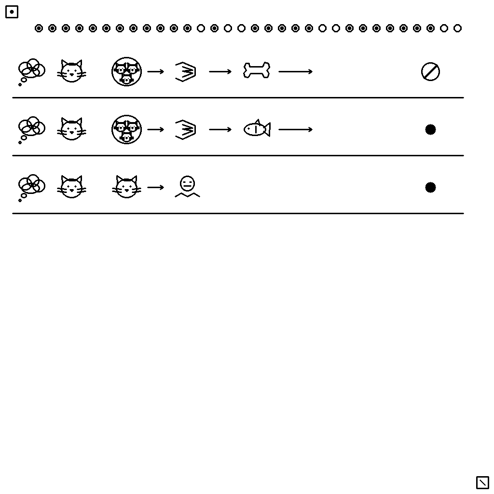</a><small class="autoria-figura">© 2026 Juan Antonio Lloret Egea · Instituto Tecnológico Virtual de la Inteligencia Artificial para el Español (ITVIA) · CC BY-NC-ND 4.0</small>

<strong>Expresión de referencia:</strong> En el pensamiento del gato blanco se expresa indiferencia y la idea de que los gatos no comen huesos y sí comen pescado. Es un contenido atribuido a ese gato, no una afirmación del narrador sobre todos los gatos reales.

<strong>Constitución:</strong> LBI09-V2. <strong>Terna:</strong> 65 valores 0, 31 valores 1, 0 valores U.

<strong>Imagen fuente:</strong> No hay captura real asociada; el contenido procede de la constitución narrativa o del contraste visual.

<strong>Potencial Atlas aproximado del glifo:</strong> 64.000000000000. <a href="datos/potenciales/Recurso200.potencial-be.gz" target="_blank" rel="noopener noreferrer">Valor exacto comprimido</a>. Longitud del entero: 33554562 bits.

<table><thead><tr><th>Célula</th><th>Morfología</th><th>P1…Pn</th></tr></thead><tbody><tr><td>1</td><td>(16,4)</td><td class="registro-vector">0000000000001011</td></tr><tr><td>2</td><td>(16,4)</td><td class="registro-vector">0000011000000011</td></tr><tr><td>3</td><td>(16,4)</td><td class="registro-vector">0000110110100000</td></tr><tr><td>4</td><td>(16,4)</td><td class="registro-vector">0010011100001101</td></tr><tr><td>5</td><td>(16,4)</td><td class="registro-vector">1011000000100110</td></tr><tr><td>6</td><td>(16,4)</td><td class="registro-vector">0010000110100110</td></tr></tbody></table>

S7 · Alimentación y convivencia · 10 células

<a href="imagenes/sucesos/S7.png" target="_blank" rel="noopener noreferrer">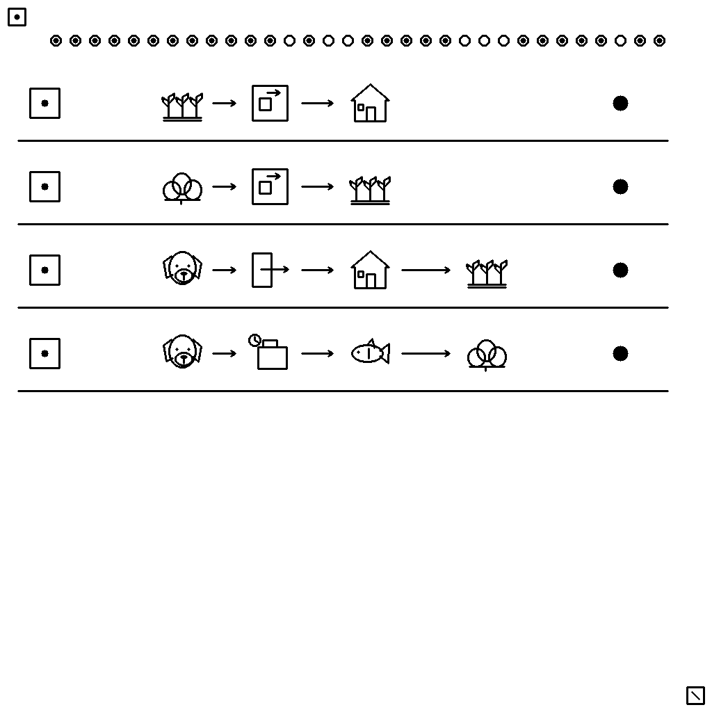</a><small class="autoria-figura">© 2026 Juan Antonio Lloret Egea · Instituto Tecnológico Virtual de la Inteligencia Artificial para el Español (ITVIA) · CC BY-NC-ND 4.0</small>

<strong>Expresión de referencia:</strong> El perro sale de la casa al jardín. El jardín pertenece a la casa y los matorrales están en el jardín. El perro tenía guardado previamente un pescado en esos matorrales.

<strong>Constitución:</strong> LBI09-V2. <strong>Terna:</strong> 70 valores 0, 34 valores 1, 0 valores U.

<strong>Imagen fuente:</strong> No hay captura real asociada; el contenido procede de la constitución narrativa o del contraste visual.

<strong>Potencial Atlas aproximado del glifo:</strong> 64.000000000000. <a href="datos/potenciales/Recurso241.potencial-be.gz" target="_blank" rel="noopener noreferrer">Valor exacto comprimido</a>. Longitud del entero: 33554562 bits.

<table><thead><tr><th>Célula</th><th>Morfología</th><th>P1…Pn</th></tr></thead><tbody><tr><td>1</td><td>(9,3)</td><td class="registro-vector">000000000</td></tr><tr><td>2</td><td>(9,3)</td><td class="registro-vector">000101100</td></tr><tr><td>3</td><td>(9,3)</td><td class="registro-vector">000111000</td></tr><tr><td>4</td><td>(9,3)</td><td class="registro-vector">001000111</td></tr><tr><td>5</td><td>(9,3)</td><td class="registro-vector">010000111</td></tr><tr><td>6</td><td>(9,3)</td><td class="registro-vector">000011101</td></tr><tr><td>7</td><td>(9,3)</td><td class="registro-vector">001100000</td></tr><tr><td>8</td><td>(9,3)</td><td class="registro-vector">000101001</td></tr><tr><td>9</td><td>(16,4)</td><td class="registro-vector">0011110000000011</td></tr><tr><td>10</td><td>(16,4)</td><td class="registro-vector">0001001101001000</td></tr></tbody></table>

S8 · Alimentación y convivencia · 5 células

<a href="imagenes/sucesos/S8.png" target="_blank" rel="noopener noreferrer">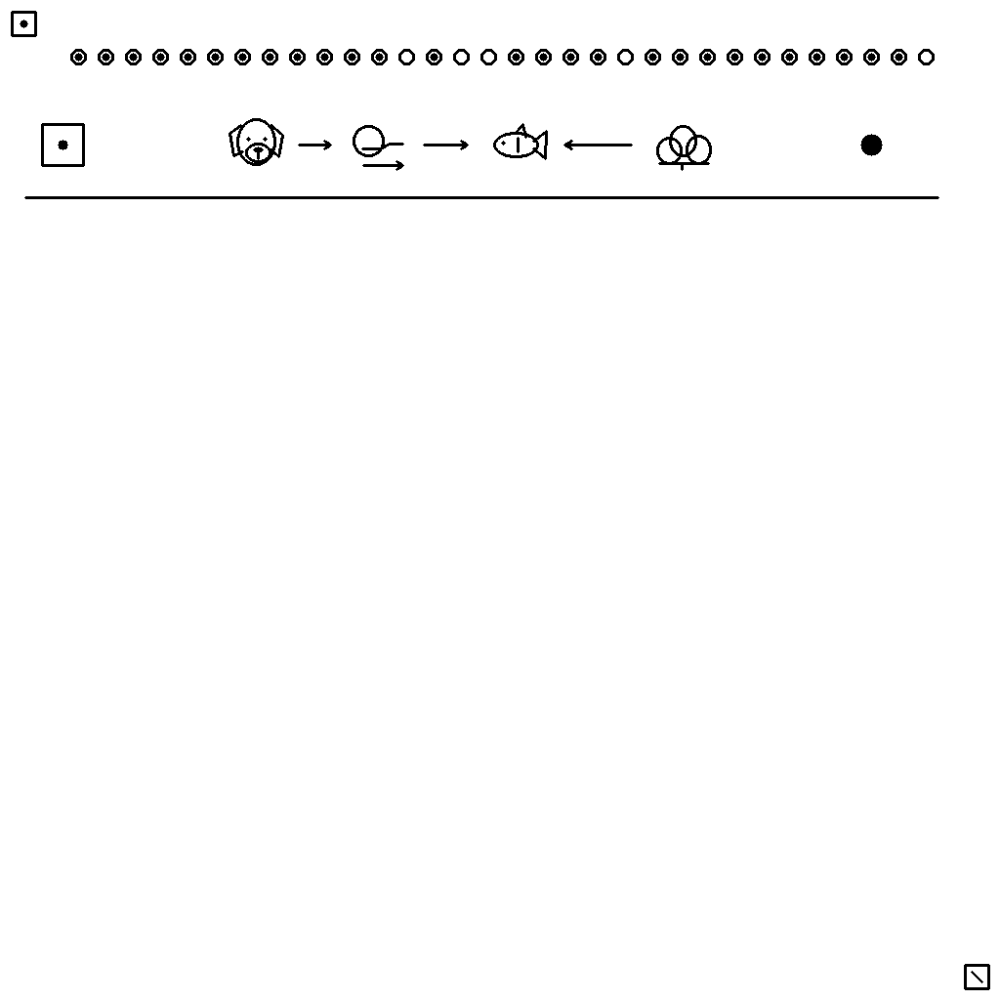</a><small class="autoria-figura">© 2026 Juan Antonio Lloret Egea · Instituto Tecnológico Virtual de la Inteligencia Artificial para el Español (ITVIA) · CC BY-NC-ND 4.0</small>

<strong>Expresión de referencia:</strong> El perro recoge con la boca el pescado de los matorrales.

<strong>Constitución:</strong> LBI09-V2. <strong>Terna:</strong> 39 valores 0, 13 valores 1, 0 valores U.

<strong>Imagen fuente:</strong> No hay captura real asociada; el contenido procede de la constitución narrativa o del contraste visual.

<strong>Potencial Atlas aproximado del glifo:</strong> 64.000000000000. <a href="datos/potenciales/Recurso282.potencial-be.gz" target="_blank" rel="noopener noreferrer">Valor exacto comprimido</a>. Longitud del entero: 33554562 bits.

<table><thead><tr><th>Célula</th><th>Morfología</th><th>P1…Pn</th></tr></thead><tbody><tr><td>1</td><td>(9,3)</td><td class="registro-vector">000000000</td></tr><tr><td>2</td><td>(9,3)</td><td class="registro-vector">000101100</td></tr><tr><td>3</td><td>(9,3)</td><td class="registro-vector">001000000</td></tr><tr><td>4</td><td>(9,3)</td><td class="registro-vector">000010011</td></tr><tr><td>5</td><td>(16,4)</td><td class="registro-vector">1001001101001000</td></tr></tbody></table>

S9 · Alimentación y convivencia · 6 células

<a href="imagenes/sucesos/S9.png" target="_blank" rel="noopener noreferrer">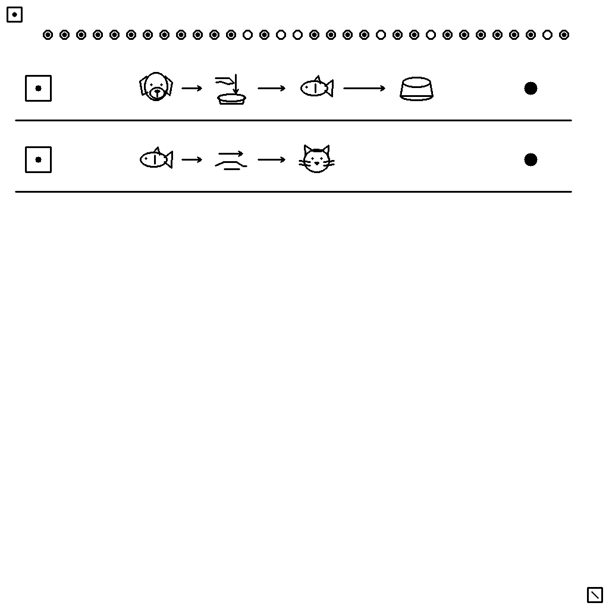</a><small class="autoria-figura">© 2026 Juan Antonio Lloret Egea · Instituto Tecnológico Virtual de la Inteligencia Artificial para el Español (ITVIA) · CC BY-NC-ND 4.0</small>

<strong>Expresión de referencia:</strong> El perro deposita el pescado en el plato. El gato blanco es el destinatario de ese alimento.

<strong>Constitución:</strong> LBI09-V2. <strong>Terna:</strong> 51 valores 0, 17 valores 1, 0 valores U.

<strong>Imagen fuente:</strong> No hay captura real asociada; el contenido procede de la constitución narrativa o del contraste visual.

<strong>Potencial Atlas aproximado del glifo:</strong> 64.000000000000. <a href="datos/potenciales/Recurso323.potencial-be.gz" target="_blank" rel="noopener noreferrer">Valor exacto comprimido</a>. Longitud del entero: 33554562 bits.

<table><thead><tr><th>Célula</th><th>Morfología</th><th>P1…Pn</th></tr></thead><tbody><tr><td>1</td><td>(9,3)</td><td class="registro-vector">000000000</td></tr><tr><td>2</td><td>(9,3)</td><td class="registro-vector">000101100</td></tr><tr><td>3</td><td>(9,3)</td><td class="registro-vector">001001000</td></tr><tr><td>4</td><td>(9,3)</td><td class="registro-vector">000100000</td></tr><tr><td>5</td><td>(16,4)</td><td class="registro-vector">0001001100101000</td></tr><tr><td>6</td><td>(16,4)</td><td class="registro-vector">1000101100011000</td></tr></tbody></table>

S10 · Alimentación y convivencia · 3 células

<small class="autoria-figura">© 2026 Juan Antonio Lloret Egea · Instituto Tecnológico Virtual de la Inteligencia Artificial para el Español (ITVIA) · CC BY-NC-ND 4.0</small>

<strong>Expresión de referencia:</strong> El gato blanco ha terminado de comerse ese pescado.

<strong>Constitución:</strong> LBI09-V2. <strong>Terna:</strong> 37 valores 0, 11 valores 1, 0 valores U.

<strong>Imagen fuente:</strong> No hay captura real asociada; el contenido procede de la constitución narrativa o del contraste visual.

<strong>Potencial Atlas aproximado del glifo:</strong> 64.000000000000. <a href="datos/potenciales/Recurso6.potencial-be.gz" target="_blank" rel="noopener noreferrer">Valor exacto comprimido</a>. Longitud del entero: 33554562 bits.

<table><thead><tr><th>Célula</th><th>Morfología</th><th>P1…Pn</th></tr></thead><tbody><tr><td>1</td><td>(16,4)</td><td class="registro-vector">0000000000001011</td></tr><tr><td>2</td><td>(16,4)</td><td class="registro-vector">0000101000000001</td></tr><tr><td>3</td><td>(16,4)</td><td class="registro-vector">1000000110110000</td></tr></tbody></table>

S11 · Alimentación y convivencia · 16 células

<a href="imagenes/sucesos/S11.png" target="_blank" rel="noopener noreferrer">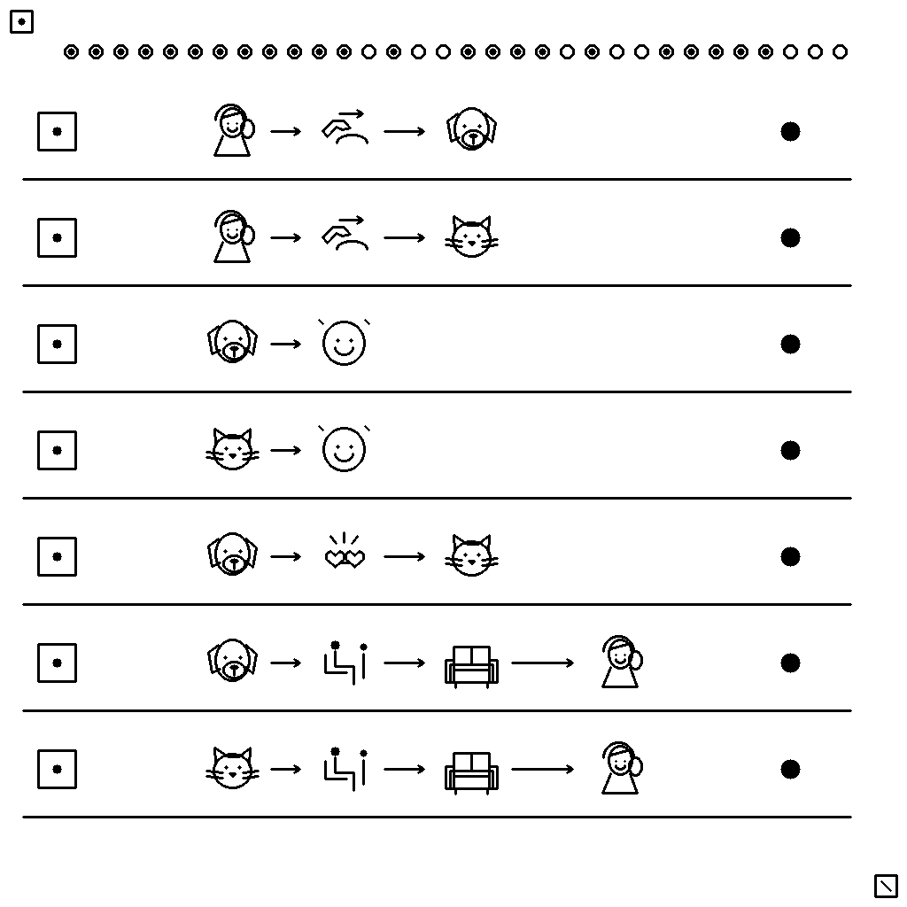</a><small class="autoria-figura">© 2026 Juan Antonio Lloret Egea · Instituto Tecnológico Virtual de la Inteligencia Artificial para el Español (ITVIA) · CC BY-NC-ND 4.0</small>

<strong>Expresión de referencia:</strong> El perro y el gato blanco se hacen amigos. Ambos están sentados en el sofá junto a la dueña; ella acaricia a los dos y ambos están alegres. Las relaciones de esta aparición no establecen una sucesión interna de caricias, posturas o estados.

<strong>Constitución:</strong> LBI09-V2. <strong>Terna:</strong> 100 valores 0, 44 valores 1, 0 valores U.

<strong>Imagen fuente:</strong> No hay captura real asociada; el contenido procede de la constitución narrativa o del contraste visual.

<strong>Potencial Atlas aproximado del glifo:</strong> 64.000000000000. <a href="datos/potenciales/Recurso15.potencial-be.gz" target="_blank" rel="noopener noreferrer">Valor exacto comprimido</a>. Longitud del entero: 33554562 bits.

<table><thead><tr><th>Célula</th><th>Morfología</th><th>P1…Pn</th></tr></thead><tbody><tr><td>1</td><td>(9,3)</td><td class="registro-vector">000000000</td></tr><tr><td>2</td><td>(9,3)</td><td class="registro-vector">000101100</td></tr><tr><td>3</td><td>(9,3)</td><td class="registro-vector">001011000</td></tr><tr><td>4</td><td>(9,3)</td><td class="registro-vector">001110101</td></tr><tr><td>5</td><td>(9,3)</td><td class="registro-vector">000010010</td></tr><tr><td>6</td><td>(9,3)</td><td class="registro-vector">000010100</td></tr><tr><td>7</td><td>(9,3)</td><td class="registro-vector">001001100</td></tr><tr><td>8</td><td>(9,3)</td><td class="registro-vector">001011001</td></tr><tr><td>9</td><td>(9,3)</td><td class="registro-vector">000001011</td></tr><tr><td>10</td><td>(9,3)</td><td class="registro-vector">001100001</td></tr><tr><td>11</td><td>(9,3)</td><td class="registro-vector">000001000</td></tr><tr><td>12</td><td>(9,3)</td><td class="registro-vector">110000100</td></tr><tr><td>13</td><td>(9,3)</td><td class="registro-vector">100101010</td></tr><tr><td>14</td><td>(9,3)</td><td class="registro-vector">000100001</td></tr><tr><td>15</td><td>(9,3)</td><td class="registro-vector">001001110</td></tr><tr><td>16</td><td>(9,3)</td><td class="registro-vector">100001000</td></tr></tbody></table>

S40 · Televisión y transiciones de funcionamiento · 5 células

<a href="imagenes/sucesos/S40.png" target="_blank" rel="noopener noreferrer">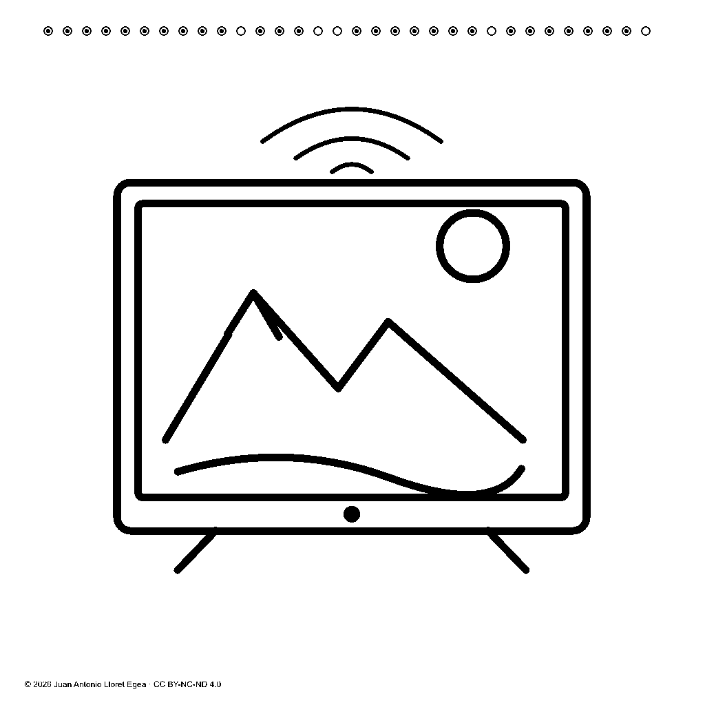</a><small class="autoria-figura">© 2026 Juan Antonio Lloret Egea · Instituto Tecnológico Virtual de la Inteligencia Artificial para el Español (ITVIA) · CC BY-NC-ND 4.0</small>

<strong>Expresión de referencia:</strong> La televisión inteligente funcionaba en el estado anterior.

<strong>Constitución:</strong> LBI33-V8. <strong>Terna:</strong> 34 valores 0, 11 valores 1, 0 valores U.

<strong>Imagen fuente:</strong> Imagen4; mitad izquierda

<strong>Potencial Atlas aproximado del glifo:</strong> 64.000000000000. <a href="datos/potenciales/Recurso119.potencial-be.gz" target="_blank" rel="noopener noreferrer">Valor exacto comprimido</a>. Longitud del entero: 33554562 bits.

<table><thead><tr><th>Célula</th><th>Morfología</th><th>P1…Pn</th></tr></thead><tbody><tr><td>1</td><td>(9,3)</td><td class="registro-vector">000000000</td></tr><tr><td>2</td><td>(9,3)</td><td class="registro-vector">010001100</td></tr><tr><td>3</td><td>(9,3)</td><td class="registro-vector">000001000</td></tr><tr><td>4</td><td>(9,3)</td><td class="registro-vector">000011010</td></tr><tr><td>5</td><td>(9,3)</td><td class="registro-vector">011010001</td></tr></tbody></table>

S41 · Televisión y transiciones de funcionamiento · 5 células

<a href="imagenes/sucesos/S41.png" target="_blank" rel="noopener noreferrer">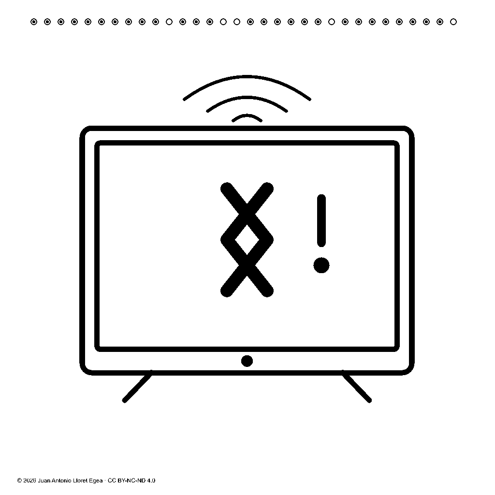</a><small class="autoria-figura">© 2026 Juan Antonio Lloret Egea · Instituto Tecnológico Virtual de la Inteligencia Artificial para el Español (ITVIA) · CC BY-NC-ND 4.0</small>

<strong>Expresión de referencia:</strong> La misma televisión inteligente no funciona en el estado presente.

<strong>Constitución:</strong> LBI33-V8. <strong>Terna:</strong> 33 valores 0, 12 valores 1, 0 valores U.

<strong>Imagen fuente:</strong> Imagen4; mitad derecha

<strong>Potencial Atlas aproximado del glifo:</strong> 64.000000000000. <a href="datos/potenciales/Recurso123.potencial-be.gz" target="_blank" rel="noopener noreferrer">Valor exacto comprimido</a>. Longitud del entero: 33554562 bits.

<table><thead><tr><th>Célula</th><th>Morfología</th><th>P1…Pn</th></tr></thead><tbody><tr><td>1</td><td>(9,3)</td><td class="registro-vector">000000000</td></tr><tr><td>2</td><td>(9,3)</td><td class="registro-vector">010001100</td></tr><tr><td>3</td><td>(9,3)</td><td class="registro-vector">000010000</td></tr><tr><td>4</td><td>(9,3)</td><td class="registro-vector">000011010</td></tr><tr><td>5</td><td>(9,3)</td><td class="registro-vector">011010011</td></tr></tbody></table>

S42 · Televisión y transiciones de funcionamiento · 9 células

<a href="imagenes/sucesos/S42.png" target="_blank" rel="noopener noreferrer">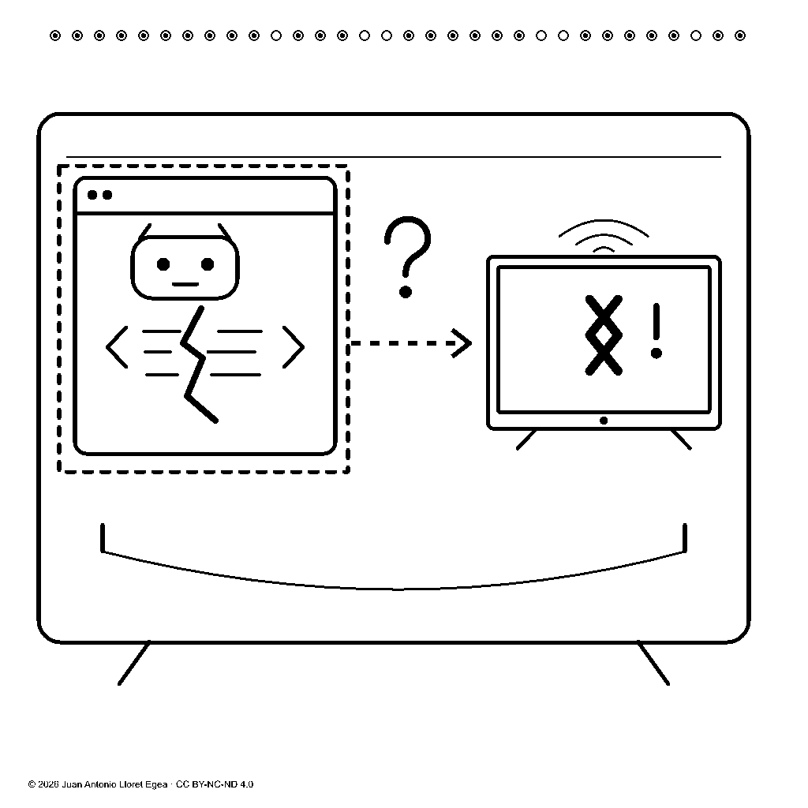</a><small class="autoria-figura">© 2026 Juan Antonio Lloret Egea · Instituto Tecnológico Virtual de la Inteligencia Artificial para el Español (ITVIA) · CC BY-NC-ND 4.0</small>

<strong>Expresión de referencia:</strong> Android es el sistema de esa televisión. La corrupción del sistema y su relación causal con el fallo constituyen una hipótesis, no un diagnóstico confirmado.

<strong>Constitución:</strong> LBI33-V8. <strong>Terna:</strong> 49 valores 0, 37 valores 1, 2 valores U.

<strong>Imagen fuente:</strong> No hay captura real asociada; el contenido procede de la constitución narrativa o del contraste visual.

<strong>Potencial Atlas aproximado del glifo:</strong> 64.000000000000. <a href="datos/potenciales/Recurso127.potencial-be.gz" target="_blank" rel="noopener noreferrer">Valor exacto comprimido</a>. Longitud del entero: 33554562 bits.

<table><thead><tr><th>Célula</th><th>Morfología</th><th>P1…Pn</th></tr></thead><tbody><tr><td>1</td><td>(9,3)</td><td class="registro-vector">000000000</td></tr><tr><td>2</td><td>(9,3)</td><td class="registro-vector">010001100</td></tr><tr><td>3</td><td>(9,3)</td><td class="registro-vector">000011000</td></tr><tr><td>4</td><td>(9,3)</td><td class="registro-vector">001001010</td></tr><tr><td>5</td><td>(9,3)</td><td class="registro-vector">011010011</td></tr><tr><td>6</td><td>(9,3)</td><td class="registro-vector">010111101</td></tr><tr><td>7</td><td>(9,3)</td><td class="registro-vector">101000101</td></tr><tr><td>8</td><td>(9,3)</td><td class="registro-vector">10111000U</td></tr><tr><td>9</td><td>(16,4)</td><td class="registro-vector">101111110110100U</td></tr></tbody></table>

S43 · Televisión y transiciones de funcionamiento · 4 células

<a href="imagenes/sucesos/S43.png" target="_blank" rel="noopener noreferrer">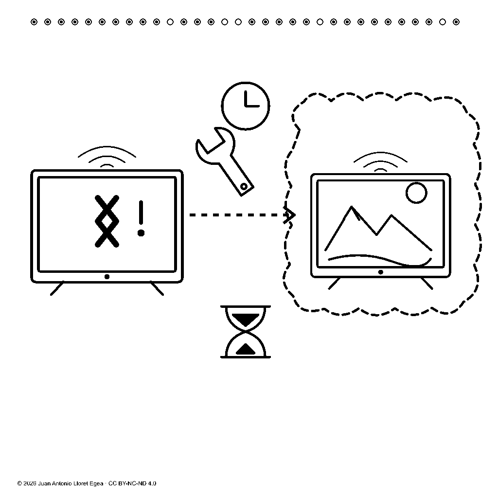</a><small class="autoria-figura">© 2026 Juan Antonio Lloret Egea · Instituto Tecnológico Virtual de la Inteligencia Artificial para el Español (ITVIA) · CC BY-NC-ND 4.0</small>

<strong>Expresión de referencia:</strong> Es necesario reparar la televisión, con el propósito de recuperar el funcionamiento. La reparación está pendiente y el resultado no se afirma realizado.

<strong>Constitución:</strong> LBI33-V8. <strong>Terna:</strong> 40 valores 0, 17 valores 1, 0 valores U.

<strong>Imagen fuente:</strong> No hay captura real asociada; el contenido procede de la constitución narrativa o del contraste visual.

<strong>Potencial Atlas aproximado del glifo:</strong> 64.000000000000. <a href="datos/potenciales/Recurso131.potencial-be.gz" target="_blank" rel="noopener noreferrer">Valor exacto comprimido</a>. Longitud del entero: 33554562 bits.

<table><thead><tr><th>Célula</th><th>Morfología</th><th>P1…Pn</th></tr></thead><tbody><tr><td>1</td><td>(9,3)</td><td class="registro-vector">000000000</td></tr><tr><td>2</td><td>(16,4)</td><td class="registro-vector">0100011000001000</td></tr><tr><td>3</td><td>(16,4)</td><td class="registro-vector">0000010110001101</td></tr><tr><td>4</td><td>(16,4)</td><td class="registro-vector">0001100111010001</td></tr></tbody></table>

## Consulta tabular y retorno

El <a href="datos/correspondencias.json" target="_blank" rel="noopener noreferrer">registro de correspondencias</a> conserva los identificadores completos, los valores, las composiciones y las rutas relativas de las imágenes. La <a href="datos/potenciales.csv" target="_blank" rel="noopener noreferrer">tabla de potenciales</a> permite compararlos sin confundir los valores aproximados con los exactos. Los enteros se conservan con compresión reversible; al descomprimirlos, el primer octeto es el más significativo. Muchos glifos comienzan con un fondo blanco y sus aproximaciones a doce decimales se muestran como 64,000000000000. Esa coincidencia de presentación no significa igualdad del valor exacto. La comparación de identidad utiliza el entero completo y la constitución, no la cifra abreviada.

En una fotografía real nueva se deben declarar captura, resolución, calibración y contexto. Después se calculan sus potenciales y se constituyen las relaciones que la evidencia sostiene. Una intención, una propiedad oculta o un diagnóstico no visible requieren otra fuente. La asociación documental mantiene ese origen y no transforma una hipótesis en observación.

La política de conservación añade cada nueva entrada y cada rectificación. Ni la repetición de un glifo ni una coincidencia decimal autorizan a reemplazar un suceso anterior. <a href="https://doi.org/10.21428/39829d0b.5e15cabb" target="_blank" rel="noopener noreferrer">Orientación universal y geográfica</a>, apartado 8.9, distingue el dato de potencial y la identidad; <a href="https://doi.org/10.21428/39829d0b.bebc607c" target="_blank" rel="noopener noreferrer">Aprendizaje trazable</a>, apartado 6.3, distingue recuperar un estado y recuperar su historia.

<!-- Autoría: © 2026 Juan Antonio Lloret Egea. CC BY-NC-ND 4.0. https://doi.org/10.21428/39829d0b.8b9c0155. -->
