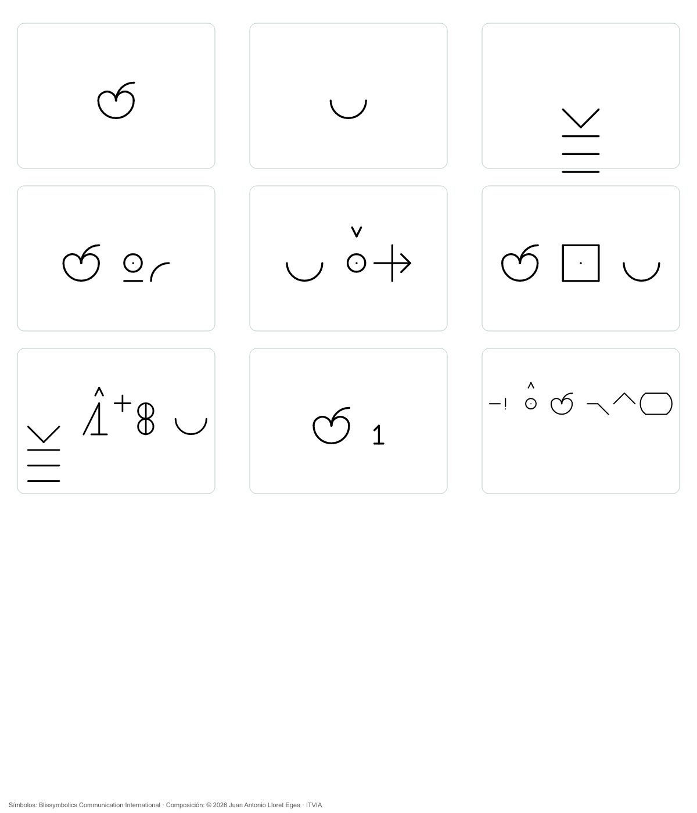

# 21. Desarrollo y validación de las representaciones visuales

La investigación distingue la conservación formal de una representación, su comprensión y la corrección de las operaciones realizadas sobre ella. Un retorno exacto puede coexistir con una interpretación equivocada; una respuesta estable puede ser siempre errónea. Este capítulo reúne resultados delimitados y los relaciona con la [biyección entre célula y polígono](02-fundamento.md#célula-y-polígono-una-correspondencia-biyectiva).

## Una imagen, una escena y varias consultas

La imagen siguiente es sintética. Su primera descripción se constituyó por inspección asistida; este antecedente no acredita reconocimiento autónomo de fotografías generales.

<figure id="figura-21-1"><figcaption><strong>Figura 21.1.</strong> Imagen sintética de referencia. © 2026 Juan Antonio Lloret Egea · Instituto Tecnológico Virtual de la Inteligencia Artificial para el Español (ITVIA) · CC BY-NC-ND 4.0.</figcaption></figure>

<figure id="figura-21-2"><figcaption><strong>Figura 21.2.</strong> Composición experimental del caso. Símbolos © Blissymbolics Communication International, <a href="https://creativecommons.org/licenses/by/4.0/" target="_blank" rel="noopener noreferrer">CC BY 4.0</a>; selección, disposición y relaciones propias © 2026 Juan Antonio Lloret Egea · ITVIA. <a href="imagenes/manzana-glifo.svg" target="_blank" rel="noopener noreferrer">Versión vectorial</a>. La composición no se presenta como una oración certificada por la organización Bliss.</figcaption></figure>

En el perfil experimental, 0 afirma la proposición constituida, 1 la niega y U conserva una indeterminación justificada. Esta interpretación se declara para cada cuestión; no se deduce del aspecto del signo ni sustituye la leyenda de una evaluación de aptitud.

| Parámetro | Proposición del perfil de escena | Valor |
|---|---|:---:|
| P1 | Hay una manzana visible | 0 |
| P2 | Hay un recipiente visible | 0 |
| P3 | Hay una superficie de apoyo visible | 0 |
| P4 | El color predominante visible de la manzana es verde | 0 |
| P5 | El recipiente tiene apariencia transparente | 0 |
| P6 | La manzana está dentro del recipiente | 0 |
| P7 | El recipiente está apoyado en la superficie | 0 |
| P8 | El inventario constituido contiene una sola manzana | 0 |
| P9 | La manzana presenta un corte visible | 1 |

La representación de escena contiene **una célula (9,3), vector 000000001: ocho valores 0, un valor 1 y ninguna U**. Su polígono canónico debe conservar, en el orden del contrato, ocho radios 1 y el último radio 2. La lámina de signos no sustituye ese polígono. El inventario explica lo visible dentro de la captura y del procedimiento; no afirma que no existan otras manzanas fuera de la imagen.

La cadena verbal de referencia está disponible en español: «Hay una manzana de color predominante verde dentro de un recipiente de apariencia transparente, apoyado sobre una superficie. El inventario contiene una manzana y no se observa un corte». La versión inglesa del perfil conserva esos mismos predicados. La disponibilidad de dos realizaciones controladas no certifica traducción libre entre todos los idiomas.

## Preguntas y respuestas sobre la evidencia constituida

| Pregunta | Cuestión | Respuesta del procedimiento |
|---|---|---|
| P1 | ¿Qué fruta aparece? | Una manzana. |
| P2 | ¿Cuál es su color predominante visible? | Verde. |
| P3 | ¿Cuántas manzanas constan? | Una. |
| P4 | ¿Dónde está la manzana? | Dentro del recipiente. |
| P5 | ¿En qué se apoya el recipiente? | En la superficie visible. |
| P6 | ¿Qué apariencia tiene el recipiente? | Transparente. |
| P7 | ¿Se observa un corte en la manzana? | No. |
| P8 | ¿Quién colocó la manzana? | No está documentado. |
| P9 | ¿Qué sabor tiene? | No está documentado. |

Las preguntas forman una edición (9,3), distinta de la célula de escena. Cada consulta dispone de una composición de dos células: evidencia y operación. Con la escena aislada, el registro experimental contiene **1 + 9 × 2 = 19 instancias de contenido**, 171 posiciones: 89 valores 0 y 82 valores 1. La célula de control se contabiliza aparte. Estas diecinueve instancias no son diecinueve células necesarias para describir la fotografía. Las dos abstenciones documentales no se convierten automáticamente en U: dependen del contrato de la consulta.

## Potencial calculado y retorno

La imagen normalizada mide **1254 × 1254 píxeles**, con cuatro componentes de ocho bits. Contiene **6 290 064 octetos** de muestras. El convenio de representación posicional de imágenes del Sistema Vectorial, versión 02 (**SVIMG02**), añade una cabecera de dieciséis octetos: el total es **6 290 080 octetos**, equivalentes a **m = 50 320 640 bits**. Sea C el entero que conserva esa secuencia ordenada.

**μ = 3·2ᵐ + C; λ = 2ᵐ − 1 − C.**

Por diferencia y suma:

**P = 2ᵐ⁺¹ + 2C + 1; I = 2ᵐ⁺² − 1.**

El retorno exacto obtiene **C = (P − 2ᵐ⁺¹ − 1)/2** y recupera la cabecera y las muestras. El valor íntegro de P se conserva como entero; una aproximación decimal breve no lo sustituye.

Con **N = m + 2**, la normalización es **q = P/2ᴺ ≈ 0,9056285917557406**. La proyección Atlas del convenio resulta:

**δ = 64·ln(1 + 10q)/ln(11) ≈ 61,60597065872314.**

En el régimen s = 64: **μₐ = 64 + δ/2 ≈ 94,80298532936158**, **λₐ = 64 − δ/2 ≈ 33,19701467063843** y **Iₐ = 128**. Son valores de la representación digital de la imagen, no una medida de la edad ni del potencial biológico de la manzana. El [capítulo 16](17-potencial.md) desarrolla la definición, la calibración y las condiciones de retorno; el [capítulo 17](23-correspondencias.md) conserva los valores y recursos de consulta.

El identificador del suceso relaciona la imagen, la composición, el texto, las células y el potencial. Cambiar el repertorio de signos no modifica el potencial de una imagen fuente cuyas muestras permanecen idénticas. El glifo tiene, a su vez, su propio cálculo como imagen. No se obtiene el potencial global sumando potenciales locales: tal operación necesitaría una definición adicional y no preserva por sí sola orden ni relaciones.

## Alcance de las composiciones con símbolos Bliss

El vocabulario autorizado de Blissymbolics Communication International, edición 2026, contiene **6551 símbolos**. Sus [recursos oficiales](https://www.blissymbolics.org/index.php/bci-av-2026) y [condiciones de atribución](https://www.blissymbolics.org/index.php/licensing) se distinguen de la gramática experimental del presente estudio. Las formas oficiales aportan un repertorio documentado; las relaciones que introduce un perfil del tratado requieren validación propia.

El procedimiento determinista contrastó 39 estructuras y, posteriormente, 936 combinaciones controladas de referentes, consultas y funciones. La conservación de esas estructuras no demuestra comprensión general de prosa libre ni que toda composición sea una expresión Bliss normativa. En consecuencia, «glifo Bliss» identifica los componentes documentados donde se utilizan; no sustituye indiscriminadamente la denominación de todos los glifos anteriores.

Una prueba posterior de lectura por un sistema artificial, con manuales y vocabulario disponibles, completó nueve interpretaciones de nueve dentro del protocolo. Ese resultado corresponde a una lectura instruida y a los materiales suministrados. No mide comprensión espontánea ni permite atribuir al lector el algoritmo interno de esta investigación.

## Estabilidad, corrección y extensión de dominio

Nueve preguntas repetidas tres veces produjeron veintisiete respuestas idénticas por grupos en el caso de la manzana. La igualdad se refiere al contenido y a las reglas fijadas, conservando identidades propias para las ejecuciones. Repetir la consulta no crea una nueva captura del objeto físico.

La ampliación perceptiva posterior examinó quince imágenes sintéticas y nueve preguntas repetidas tres veces: **405 ejecuciones**. Los 135 grupos fueron estables, pero sólo once de quince referencias se cumplieron, incluidas dos abstenciones exigidas; de tres imágenes nuevas, sólo una cumplió su referencia. Persisten errores al separar objetos solapados y al interpretar una manzana bicolor. El control **000110000** alcanza siete conformidades, pero incumple dos parámetros críticos: el dictamen del conjunto es **No apto**.

La realización posterior utiliza el potencial exacto para recuperar las muestras que entran en la percepción. Ese uso es efectivo y distinto de adjuntar una cifra al resultado. No demuestra todavía que diferencias de potencial identifiquen objetos, midan semejanza semántica o mejoren una deducción. La [obra de inteligencia artificial, capítulo 10](https://documentos-sv.itvia.online/investigacion/inteligencia-artificial-sv/10-ensayos), expone el proceso y las magnitudes sin confundir repetibilidad con corrección.

<!-- Autoría: © 2026 Juan Antonio Lloret Egea. CC BY-NC-ND 4.0. https://doi.org/10.21428/39829d0b.8b9c0155. Símbolos Bliss de terceros: CC BY 4.0. -->
