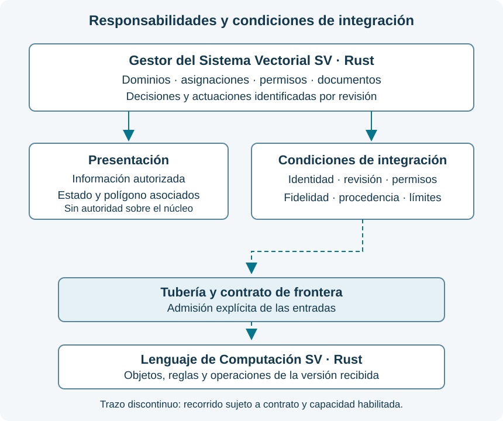

# **18.** Integración con el Gestor del Sistema Vectorial SV {#integración-con-el-gestor-del-sistema-vectorial-sv}

El **Gestor del Sistema Vectorial SV** es una aplicación desarrollada en Rust que reúne la administración de dominios, documentación, modelos y conexiones, permisos, evaluaciones y registros de actividad. La gestión documental es uno de sus módulos. El acceso a cada función depende de su habilitación y de las facultades de la cuenta.

Este apéndice explica la relación del Gestor con los contratos del Lenguaje. Las instrucciones y los archivos SVP se estudian en los capítulos del lenguaje; las operaciones cotidianas del aplicativo disponen de ayuda contextual. La [portada del Gestor](https://administracion.itvia.online/) ofrece acceso a la aplicación y a sus servicios públicos. El alojamiento, los proveedores de identidad y la custodia se determinan para cada instalación.

## **18.1.** Función del Gestor y relación con el Lenguaje {#función-del-gestor-y-relación-con-el-lenguaje}

El Gestor prepara y conserva decisiones institucionales: qué dominio se configura, qué recursos puede utilizar, quién está autorizado y qué documentos sustentan una actuación. El Lenguaje expresa y comprueba los objetos y operaciones definidos por sus contratos, dentro del alcance implementado. La configuración administrativa no modifica la semántica ni añade instrucciones a la DSL.

| Responsabilidad | Alcance |
| --- | --- |
| Administración institucional | Decide asignaciones y concede facultades conforme a las funciones autorizadas. |
| Servicio del Gestor, en Rust | Comprueba sesión, permisos, revisión y límites; registra las actuaciones y aplica las restricciones de la versión. |
| Presentación y visor | Muestran información autorizada y conservan su correspondencia con el estado recibido. |
| Integración con el Lenguaje | Transporta entradas identificadas por la tubería y exige admisión mediante el contrato de frontera antes de cualquier operación nuclear. |

El diagrama expresa responsabilidades y condiciones de integración. Las operaciones disponibles dependen de la versión recibida de cada componente. La presencia de un transporte, una interfaz de funciones o una pantalla no acredita por sí sola el recorrido completo hasta el núcleo. Los [entornos de ejecución](arquitectura-ejecucion.md) y el [desarrollo y validación del núcleo](desarrollo-validacion-nucleo.md) precisan estos límites.

HTML y CSS presentan los controles; JavaScript desempeña las funciones de transporte y presentación delimitadas para el visor. El visor Rust/egui compilado a WebAssembly conserva la representación recibida y carece de autoridad para cambiar estados, permisos o reglas del núcleo. Una IA tampoco obtiene acceso directo al núcleo: la tubería y la instrucción de frontera deben comprobar las entradas admisibles. Estas obligaciones son distintas del control de salida de datos hacia un proveedor.

## **18.2.** Estados y representación {#estados-y-representación}

El Gestor conserva el significado de los [estados celulares](construcciones-y-componentes.md#estados-celulares-y-terna) y su [correspondencia con el polígono](parametros-rutas.md#correspondencia-visual). La posición, el parámetro, el estado y la revisión deben mantenerse unidos al consultar la evidencia. Una representación desactualizada no describe el estado vigente.

Los indicadores de conexión o preparación informan de comprobaciones administrativas y técnicas. No constituyen valoraciones de la terna: una conexión correcta no concede aptitud a un modelo, y un fallo de conexión necesita su diagnóstico propio. La vigencia y el alcance de la comprobación deben ser visibles junto a su resultado.

## **18.3.** Configuración por dominio {#configuración-por-dominio}

La preparación institucional sigue el orden **dominio → nodo → modelo**. El dominio establece la necesidad y el alcance; el nodo delimita las posibilidades de ejecución y de auditoría; después se elige un modelo compatible con esas condiciones.

| Nodo | Condición que lo distingue |
| --- | --- |
| **1 · IA integrada** | IA incorporada al SV para consejo experto y exámenes, con inferencia auditable de extremo a extremo. Un alojamiento propio o una API propia no acreditan por sí solos esa condición. |
| **2 · Ejecución en plataforma** | Ejecución mediante una plataforma, con identificación del control y de las evidencias efectivamente disponibles. La plataforma no garantiza por su nombre una auditoría completa. |
| **3 · Servicio del proveedor** | Modelo gobernado por el proveedor. El SV observa las comunicaciones y medidas disponibles, sin atribuirse acceso al razonamiento interno. |

El nodo describe la relación de ejecución y control. Los entornos nativo y WebAssembly, así como los dispositivos CPU, GPU, TPU o NPU, tienen funciones diferentes y se explican en [Arquitectura y recursos](arquitectura-ejecucion.md#gobierno-de-la-ejecución-y-recursos).

Las asignaciones se identifican por institución, dominio, función, nodo, modelo y configuración. Un dominio puede conservar varios usos delimitados; su coexistencia no concede por sí sola actuación simultánea ni composición automática de consejos. Cada uso conserva sus facultades, evidencia, revisión y vigencia, conforme al [libro de validación y autorización](https://documentos-sv.itvia.online/evaluacion/validacion-autorizacion-modelos/autoridad.html). Dos dominios pueden repetir modelo y nodo, manteniendo documentos, permisos y decisiones propios. La asignación no otorga propiedad jurídica sobre el modelo ni exclusividad sobre los recursos.

Las autorizaciones no se transfieren por compartir una conexión. Cada dominio permanece sujeto a sus condiciones, a las restricciones generales de la instalación y a los límites de los recursos comunes. Compatibilidad técnica, aptitud evaluada y autorización de uso son comprobaciones distintas. Una evaluación favorable conserva su ámbito y no se extiende automáticamente a otro dominio.

La ficha institucional registra la decisión, su aplicación, la cuenta responsable, la fecha, el alcance y el motivo. Los cambios conservan su revisión; el historial de una actuación debe permitir conocer la asignación que le correspondía. La preparación, la comprobación y la habilitación de uso son etapas diferenciadas.

**Alcance de esta edición del Gestor.** Los nodos 1 y 2 no están habilitados. La restricción general del nodo 3 permite autenticación y consulta del catálogo sin contenido documental. Las excepciones recibidas para ediciones y candidatos concretos de EET-CYB16 se rigen por la norma [Código limpio y auditable](https://github.com/juantoniolloretegea/SV-lenguaje-de-computacion/blob/main/docs/calidad/tuberias-ia/continuacion-15-09-2026/CODIGO-LIMPIO-Y-AUDITABLE.md); requieren sus condiciones y autorizaciones específicas. No se extienden a otra convocatoria por reutilizar un formulario, una conexión o un contador. La convocatoria práctica SV(25,5) mantiene restringida la entrega de contenido a proveedores. La inferencia experta en producción permanece deshabilitada. Una decisión institucional sobre un candidato no elimina estos límites.

## **18.4.** Documentos y evidencias {#documentos-y-evidencias}

El Gestor aplica las condiciones de [fidelidad y acceso a las fuentes](parametros-rutas.md#fidelidad-y-acceso-a-las-fuentes). La identidad del original, su versión, la selección y las transformaciones permiten reconstruir qué información se utilizó. La integridad de un archivo y la fidelidad de su representación son comprobaciones complementarias.

### **18.4.1.** Traducción auxiliar {#traducción-auxiliar}

HelsinkiNLP es una herramienta auxiliar de lectura, fuera de los tres nodos de inferencia experta. El motor local y los archivos del modelo forman parte de la instalación del Gestor; su ejecución aislada utiliza un proceso auxiliar. La disponibilidad exige que estén presentes los componentes identificados, además de la habilitación institucional y el permiso documental del lector.

La administración puede desactivarla desde la ficha institucional. El Gestor impide nuevas solicitudes, cancela las pendientes al detectar el cambio y comprueba otra vez la habilitación antes de entregar el resultado. Los originales, sus permisos y los antecedentes se conservan; una traducción ya mostrada no puede retirarse de la lectura efectuada. Al ser opcional, su desactivación no constituye un defecto de configuración.

La traducción facilita la comprensión humana y debe contrastarse con el original. No es una traducción certificada ni sustituye una revisión científica, clínica o jurídica. Su salida no se incorpora como entrada al núcleo, a la semántica, a la IR, a un examen o al consejo experto. En las evaluaciones que exigen documentación íntegra y nativa, se conserva ese requisito.

### **18.4.2.** Acceso y trazabilidad {#acceso-y-trazabilidad}

La consulta de una conclusión y de sus referencias no concede permiso para abrir los documentos que la sustentan. Cuando el usuario carece de permiso documental, la presentación se limita al consejo y a la procedencia autorizados, sin fragmentos ni apertura del original. La comprobación corresponde al servicio y debe mantenerse en cada vía de acceso, incluida la representación visual.

Lectura, transformación, descarga y suministro a una IA conservan sus autorizaciones específicas. La revisión documental, la disponibilidad técnica o la conservación de una evidencia no conceden facultades adicionales. Cada actuación debe registrar identidad, alcance y resultado, distinguiendo solicitud, preparación, entrega y consulta observable. La traza no acredita procesos internos del modelo ni que una persona haya leído lo presentado.

---

© 2026 Juan Antonio Lloret Egea. Algunos derechos reservados. | ORCID: 0000-0002-6634-3351 | Instituto Tecnológico Virtual de la Inteligencia Artificial para el Español™ (ITVIA) | IA eñ™ – La Biblia de la IA™ | ISSN 2695-6411 | Licencia Creative Commons Atribución-NoComercial-SinDerivadas 4.0 Internacional (CC BY-NC-ND 4.0).

