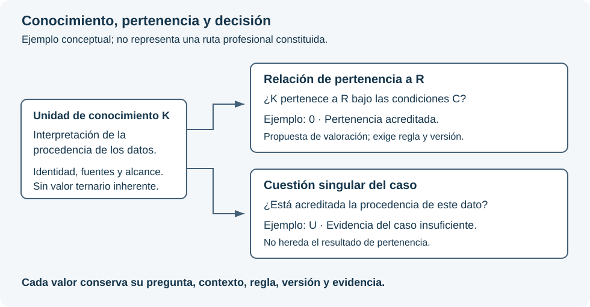

# Parámetros, recorridos y evidencia: requisitos de integración

**Complemento documental · 12 de octubre de 2026 · Conceptos de diseño y requisitos de integración.**

Este capítulo explica qué debe poder representar y preservar el Lenguaje de Computación SV al relacionarse con Universos, fuentes documentales y valoraciones. No define sintaxis nueva ni acredita que esas funciones estén implementadas. El desarrollo conceptual se consulta en [Dominios y universos](../../universos/parametros-rutas.html).

## Separar identidad, relación y valoración

El parámetro de conocimiento define una unidad de conceptos o datos generales. El parámetro singular de decisión recibe una valoración concreta conforme a su contrato. Se propone además valorar con 0, 1 o U la pertenencia de un parámetro de conocimiento a una ruta determinada.

El Lenguaje deberá conservar la diferencia entre **contenido de conocimiento**, **valoración de pertenencia** y **valoración decisional**. La terna compartida no convierte las dos valoraciones en intercambiables. La relación de pertenencia necesita identificar parámetro, ruta, versiones, condiciones y contexto; no constituye un valor permanente del conocimiento.

Ejemplo: una unidad explica la procedencia de los datos. Puede pertenecer a una ruta de comprobación y, al mismo tiempo, la procedencia del dato de un caso concreto seguir indeterminada. Un resultado favorable de pertenencia no resuelve esa segunda cuestión. La leyenda exacta de 0, 1 y U debe acompañar a cada proposición; no se deduce del nombre abreviado de un campo.

El diagrama representa distinciones necesarias. No es una célula, una ruta profesional constituida ni una prueba ejecutada.

## Constitución y representación celular

La atomicidad se justifica antes de asignar una representación matricial. Las consecuencias candidatas permiten comprobar la separación de unidades; las consecuencias operacionales y rutas se constituyen después de los parámetros y su propiedad. El orden de esta comprobación se explica en la [metodología de los Universos](../../universos/metodologia.html).

La familia matemática de células, las dimensiones admitidas por una versión y la dimensión fija de una instancia son conceptos distintos. No se añaden posiciones para ajustar un inventario a una figura. U no sustituye una posición sin parámetro, un error de transmisión ni una definición inexistente.

La propuesta de pertenencia deja pendiente su representación técnica concreta. Debe demostrarse si los contratos vigentes permiten conservarla como relación y valoración diferenciadas o si existe una pérdida que requiera una modificación competente. No se incorpora silenciosamente a la representación intermedia ni se altera la semántica de una célula.

## Dependencias y ejecución

La definición de una ruta debe conservar estructura, dirección, condiciones, obligatoriedad y efecto de sus dependencias. Una secuencia de sucesos no sustituye esa estructura. Pertenencia, activación y obligatoriedad deben poder distinguirse.

La IA no constituye la ruta ni modifica sus reglas durante una actuación. El ejecutor verifica lo autorizado y registra su aplicación. La ausencia o indeterminación de una dependencia obligatoria no habilita un salto; se aplica el bloqueo, abstención o revisión previstos.

Una ruta pendiente de definición debe aparecer con ese estado documental. No se devuelve una terna ficticia para aparentar una evaluación. La prioridad de documentos o Universos tampoco determina por sí sola criticidad, posición celular o resultado.

### Ejemplo: cinco elementos y una ruta crítica

Sean A, B, C, D y E cinco elementos de conocimiento delimitados. Cada uno puede representar un Universo completo o una parte identificada de éste; la leyenda de la ruta debe declarar el alcance de cada elemento y sus documentos y parámetros asociados.

En este ejemplo se establecen dos reglas: los cinco elementos son obligatorios y cada uno requiere el cumplimiento del anterior. La ruta crítica es **A → B → C → D → E**. Es la única secuencia que satisface ambas reglas; su unicidad procede de estas condiciones expresas, no de una propiedad general de cualquier conjunto de cinco elementos.

| Recorrido propuesto | Comprobación frente a las reglas del ejemplo |
|---|---|
| A → B → C → D → E | Conserva los cinco elementos y respeta todas las dependencias. |
| A → B → D → E | Omite C, que es obligatorio. |
| A → C → B → D → E | Contiene todos los elementos, pero sitúa C antes de su requisito B. |
| A → B → C → E → D | Adelanta E respecto de su requisito D. |

Cinco elementos distintos admiten 5! = 120 permutaciones si no se fija ninguna posición. Si A debe ser el inicio y E el final, quedan 3! = 6 órdenes de los tres elementos intermedios. Esas posibilidades combinatorias no son autorizaciones: las dependencias del ejemplo sólo admiten una. Los recorridos que omiten elementos son variaciones adicionales y también deben confrontarse con las obligaciones declaradas.

**Ruta exigida y recorrido acreditado son objetos distintos.** Si únicamente constan cumplidos A y B, dibujar la ruta completa no permite dar por cumplido C. El acceso al siguiente paso dependiente debe conservar la condición pendiente y su evidencia. Esto tampoco impide consultar otras fuentes ya autorizadas que no dependan de ese paso.

Al seleccionar un elemento, la visualización deberá mostrar su Universo, los parámetros implicados, la edición documental, las páginas o pasajes utilizados, las condiciones de acceso y la evidencia de la actuación. Una figura no sustituye esos registros. Las flechas expresan dependencias de conocimiento; no duraciones ni costes. Los estados de seguimiento de este ejemplo no son valores de la terna decisional.

El diseño no atribuye todavía consecuencias profesionales concretas a una omisión ni establece el algoritmo que constituirá las rutas. Esa definición requiere reglas, fuentes y validación propias del dominio. La representación permite explicar y comprobar una ruta una vez constituida; no la inventa.

### Analogía: la coordinación de una escala aeroportuaria

En la gestión aeroportuaria, la preparación de una salida reúne actividades dependientes, algunas simultáneas. EUROCONTROL describe el seguimiento de la escala y la preparación de la salida mediante hitos que permiten actualizar previsiones y avisos. Esta referencia aporta una analogía de coordinación y seguimiento; no prescribe las rutas del SV. [EUROCONTROL: especificación A-CDM, edición 1.0](https://www.eurocontrol.int/publication/eurocontrol-specification-airport-collaborative-decision-making-cdm).

Supóngase la siguiente planificación simplificada. Las actividades y sus duraciones son **hipotéticas**; agrupan operaciones únicamente para explicar el diagrama y no representan un procedimiento de aeropuerto.

| Elemento | Bloque del ejemplo | Duración supuesta | Requisito previo |
|---|---|---|---|
| A | Coordinación inicial de la escala | 5 minutos | Inicio |
| B | Preparación de cabina | 12 minutos | A terminado |
| C | Preparación de equipaje | 7 minutos | A terminado |
| D | Comprobación conjunta de ambos bloques | 4 minutos | B y C terminados |
| E | Cierre del proceso considerado | 3 minutos | D terminado |

B y C pueden desarrollarse simultáneamente. Bajo estas hipótesis, la duración resulta **5 + máximo(12, 7) + 4 + 3 = 24 minutos**. La ruta A → B → D → E fija la terminación y es la única ruta crítica temporal de este ejemplo. La secuencia A → C → D → E suma 19 minutos: C dispone de cinco minutos de margen, pero **continúa siendo obligatoria**. Elegir la secuencia más corta y prescindir de B incumpliría el requisito de D. Una demora de tres minutos en B llevaría la terminación a 27 minutos; si el coste adicional supuesto fuera de 100 unidades monetarias por minuto de demora final, añadiría 300 unidades. Son cifras didácticas, no estimaciones de un aeropuerto.

Microsoft Project representa este tipo de dependencias y distingue las tareas con margen de las que condicionan la fecha de terminación. Ese significado temporal explica la analogía y debe conservarse al citar la aplicación. [Microsoft: administración de la ruta crítica](https://support.microsoft.com/es-es/project/manage-your-project-s-critical-path).

En el SV se conserva la idea de **dependencias explícitas, condiciones de avance y seguimiento comprobable**, mientras que la criticidad se fundamenta en el conocimiento requerido y las consecuencias de omitirlo. Un parámetro no se vuelve prescindible porque su consulta sea breve ni porque ocupe pocos documentos. Del mismo modo, una dependencia no desaparece por pertenecer a un Universo compartido. El cálculo temporal anterior no es el algoritmo de rutas del SV; permite comprender gráficamente por qué cada obligación debe estar definida y acreditada.

### Analogía: un reparto con nueve destinos

Un repartidor debe atender nueve destinos. Omitir uno incumple el encargo aunque reduzca el tiempo o el combustible. Visitar los nueve, por otra parte, no determina automáticamente el orden: hacen falta distancias, tiempos de viaje, consumo, punto de partida y llegada, y las restricciones que correspondan. Esta clase de problema se estudia en planificación de recorridos; una formulación básica es el problema del viajante, documentado en [Google OR-Tools](https://developers.google.com/optimization/routing/tsp).

La secuencia **1 → 4 → 2 → 8 → 5 → 7 → 3 → 9 → 6** del diagrama sólo ilustra cobertura completa. No se afirma que ahorre más combustible ni tiempo: no se han proporcionado datos que permitan calcularlo. Ambos criterios pueden favorecer recorridos diferentes y necesitan una regla de comparación declarada. Con nueve destinos distintos hay 9! = 362.880 órdenes posibles antes de imponer restricciones o identificar recorridos equivalentes.

El ejemplo explica por qué la planificación no debe confiarse a una secuencia aparentemente razonable. En el SV, una propuesta debe someterse a comprobaciones de cobertura, dependencias, permisos y evidencia. Una respuesta convincente de un LLM no acredita por sí misma que se haya consumido todo el conocimiento exigido. Se conserva exclusivamente la denominación **ruta crítica** para el concepto del SV; las analogías logísticas no fijan su algoritmo ni convierten el número de destinos en una dimensión celular.

### Matrices, restricciones y aceleración

La investigación operativa ofrece antecedentes útiles. Un problema de transporte puede expresar cantidades mediante una matriz X y costes unitarios mediante otra matriz C; el coste total se escribe como la suma de Cᵢⱼ·Xᵢⱼ, sometida a restricciones de oferta, demanda y capacidad. Su formulación lineal admite métodos como el símplex. Ordenar visitas añade restricciones diferentes: una asignación de cantidades no constituye por sí sola un recorrido que visite todos los destinos. Véanse los ejemplos oficiales de [flujo de coste mínimo](https://developers.google.com/optimization/flow/mincostflow) y [programación lineal](https://developers.google.com/optimization/lp/lp_example).

El objetivo de diseño del SV es llevar las operaciones computables a representaciones vectoriales, matriciales y tensoriales que permitan aprovechar la aceleración disponible, bajo control de Rust. Cada matriz debe declarar qué significan sus filas, columnas, valores y operaciones. **La forma numérica conserva el significado; no lo sustituye.** Las restricciones, autorizaciones y evidencias deben acompañar la representación.

Una representación tensorial puede facilitar cálculos en paralelo; no convierte automáticamente la búsqueda de una ruta en una multiplicación de matrices ni elimina su dificultad combinatoria. La elección del algoritmo, su equivalencia con las reglas del SV y su rendimiento completo requieren comprobación. La aceleración es un objetivo verificable, no una velocidad insuperable acreditada por emplear Rust, GPU o tensores.

## De la fuente al resultado comprobable

La evidencia de una actuación debe enlazar:

1. La fuente y su selección exacta, con versión, huella y representación.
2. El Universo, los parámetros y las relaciones vigentes para esa actuación.
3. La ruta, sus condiciones, las reglas aplicadas y las entradas admitidas.
4. Cada valoración con su pregunta, clase, contexto y fundamento.
5. El contenido efectivamente suministrado, el destinatario y la respuesta recibida.
6. La comprobación de soporte y la decisión posterior del experto.

Preparación, envío, consulta observable, cita y contraste son hechos diferentes. Deben conservarse incluso cuando una etapa falla o no llega a realizarse. La evidencia no certifica procesos cognitivos internos del modelo.

Los nodos 1, 2 y 3 y la frontera de comunicación deben preservar las mismas identidades, alcance autorizado y distinciones semánticas. Una adaptación que no pueda transportarlas debe declarar la incompatibilidad; no omitirlas ni reconstruirlas por inferencia. El acceso por Internet a un servicio no concede permiso de búsqueda documental abierta.

El Calificador de actividades documentales asigna las categorías de actividad mediante reglas deterministas en Rust. La custodia debe permitir reconstrucción por documento, Universo, parámetro y actuación, bajo los permisos correspondientes. Una actualización añade una nueva revisión; no reescribe la evidencia anterior.

## Correspondencia visual

El mapa de composición muestra relaciones entre objetos. El recorrido registrado muestra hechos de una actuación. El frame decisional muestra posiciones y valores de una instancia. Egui deberá presentarlos de manera enlazada, conservando esas diferencias y su correspondencia con las evidencias.

Al seleccionar una posición, el experto debe poder acceder a la pregunta evaluada, su valor, las reglas aplicadas y los documentos o pasajes que lo sustentan. La presentación no debe generar relaciones, ocultar U críticas ni sustituir la evidencia por una explicación plausible.

### Realización celular de un Universo

El Universo constituido debe disponer de una realización computable mediante células SV. La cadena de diseño relaciona **Universo y parámetros → células constituidas → organización matricial → representación tensorial → operaciones autorizadas**. Cada transformación conserva las identidades y el significado; no convierte esos niveles en objetos semánticamente intercambiables.

La correspondencia entre parámetros y posiciones, las dimensiones y las relaciones celulares deben constituirse expresamente. La presencia de un concepto de conocimiento no autoriza a asignarle automáticamente 0, 1 o U para completar un estado. Su estructura y su eventual valoración conservan contratos diferenciados. Las referencias compartidas tampoco duplican por sí mismas un estado.

La organización de cálculo preserva cada célula y su vínculo con el frame. Cambiar la disposición de almacenamiento no permite reordenar posiciones, fusionar instancias ni transformar la prioridad documental en orden celular. Esta es la condición para estudiar la aceleración conservando el objeto del SV.

## Representación tensorial y ejecución acelerada

El contrato de paridad vincula el estado matemático y su representación visual mediante **Frame_C = (frmat, frvis)**. Ambos deben conservar instancia, constitución y revisión. La imagen puede materializarse bajo demanda; una figura de un estado anterior no representa el estado vigente.

Una célula exacta es un vector plano de estados de {0, 1, U}, ordenado y posicional. Su fundamento es un producto cartesiano finito, no un espacio vectorial sobre un cuerpo. Una representación tensorial computacional puede servir para organizar lotes de instancias compatibles. No concede por sí misma operaciones de suma, promedio o composición semántica.

Ejemplo de organización: un eje identifica la instancia celular y otro la posición. Cada elemento debe seguir vinculado a su parámetro y cada instancia a su frame. Agrupar datos para calcular no cambia la dimensión de la célula ni convierte varias células en una sola. La codificación de U debe conservarse exactamente.

### Ejemplo: los 19.683 estados de SV(9,3)

SV(9,3) admite **3⁹ = 19.683 vectores de estado posibles**, cada uno de nueve posiciones. Una enumeración completa podría ocupar una tabla de 19.683 filas y nueve columnas. La tabla representa el espacio de estados; no convierte la célula en una matriz de 3 × 3 ni cambia su dimensión. Tampoco es necesario materializar todos los estados para evaluar uno. Para dimensiones mayores, el crecimiento de 3ⁿ exige justificar el almacenamiento y los recursos.

Un ejemplo de representación tensorial auxiliar consiste en separar tres indicadores: presencia de 0, presencia de 1 y presencia de U. Para cada instancia y posición, exactamente uno de los tres indicadores vale uno. **Ese uno es una marca de presencia, no el estado semántico 1 del SV.**

En un lote de m células compatibles de n posiciones, esos indicadores pueden organizarse en tres matrices de m × n. Multiplicar cada matriz por una columna de n unos permite contar, por instancia, N₀, N₁ y Nᵤ. Es una operación matricial con significado explícito: cuenta estados; no multiplica decisiones ni promedia U. Debe conservarse el vector original porque los recuentos no preservan el orden de las posiciones.

Por ejemplo, el estado ordenado (0, 0, U, 1, 0, U, 0, 1, 0) produce N₀ = 5, N₁ = 2 y Nᵤ = 2. La suma es nueve. El cálculo conserva U como categoría y no como cero, valor medio o ausencia. Otro orden con esos mismos recuentos seguiría siendo otro vector: por eso deben conservarse las posiciones y su frame.

La terminología general de vectores, matrices, tensores y producto matricial se apoya en Goodfellow, Bengio y Courville, *Deep Learning* (MIT Press, 2016), [capítulo 2, apartados 2.1 y 2.2](https://www.deeplearningbook.org/contents/linear_algebra.html). El ejemplo de indicadores es una aplicación explicativa propia; esa bibliografía no define ni valida la semántica del SV.

La evaluación posterior aplica exclusivamente la regla constituida. Cualquier otra multiplicación, relación entre matrices o composición de células necesita justificar entradas, operación y significado de la salida. Codificar U mediante un número no autoriza a tratarla como una magnitud ordinaria.

Rust puede dirigir cómputo GPU mediante interfaces específicas, como documenta [wgpu](https://wgpu.rs/doc/wgpu/struct.ComputePipeline.html). Este ejemplo acredita una posibilidad técnica, no una selección ni integración en el SV. GPU y TPU requieren soportes y operaciones adecuados a cada dispositivo; su rendimiento no se deduce del formato tensorial.

El diseño exige una realización de referencia, equivalencia de resultados y rechazos, conservación de identidad y versiones, y medición completa de preparación, transferencia, cálculo y recuperación. La [aritmética en coma flotante](https://docs.nvidia.com/cuda/floating-point/index.html) requiere especial atención al orden de las operaciones. La ejecución acelerada no puede alterar estados ternarios, umbrales o decisiones mediante aproximaciones inadvertidas.

Los tensores internos de un LLM son parte de su propio funcionamiento. Un vector del SV escrito en una petición no constituye evidencia de que el modelo haya ejecutado su contrato en GPU o TPU. Deben registrarse la operación concreta del SV, la entrada efectiva del modelo y la comprobación del resultado. El rendimiento y la fidelidad de ese recorrido son cuestiones que deben medirse separadamente.

## Cómo se convierte una necesidad en una capacidad

El recorrido exigido es: formular la necesidad, contrastarla con los contratos vigentes, mostrar una pérdida concreta si existe, determinar la autoridad y el componente competentes, adoptar una decisión versionada, realizarla en Rust y comprobarla. Sólo después puede declararse disponible.

Entre las comprobaciones pendientes están el rechazo de una terna usada con el significado equivocado, la conservación de propiedad única, el rechazo de selecciones sin correspondencia, el tratamiento de dependencias obligatorias y la detección de discrepancias entre estado y figura. Estos enunciados no son resultados de pruebas.

Las figuras representan las relaciones definidas en este capítulo. Sus rótulos distinguen los objetos, las valoraciones y las transformaciones; los ejemplos no constituyen reglas profesionales de decisión.

## Referencias

- [Pilares y restricciones del Lenguaje](https://github.com/juantoniolloretegea/SV-lenguaje-de-computacion/blob/f10aac725676997adc3840a1bd1a41e1579589ea/docs/calidad/PILARES_Y_RESTRICCIONES_DE_DISENO_DEL_LENGUAJE_DE_COMPUTACION_SV_2026_09_05.md).
- [Célula, imagen y agentes](https://github.com/juantoniolloretegea/SV-lenguaje-de-computacion/blob/f10aac725676997adc3840a1bd1a41e1579589ea/docs/calidad/tuberias-ia/paridad-imagen-celula-matematica/CELULA_IMAGEN_Y_AGENTES_EN_EL_SV_P1_P3_BIS_2026_09_13_V2.md).
- [Rutas, conocimiento, frame y trazabilidad](https://github.com/juantoniolloretegea/SV-lenguaje-de-computacion/blob/f10aac725676997adc3840a1bd1a41e1579589ea/docs/calidad/tuberias-ia/frame-significado-humano-trazabilidad-y-fidelidad/ACTA_EVALUACION_Y_RECEPCION_DOCUMENTAL_RUTAS_CONOCIMIENTO_SV_2026_09_14.md).
- [Especificación de necesidades del sistema conjunto](https://github.com/juantoniolloretegea/SV-motor/blob/8d3aeda0bf8b7ba71fdde9af4f973b5b41a21638/laboratorio/sistema-conjunto-lenguaje-computacion-ia-gobernada/NECESIDADES-PARAMETROS-RUTAS-Y-TRAZABILIDAD.md).

La especificación documenta requisitos y una propuesta en evaluación. No sustituye el pliego, la gramática, la representación intermedia ni las recepciones competentes del Lenguaje.

---

© 2026 Juan Antonio Lloret Egea. Algunos derechos reservados. | ORCID: 0000-0002-6634-3351 | Instituto Tecnológico Virtual de la Inteligencia Artificial para el Español™ (ITVIA) | IA eñ™ – La Biblia de la IA™ | ISSN 2695-6411 | Licencia Creative Commons Atribución-NoComercial-SinDerivadas 4.0 Internacional (CC BY-NC-ND 4.0).
